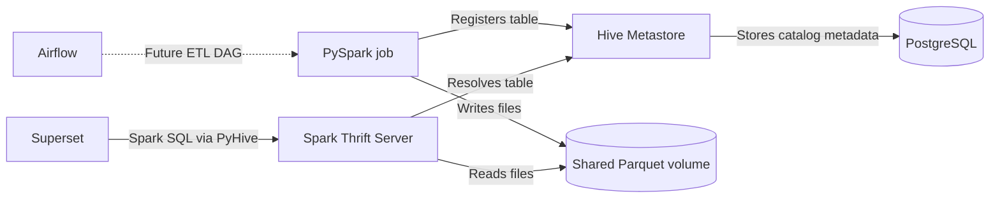

# Analytical Service Environment

The analytical Compose file follows the Phase 2 assignment diagram. It can run on its own or be combined with the OLTP Compose file. [Analytical Compose](../docker-compose.analytics.yml), [OLTP Compose](../docker-compose.yml).



Airflow runs in standalone mode for local development. The Airflow orchestration component will supply the ETL DAG.

## Services and storage

| Service | Version | Internal endpoint or storage |
| --- | --- | --- |
| `spark-job` | Spark 4.0.5 | Runs `spark-submit` on demand in the `jobs` profile. Mounts `analytics-warehouse` at `/warehouse`. |
| `spark-thrift` | Spark 4.0.5 | Serves HiveServer2 at `spark-thrift:10000` and mounts the same warehouse. |
| `hive-metastore` | Hive 4.0.1 | Serves catalog metadata at `thrift://hive-metastore:9083` and mounts the warehouse at the same path. |
| `hive-postgres` | PostgreSQL 18.6, pgJDBC 42.7.14 | Persists the `hive_metastore` database in `hive-postgres-data`. |
| `superset` | Superset 6.1.0, PyHive 0.7.0 | Listens at `superset:8088`. Registers the Spark SQL connection at startup using `SPARK_SQL_URI` and persists local metadata in `superset-data`. |
| `airflow` | Airflow 3.4.0 | Listens at `airflow:8080` and persists local metadata in `airflow-data`. |

Both Spark processes use `local[2]`, the same configuration, and Hive client libraries packaged in their image. The metastore holds schemas, locations, and partition metadata. Table rows live in Parquet under `file:/warehouse`. The analytics file publishes no host ports. [Spark configuration](../infra/analytics/spark/spark-defaults.conf).

## Catalog check

Run the catalog check from the repository root with Docker Compose and OpenSSL available.

```sh
bash infra/analytics/checks/verify-catalog.sh
```

The script starts an isolated Compose project with temporary credentials. A PySpark job registers `default.catalog_probe`, then exits. The check confirms a Parquet file exists under `/warehouse/catalog_probe` and queries the table by name from a new Beeline session through Thrift Server. Superset loads its saved Spark SQL connection and runs the same query with PyHive. Both queries must return exactly one row with `marker = 42`. This covers the catalog registration and query in E2-7. The script removes the project's containers, network, volumes, and locally built images on exit.

## Startup orchestration inputs

- Compose receives `HIVE_METASTORE_DB_PASSWORD` and `SUPERSET_SECRET_KEY` through the environment or a local `.env`. Keep both values stable when reusing the corresponding metadata volumes.
- Start the Hive metadata database and metastore before the Spark job or Thrift Server. Superset needs the Thrift endpoint and its own metadata volume. Keep `/warehouse` identical across the Spark and metastore containers.
- Startup orchestration covers the integrated startup and restart checks in E2-11 and CA1, including the Superset asset and access imports. The batch ingestion component supplies the raw data paths. The DAG, dimensional tables, dashboard, and row-level security belong to their respective components.
