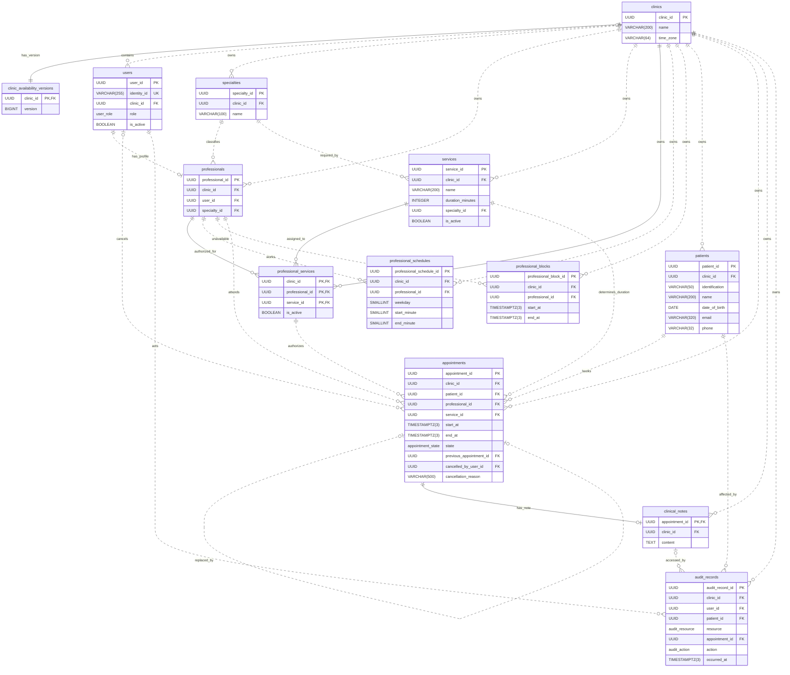

# 1. Business Rules

## Service Catalog Updates

A clinic administrator may edit a service's name, duration, and required specialty before any appointment references it. After that, a different duration or specialty requires a new service. Name corrections remain allowed for the same consultation type (`RF3`, `I4`).

Deactivation blocks new bookings. It preserves appointments and their history, including the option to reschedule an existing reservation with the inactive service.

## Appointment States and Rescheduling

A `reserved` appointment occupies the agenda. It may become `attended`, `absent`, `cancelled`, or `rescheduled`. Each of those states is final (`RF13`).

Rescheduling atomically changes the original to `rescheduled` and creates a linked reservation with a new identifier. The replacement keeps the clinic, patient, and service. It may change the date, time, or professional and may itself be rescheduled (`RF10`).

Booking and rescheduling accept future whole-minute starts. Intervals include the start and exclude the end, so adjacent appointments do not overlap (`I1`, `I2`).

## Schedule Changes and Appointment Conflicts

Weekly schedule edits must preserve full coverage for every reserved appointment. A block must avoid every reserved appointment. Report conflicts and leave the schedule and appointments unchanged so the actor can resolve them before retrying (`RF5`, `I3`).

The block rule differs from `RF6`, which calls for creating a block before resolving its appointments. The current design avoids pending blocks and extra appointment states, but new bookings can enter before a retry. This discrepancy remains unresolved.

# 2. Tech Stack

- TypeScript and Express serve the REST API
- PostgreSQL is the source of truth. Prisma defines the data model and manages migrations
- Keycloak manages identity and credentials
- Redis caches availability
- Docker Compose orchestrates services and networking

# 3. Data Model

## clinics

### Fields

- clinic_id UUID NOT NULL DEFAULT gen_random_uuid() (PK)
- name VARCHAR(200) NOT NULL
- time_zone VARCHAR(64) NOT NULL -- Named time zone, Ex: America/Costa_Rica, America/Bogota

### Constraints

- CHECK clinics_name_check: name <> ''

## clinic_availability_versions

### Fields

- clinic_id UUID NOT NULL (PK, FK->clinics.clinic_id)
- version BIGINT NOT NULL DEFAULT 0

### Constraints

- CHECK clinic_availability_versions_version_check: version >= 0

Initialize the row during clinic registration and increment `version` once per relevant transaction without resetting it.

## users

### Fields

- user_id UUID NOT NULL DEFAULT gen_random_uuid() (PK)
- identity_id VARCHAR(255) NOT NULL -- Keycloak user ID, no credentials
- clinic_id UUID NULL (FK->clinics.clinic_id) -- NULL only for platform_administrator
- role user_role NOT NULL -- Enum: platform_administrator, clinic_administrator, reception, healthcare_professional
- is_active BOOLEAN NOT NULL DEFAULT TRUE

### Constraints

- UNIQUE users_identity_id_key: (identity_id)
- UNIQUE users_clinic_user_key: (clinic_id, user_id)
- CHECK users_role_clinic_check: clinic_id must be NULL for platform_administrator and NOT NULL for all other roles

## specialties

### Fields

- specialty_id UUID NOT NULL DEFAULT gen_random_uuid() (PK)
- clinic_id UUID NOT NULL (FK->clinics.clinic_id)
- name VARCHAR(100) NOT NULL

### Constraints

- UNIQUE specialties_clinic_specialty_key: (clinic_id, specialty_id)
- UNIQUE specialties_clinic_name_key: (clinic_id, name)
- CHECK specialties_name_check: name <> ''

## professionals

### Fields

- professional_id UUID NOT NULL DEFAULT gen_random_uuid() (PK)
- clinic_id UUID NOT NULL (FK->clinics.clinic_id)
- user_id UUID NOT NULL (FK: (clinic_id, user_id) -> users(clinic_id, user_id))
- specialty_id UUID NOT NULL (FK: (clinic_id, specialty_id) -> specialties(clinic_id, specialty_id))

### Constraints

- UNIQUE professionals_clinic_professional_key: (clinic_id, professional_id)
- UNIQUE professionals_user_key: (clinic_id, user_id)

## services

### Fields

- service_id UUID NOT NULL DEFAULT gen_random_uuid() (PK)
- clinic_id UUID NOT NULL (FK->clinics.clinic_id)
- name VARCHAR(200) NOT NULL
- duration_minutes INTEGER NOT NULL
- specialty_id UUID NOT NULL (FK: (clinic_id, specialty_id) -> specialties(clinic_id, specialty_id))
- is_active BOOLEAN NOT NULL DEFAULT TRUE

### Constraints

- UNIQUE services_clinic_service_key: (clinic_id, service_id)
- UNIQUE services_clinic_name_key: (clinic_id, name)
- CHECK services_name_check: name <> ''
- CHECK services_duration_check: duration_minutes > 0

## professional_services

### Fields

- PK: (clinic_id, professional_id, service_id)
- clinic_id UUID NOT NULL (FK->clinics.clinic_id)
- professional_id UUID NOT NULL (FK: (clinic_id, professional_id) -> professionals(clinic_id, professional_id))
- service_id UUID NOT NULL (FK: (clinic_id, service_id) -> services(clinic_id, service_id))
- is_active BOOLEAN NOT NULL DEFAULT TRUE

Inactive associations remain stored for historical appointment references.

## professional_schedules

### Fields

- professional_schedule_id UUID NOT NULL DEFAULT gen_random_uuid() (PK)
- clinic_id UUID NOT NULL (FK->clinics.clinic_id)
- professional_id UUID NOT NULL (FK: (clinic_id, professional_id) -> professionals(clinic_id, professional_id))
- weekday SMALLINT NOT NULL -- ISO weekday, 1 = Monday, 7 = Sunday
- start_minute SMALLINT NOT NULL -- Minutes after local midnight, Ex: 480 = 08:00
- end_minute SMALLINT NOT NULL -- Exclusive local endpoint, Ex: 1020 = 17:00, 1440 = next midnight

### Constraints

- CHECK professional_schedules_weekday_check: weekday must be between 1 (Monday) and 7 (Sunday)
- CHECK professional_schedules_interval_check: start_minute must be at least 0, end_minute must not exceed 1440, and start_minute must be less than end_minute

## professional_blocks

### Fields

- professional_block_id UUID NOT NULL DEFAULT gen_random_uuid() (PK)
- clinic_id UUID NOT NULL (FK->clinics.clinic_id)
- professional_id UUID NOT NULL (FK: (clinic_id, professional_id) -> professionals(clinic_id, professional_id))
- start_at TIMESTAMPTZ(3) NOT NULL -- Absolute instant, inclusive endpoint
- end_at TIMESTAMPTZ(3) NOT NULL -- Absolute instant, exclusive endpoint

### Constraints

- CHECK professional_blocks_interval_check: start_at and end_at must be finite, and start_at must be earlier than end_at

## patients

### Fields

- patient_id UUID NOT NULL DEFAULT gen_random_uuid() (PK)
- clinic_id UUID NOT NULL (FK->clinics.clinic_id)
- identification VARCHAR(50) NOT NULL
- name VARCHAR(200) NOT NULL
- date_of_birth DATE NOT NULL
- email VARCHAR(320) NULL -- Sensitive contact data, NULL means not provided
- phone VARCHAR(32) NULL -- Sensitive contact data, preserve country prefix and leading zeros, NULL means not provided

### Constraints

- UNIQUE patients_clinic_patient_key: (clinic_id, patient_id)
- UNIQUE patients_identification_key: (clinic_id, identification)
- CHECK patients_identification_check: identification <> ''
- CHECK patients_name_check: name <> ''
- CHECK patients_contact_check: At least one of email or phone must be provided, and neither may be an empty string when provided

Application validation requires non-whitespace identification and name, a real `YYYY-MM-DD` birth date no later than today in the clinic's time zone, and at least one valid contact method. Validate each provided contact: email uses `name@domain.ext`; phone allows digits, spaces, hyphens, parentheses, and an optional leading `+`, with at least one digit. Preserve submitted text.

## appointments

### Fields

- appointment_id UUID NOT NULL DEFAULT gen_random_uuid() (PK)
- clinic_id UUID NOT NULL (FK->clinics.clinic_id)
- patient_id UUID NOT NULL (FK: (clinic_id, patient_id) -> patients(clinic_id, patient_id))
- professional_id UUID NOT NULL (FK: (clinic_id, professional_id) -> professionals(clinic_id, professional_id))
- service_id UUID NOT NULL (FK: (clinic_id, service_id) -> services(clinic_id, service_id), FK: (clinic_id, professional_id, service_id) -> professional_services(clinic_id, professional_id, service_id))
- start_at TIMESTAMPTZ(3) NOT NULL -- Absolute instant aligned to a whole UTC minute
- end_at TIMESTAMPTZ(3) NOT NULL -- Computed by the backend from start_at and service duration, exclusive endpoint
- state appointment_state NOT NULL DEFAULT 'reserved' -- Enum: reserved, attended, absent, cancelled, rescheduled
- previous_appointment_id UUID NULL (FK: (clinic_id, previous_appointment_id, patient_id, service_id) -> appointments(clinic_id, appointment_id, patient_id, service_id)) -- NULL for first appointments
- cancelled_by_user_id UUID NULL (FK: (clinic_id, cancelled_by_user_id) -> users(clinic_id, user_id)) -- Required only when cancelled
- cancellation_reason VARCHAR(500) NULL -- Required only when cancelled

### Constraints

- UNIQUE appointments_clinic_appointment_key: (clinic_id, appointment_id)
- UNIQUE appointments_replacement_target_key: (clinic_id, appointment_id, patient_id, service_id)
- UNIQUE appointments_previous_key: (clinic_id, previous_appointment_id) -- NULL predecessors remain distinct
- CHECK appointments_interval_check: start_at must be earlier than end_at
- CHECK appointments_minute_check: start_at must be aligned to a whole UTC minute
- CHECK appointments_previous_check: previous_appointment_id must differ from appointment_id when provided
- CHECK appointments_cancellation_check: Cancelled appointments must have cancelled_by_user_id and a nonempty cancellation_reason, all other states must have both fields NULL

## clinical_notes

### Fields

- appointment_id UUID NOT NULL (PK, FK: (clinic_id, appointment_id) -> appointments(clinic_id, appointment_id))
- clinic_id UUID NOT NULL (FK->clinics.clinic_id)
- content TEXT NOT NULL -- Sensitive clinical content, treating professional derived from the appointment

### Constraints

- UNIQUE clinical_notes_clinic_appointment_key: (clinic_id, appointment_id)
- CHECK clinical_notes_content_check: content <> ''

## audit_records

### Fields

- audit_record_id UUID NOT NULL DEFAULT gen_random_uuid() (PK)
- clinic_id UUID NOT NULL (FK->clinics.clinic_id)
- user_id UUID NOT NULL (FK: (clinic_id, user_id) -> users(clinic_id, user_id)) -- Acting user
- patient_id UUID NOT NULL (FK: (clinic_id, patient_id) -> patients(clinic_id, patient_id)) -- Affected patient
- resource audit_resource NOT NULL -- Enum: patient_contact, clinical_note
- appointment_id UUID NULL (FK: (clinic_id, appointment_id) -> clinical_notes(clinic_id, appointment_id)) -- Clinical note identifier, NULL for patient_contact
- action audit_action NOT NULL -- Enum: read, write
- occurred_at TIMESTAMPTZ(3) NOT NULL DEFAULT clock_timestamp() -- Absolute event instant, no sensitive payload copies

### Constraints

- CHECK audit_records_resource_check: appointment_id is required for clinical_note and must be NULL for patient_contact
- TRIGGER audit_records_append_only_guard: Reject every UPDATE, DELETE, or TRUNCATE statement before execution

## Entity-Relationship Diagram



## Relationships

- Every clinic has one availability version. Clinic users belong to one clinic, while platform administrators have no clinic
- A clinic owns its specialties, professionals, services, associations, schedules, blocks, patients, appointments, notes, and audit records. Composite foreign keys keep their references within the clinic
- A professional requires one local user and one specialty. A user may have one professional profile. A service requires one specialty. Professionals and services have a many-to-many relationship through `professional_services`, with one row per pair
- A professional has many weekly intervals and blocks. A patient, a professional, a service, and their applicable professional-service association can each have many appointments. An appointment requires one of each and keeps its association even after deactivation
- Only cancelled appointments reference a cancelling user. Each replacement references one predecessor, and each rescheduled appointment has one direct replacement. Both appointments share their clinic, patient, and service
- An attended appointment may have one clinical note. Its treating professional is derived from the appointment
- An audit event identifies its acting user and affected patient. Clinical note events also reference one note through the appointment identifier

## Normalization

### First Normal Form (1NF)

Store atomic values under declared keys. Availability versions have one row per clinic, authorizations one row per professional-service pair, and schedules and blocks one row per interval.

### Second Normal Form (2NF)

A patient identified by `(clinic_id, identification)` has details that depend on both fields. Association activation depends on the professional-service pair. Service name and duration depend only on the service and stay in `services`. The association's redundant `clinic_id` is a deliberate exception.

### Third Normal Form (3NF)

Keep descriptive values with the entities that determine them. Clinic names and time zones stay in `clinics`, specialty names in `specialties`, and patient details and service definitions outside appointments. Clinical note content stays outside audit records. Foreign keys preserve these dependencies without copying the descriptive values.

### Deliberate Denormalizations

- Repeated `clinic_id` supports direct RLS and clinic-scoped relationships at the cost of redundant values and composite indexes. Composite foreign keys prevent disagreement. Examples include clinic ownership derived from a service's specialty or a schedule's professional
- Stored appointment ends support overlap checks without joining services. Derive the end from the start and service duration, then protect both the appointment interval and referenced duration
- Audit patient identifiers support direct filtering of note events. Validate that the patient matches the appointment
- Audit resource types explicitly identify the accessed data. A check keeps the type consistent with the optional note reference

# 4. Multi-tenancy

The comparison assumes one PostgreSQL instance. All three strategies share its CPU, memory, and storage. Future OLAP copies must preserve clinic ownership and enforce their own access rules.

## Database per Clinic

### Data Isolation

A connection is bound to one database. Separate credentials can enforce that boundary, provided the application selects the database from the authenticated clinic.

### Implementation Complexity

Provision a database, migrate it, and configure its permissions for each clinic. Database creation cannot share a transaction with the rest of provisioning, so incomplete setups need cleanup or retry.

### Operations and Maintenance

Track migrations for each database. Logical backups can target one clinic. Server maintenance and physical recovery still affect the instance.

### Resource Usage and Performance

Each database has its own tables, indexes, and catalogs. Connections cannot move between databases, so idle pools consume shared capacity. Smaller indexes may help individual queries. Compare plans and measurements before drawing performance conclusions.

### Implications for OLAP

Extract from each database and track progress separately. Preserve the source clinic so independent identifiers remain distinguishable in the combined store.

## Schema per Clinic

### Data Isolation

Each clinic has separate tables in one database. Schema and table grants enforce the boundary when the application uses the correct restricted profile. Broad grants would let a wrongly routed query reach another clinic.

### Implementation Complexity

Create each clinic's tables, constraints, indexes, and grants together in one transaction. Route shared domain queries to the authenticated clinic's schema.

### Operations and Maintenance

Track migrations for each schema. Logical exports can target a schema. Server maintenance and physical recovery still affect the instance.

### Resource Usage and Performance

Connections can serve different schemas when permissions allow it. Each schema still duplicates table and index structures. Compare query plans against equivalent shared-table indexes.

### Implications for OLAP

Extract from multiple schemas through one connection. Track the participating schemas and their migration state, and preserve the clinic of origin.

## Shared Tables with Row-Level Security

### Data Isolation

PostgreSQL RLS filters existing rows and checks inserted or updated rows against the authorized `clinic_id`. Deny access without valid transaction-local context. Run application queries under restricted roles subject to RLS. Use composite foreign keys to prevent cross-clinic references.

### Implementation Complexity

Reuse tables and policies across clinics. Register a clinic by inserting its initial records. Each protected operation must establish context on the same connection as its queries, including reads.

### Operations and Maintenance

Apply structural changes once. Restoring one clinic requires selecting its related rows instead of restoring a database or schema.

### Resource Usage and Performance

Shared tables avoid duplicate structures. Indexes cover all clinics, and policy evaluation and transaction preparation add work. Measure queries under the actual restricted profiles.

### Implications for OLAP

Extract from one source using the existing `clinic_id`. Cross-clinic extraction requires an explicitly authorized scope.

## Selected Strategy

Use shared tables with PostgreSQL RLS and a `clinic_id` discriminator.

### Data Isolation

Accept shared storage in exchange for database-enforced row isolation. Derive the clinic from the authenticated user and use clinic-scoped references. Test foreign identifiers, manipulated clinic parameters, and context leakage across pooled connections (`I5`).

### Implementation Complexity

One schema and reusable policies simplify clinic registration. The tradeoff is that every protected operation needs a correctly scoped transaction.

### Operations and Maintenance

Centralize migrations and accept more work to recover one clinic's rows.

### Resource Usage and Performance

Maintain fewer structures and validate shared-index and policy costs with execution plans. The comparison establishes no measured performance winner.

### Implications for OLAP

Keep a common source and explicit clinic ownership. Authorize access to the analytical store independently.

# 5. Transactions and Concurrency

Each SQL phase uses an explicit isolation level, a scoped connection, and current authorization. Hold locks through commit or rollback. When locks are needed, acquire users, services, professionals, patients, appointments, and the clinic availability version in that order. Sort rows of the same kind by identifier and lock each once at the strongest required mode.

Commit domain writes, required audit events, and availability-version changes together. Release the connection before sending the response. Follow [transaction context](#transactional-clinic-and-permission-context), [cache coordination](#transaction-and-cache-coordination), and [retry rules](#conflicts-deadlocks-and-retries) for the shared boundaries.

Patient, user, service, professional specialty, and association activation edits apply only supplied fields to the locked current state. Validate the resulting record and preserve omitted values. Explicit `NULL` clears only nullable fields. Different-field edits can coexist if their combined state is valid. A later same-field assignment may overwrite an earlier one. The design accepts this tradeoff to avoid original-value comparisons and edit-version counters. Weekly schedules replace the complete week.

## Overlapping Bookings

### Concurrency Risk

Two transactions can both see an empty interval. Locking matching appointments cannot protect an interval with no rows. A professional-only lock would still allow overlapping bookings for the same patient with different professionals (`RF9`, `I1`, `I2`).

### Transaction Design

1. Use `READ COMMITTED`. Protect the service and eligibility under [catalog and authorization rules](#concurrent-service-and-professional-authorization-changes). Acquire `FOR NO KEY UPDATE` on the same-clinic professional, then the patient
2. Use fresh queries after locking. Derive the appointment end from the service duration. Require complete schedule coverage, no overlapping blocks, and no overlapping same-clinic reservations for either the professional or patient
3. Immediately before insertion, require a whole-minute start strictly later than the wall clock. Insert a `reserved` appointment

For example, two requests for tomorrow's last 10:00 slot serialize on the professional row. The second checks again and sees the winner's reservation. Acceptance requires a reproducible race with exactly one winner, plus a race for the same patient across professionals.

Under `READ COMMITTED`, each post-lock statement sees reservations committed during the wait. Professional and patient locks allow unrelated bookings to proceed, though the version row can still contend. A shared professional or patient serializes bookings even across dates. `SERIALIZABLE` would add conflict monitoring and retries. Advisory locks would require a separate key convention. The selected row locks reuse existing entities and depend on every agenda writer following the protocol.

## Atomic Rescheduling

### Concurrency Risk

Separate commits can leave the original without a replacement or leave both appointments active. Competing transitions can also make an earlier `reserved` check stale (`RF10`, `RF13`).

### Transaction Design

1. Use `READ COMMITTED`. Read the original's references for lock preparation. Lock the source and destination professionals and the patient with `FOR NO KEY UPDATE`, then lock the original appointment in the same mode
2. Confirm that the locked original remains `reserved` and its clinic, professional, patient, and service match the preliminary references. Derive the replacement's clinic, patient, and service from it
3. Apply the booking checks to the destination, excluding only the original from professional and patient overlap checks. The existing service may be inactive, but the destination professional must be eligible and the service duration still determines the end
4. Mark the original `rescheduled` without changing its interval or predecessor. Recheck the future whole-minute start immediately before inserting the new `reserved` appointment. Its predecessor links to the original, and uniqueness permits one direct replacement

The original lock protects the transition throughout validation. A conditional update would defer the state check. A destination conflict rolls back both writes. One version increment covers both the released and occupied intervals (`I7`).

## Concurrent Appointment State Transitions

### Concurrency Risk

Cancellation, rescheduling, and outcome registration can race. A later transition must observe the committed state before it can act (`RF10` through `RF13`).

### Transaction Design

1. Use `READ COMMITTED`. For cancellation and outcomes, lock the same-clinic appointment with `FOR NO KEY UPDATE`. Check that it remains `reserved` and the actor is authorized
2. For cancellation, write the state, nonempty reason, and authenticated cancelling user together (`RF11`)
3. For an outcome, require the current clock to be strictly past the start after lock waits. Set `attended` or `absent`, with both cancellation fields left null (`RF12`)

Cancellation and outcomes remove occupation, so they only need the appointment lock. Rescheduling adds occupation and follows [its agenda lock order](#atomic-rescheduling).

## Concurrent Weekly Schedule Changes

### Concurrency Risk

A booking can enter hours being removed. Two complete-week replacements can also overwrite edits to different weekdays (`RF5`, `I3`).

### Transaction Design

1. Use `READ COMMITTED`. Lock the same-clinic professional with `FOR NO KEY UPDATE`, check the actor's permission, and read the current week
2. Validate the complete proposed week, including interval bounds and ownership of referenced schedule rows. Use clinic-local time and allow adjacent intervals to provide continuous coverage
3. Query all current reservations for that professional, including past appointments still in `reserved`. Reject and report appointments that lose any coverage. Otherwise replace the week atomically

The professional lock coordinates with booking and rescheduling even when the week has no rows. Cancellation and outcomes only remove reservations, so no appointment locks are needed. A still-uncommitted cancellation can cause a conservative rejection. The later successful replacement wins without an original-week check.

## Concurrent Schedule Block Creation

### Concurrency Risk

A block and a reservation can both pass separate checks and then occupy the same interval (`RF6`, `I3`).

### Transaction Design

1. Use `READ COMMITTED`. Lock the same-clinic professional with `FOR NO KEY UPDATE` and check the actor's permission
2. Validate finite endpoints and positive duration. Check fresh reservations using half-open overlap rules
3. Report conflicts without creating a block or changing appointments. Otherwise insert the block for the locked professional

Use the same professional lock as bookings and weekly edits, with no additional appointment or patient locks. A cancellation in progress can cause a conservative rejection. The [business rules](#schedule-changes-and-appointment-conflicts) record the unresolved difference from `RF6`.

## Concurrent Service and Professional Authorization Changes

### Concurrency Risk

A booking can race with the first duration change or use an association whose activation or specialty changes during validation (`RF3`, `RF4`, `I4`).

### Transaction Design

Use `READ COMMITTED` and lock services before professionals. Bookings and rescheduling take `FOR SHARE` on the service and use the professional lock from their agenda protocol. Catalog edits take `FOR NO KEY UPDATE` on the service. Association writes take `FOR SHARE` on the service and `FOR NO KEY UPDATE` on the professional. Professional specialty edits take `FOR NO KEY UPDATE` on the professional.

- **Booking and rescheduling.** Validate matching specialties and an active association under lock. Booking requires an active service. Rescheduling may retain an inactive service. Both use the protected duration
- **Service edits.** Only name, duration, required specialty, and activation are mutable. Before changing duration or specialty, reject if any appointment references the service. A specialty change also requires disabling its active associations first. Service deactivation keeps both appointments and associations. Service edits advance the clinic availability version only when duration or required specialty changes
- **Professional edits.** Only specialty is mutable. Disable active associations before changing it, preserving inactive associations and historical appointments. Changing a professional's specialty leaves the clinic availability version unchanged
- **Association writes.** Creation requires a new pair. Creation or reactivation requires matching specialties. Deactivation requires no remaining reservations for the pair. Preserve the row and its historical references. Creating an association or changing its activity advances the clinic availability version once

Shared service locks allow parallel readers while preventing catalog edits. The professional lock protects associations even before a row exists. No appointment lock is needed for deactivation checks because concurrent cancellations and outcomes only remove reservations. Keeping inactive associations preserves the appointment foreign key. User activity and role checks follow [clinic and user management](#clinic-and-user-management-consistency).

## Concurrent Patient Registration and Updates

### Concurrency Risk

Concurrent registrations can claim the same identification. Concurrent partial edits can combine into an invalid record, such as when two requests each clear a different contact method (`RF14`, `RF18`).

### Transaction Design

1. Use `READ COMMITTED`. Register with a normal insert. The unique constraint on clinic and identification rejects duplicates without reusing or overwriting a record
2. For an edit, take `FOR UPDATE` if identification is supplied and `FOR NO KEY UPDATE` otherwise. Select that mode before reading the current row. This avoids taking or upgrading to a stronger lock for edits that leave identification alone
3. Validate the complete result under lock. Preserve the patient identifier and clinic. Allow changes to identification, name, birth date, email, and phone. Require at least one nonempty contact method. Preserve phone prefixes and leading zeros as text. Reject duplicate identification on update
4. Apply the supplied fields and commit with the [required contact audit events](#sensitive-data-access-and-audit-consistency)

Patient-only edits need no service, professional, or appointment locks. The same uniqueness constraint covers inserts and updates because a preliminary lookup cannot lock an absent identity.

## Concurrent Clinical Note Creation

### Concurrency Risk

Two requests can both see no note. The note also depends on the appointment's final state and ownership, and must commit with its write event (`RF15`, `RF18`).

### Transaction Design

1. Use `READ COMMITTED`. Derive the acting professional from the authenticated user. Lock the same-clinic appointment with `FOR SHARE` before checking its state
2. Require an `attended` appointment owned by that professional and nonempty note content. Current service or association activation does not affect historical note creation
3. Insert the note and its write event in one transaction. Derive the patient and clinic from the appointment. The note's primary key rejects duplicates without replacing or returning existing content

The shared lock waits for an outcome already in progress and protects the appointment facts. The primary key arbitrates competing note inserts. A separate audit transaction would lose atomicity.

## Sensitive Data Access and Audit Consistency

### Concurrency Risk

A response can expose sensitive content without a persistent read event. Separate write and audit commits can also disagree (`RF18`).

### Transaction Design

- **Read events.** In the authorized operation transaction, record one read per distinct patient contact or clinical note retrieved. Include internal contact reads used to validate patient edits. Empty results and identifier-only queries create no resource events
- **Write events.** Record patient registration, contact assignments including unchanged values, and clinical note creation. Edits to other patient fields only produce read events if they retrieve stored contact data. Keep write responses and write projections limited to identifiers and operation results
- **Attribution.** Derive the actor and clinic from authorized context. Contact events identify the patient. Note events also identify the appointment and derive the patient from it. Store metadata and event time without copying contact or clinical content
- **Commit.** Materialize the result and insert the events before confirming the transaction. Deliver sensitive content only after confirmed commit. Rollback discards domain writes and all events, including internal reads from a rejected edit. An uncertain commit can leave an event without a delivered response
- **Immutability.** Enforce append-only records in PostgreSQL through grants and a statement trigger that rejects updates, deletes, and truncation, even when no rows match (`I6`). Concurrent inserts need no global audit lock. The event timestamp records generation time, independently of commit order and receipt

Application-generated events carry authenticated attribution. The single transaction keeps events and domain work consistent, accepting that failed internal reads leave no separate audit history.

### Audit Record Query

Clinic administrators can read audit metadata for their own clinic (`RF19`). Combine optional user, patient, and date filters. The lower bound is inclusive and the upper bound exclusive. Sort by event time descending, then by event identifier descending. A valid query may return no records. See the [HTTP contract](../README.md#audit-api).

## Clinic and User Management Consistency

### Concurrency Risk

Separate clinic and administrator commits could leave an incomplete registration. Concurrent registrations can claim the same provider identity. Local role changes can race with authorization, and a successful Keycloak change can outlive a failed SQL transaction (`RF1`, `RF2`, `RF17`, `I5`).

### Transaction Design

1. Authorize the caller before looking up an existing Keycloak identity for registration. Provider lookup is a point-in-time check. Open a `READ COMMITTED` management transaction and recheck authorization under lock
2. Lock users before domain resources. Use `FOR SHARE` for the actor and other eligibility checks, and `FOR NO KEY UPDATE` for a user being edited. If the actor is also the target, acquire the stronger mode once. Check activity and role after locking, and require the current role to match a mapped token role
3. Preserve each user's identity and clinic and each professional's user association. A different identity or clinic requires a new local user. Existing identity uniqueness prevents reusing the same provider identity. Register professional profiles separately for a user with the professional role, with at most one profile per user
4. Apply only requested role and activity changes against the locked current state. Deactivation is local. Bookings and rescheduling destinations require a protected active user with the professional role and a profile. Existing appointments and profiles remain. An inactive source user does not block rescheduling to an eligible destination, cancellation, or outcome registration under their usual permissions
5. For registrations and actual role changes, finish SQL writes and any version increment before synchronizing the application role with Keycloak. Add the new role before removing other mapped domain roles from the application. Preserve credentials, unrelated roles, and account enabled state. Hold the target lock until SQL finishes. Activity-only and unchanged edits need no provider call
6. Disable automatic retries immediately before dispatching a provider mutation. Require both provider confirmation and SQL commit. Roll back SQL when Keycloak fails. Distinguish a confirmed partial provider change from an uncertain outcome. A provider change can persist or arrive late even when SQL rolls back. Resolve divergence manually

Shared locks allow concurrent work by an authorized user and make deactivation wait for protected operations. A token with only the previous role fails the current local role check. Synchronous role updates avoid a background synchronization workflow at the cost of holding SQL resources during a provider request and accepting possible divergence.

### Clinic Registration Endpoint

A platform administrator registers a clinic, its first active administrator, and its initial availability version atomically in PostgreSQL. The administrator must have an existing provider identity. Identity uniqueness rejects duplicates without leaving a partial clinic. Return the new clinic and administrator identifiers after both confirmations. See the [HTTP contract](../README.md#clinic-api).

### Clinic User Registration Endpoint

A clinic administrator registers an active user with an existing provider identity and a clinic role. Derive the clinic from locked authorization. Reject duplicate identities across clinics without disclosing their existing clinic or modifying their association. Return the local user identifier after both confirmations. See the [HTTP contract](../README.md#clinic-api).

## Consistent Concurrent Queries

### Concurrency Risk

Under `READ COMMITTED`, separate statements can see different committed states. An agenda can list a reservation that a later count omits after a cancellation. A moving clock can also split related results (`RF7`, `RF8`, `RF16`, `RF20`, `RF21`).

### Transaction Design

1. Keep clinic, date bounds, filters, and resource restrictions consistent across related results. Patient history includes appointment states and replacement links. Daily agendas cover one professional or the clinic. Count appointments by state and date range in PostgreSQL
2. Use `READ COMMITTED` for one statement that supplies all related facts and `REPEATABLE READ` when several statements need one snapshot. Authorization preparation can establish that snapshot. Audit inserts alone do not change the isolation choice. Protect actor authorization with `FOR SHARE` and read domain resources without agenda locks. If a locking read finds a row changed since the transaction snapshot, abort that attempt
3. When time matters, capture the wall clock once after authorization locks. Use it and the snapshot's clinic time zone across the whole response. A transaction-start timestamp would miss time spent waiting for locks
4. Materialize all results and required audit events before confirming commit. Send one complete response after releasing SQL resources. Discard failed or unconfirmed attempts, including results already read

Clinic administrators, reception, and healthcare professionals may read a patient's complete appointment history within their clinic, including appointments assigned to other professionals and their replacement links (`RF16`).

Reception may read daily agendas for its whole clinic or a selected professional within that clinic. Healthcare professionals may read their own daily agenda through their protected local association (`RF20`). A required calendar date selects the clinic's local day. Include all persisted states and every appointment overlapping that day, including appointments that cross midnight. Exclude the end instant of each appointment. Preserve repeated local times and return an empty agenda for a skipped local date. Sort daily agendas by start time ascending, then appointment identifier ascending.

Clinic administrators may read appointment counts by state within their own clinic (`RF21`). Select an inclusive range of clinic-local calendar dates. Assign each appointment to the local date of its start and group by its persisted state in PostgreSQL. Include a zero count for each state without matching appointments.

Each appointment query uses one SQL statement under `READ COMMITTED` for its related domain facts and resource checks. Materialize the response before commit and send it after commit confirmation.

The mixed isolation policy avoids forcing every query into one statement or holding a transaction snapshot when one statement suffices. Materialization uses memory but releases the connection before transmission. Later commits may change the state after the snapshot. Availability never reserves a slot.

## Transactional Clinic and Permission Context

### Concurrency Risk

A pooled connection can leak clinic context or roles into another request. Broad permissions during identity and resource resolution would bypass the protection those lookups prepare (`I5`, `RF17`).

### Transaction Design

1. Derive the provider identity from the validated token. Open the operation's SQL phase on the shared pool under a restricted base login, with ordinary domain access denied by default
2. Use bounded functions to resolve the actor's user and clinic. For booking and rescheduling, resolve the destination professional's user before taking user locks. For rescheduling, also resolve the original appointment's references. These lookups establish neither permission nor a protected state
3. Lock the actor and required users in order. Verify the actor's identity and clinic match the resolved association. Check current activity, token-role correspondence, and operation permission. Resolve the actor's stable professional association when required. A missing or foreign target fails authorization rather than producing a valid empty result
4. Set the validated actor and clinic and select the database profile from a fixed mapping outside privileged functions. Limit both to this transaction. Complete authorization before handing the scoped client to the operation. Run all parameterized queries and audit inserts through that client. A phase must allow its required locks and writes, even when its business operation is a read
5. End access to the scoped connection when the operation finishes. Transaction-local context and role expire at commit or rollback. Discard a connection with uncertain state

A platform administrator has no clinic and uses the bounded clinic creation function. The base login has no ordinary table privileges, and runtime profiles remain subject to RLS. Use the [restricted functions](#function-ownership) when a lookup or lock needs privileges the caller must not hold directly.

Transaction-local scope avoids manual session cleanup and separate pools per role. The backend remains responsible for token and operation checks. SQL settings delimit the permitted scope, while the authenticated local user supplies audit attribution.

## Transaction and Cache Coordination

### Concurrency Risk

Deleting a cache entry after SQL commit leaves a failure gap. A late producer can also publish older availability after a booking. A cached start can pass without any database write (`I7`, `I8`).

### Transaction Design

- **Writers.** Create one version row per clinic at registration with value zero. Increment it atomically once per transaction that changes an availability input, after domain writes and audit events and before commit. Cover bookings, rescheduling, departures from `reserved`, schedules, blocks, catalog, professional profiles and specialties, associations, and actual role or activity changes for users with a professional profile. Contact, note, and audit-only writes do not advance it. A missing row or failed increment aborts the write. Role synchronization follows the increment when required
- **Prepare.** Resolve the clinic, candidate version, and candidate units in an authorized SQL phase. Confirm it before one Redis lookup outside SQL. Treat missing, unreadable, malformed, and mismatched entries as misses
- **Validate and calculate.** Reauthorize in a separate definitive SQL phase. Read the version, final eligibility, and calculation inputs in one snapshot, even if preparation found no candidates. Accept candidates only if scope, format, and exact version match. Include newly eligible professionals and exclude ineligible ones. Calculate missing or rejected units in that snapshot. A version change triggers calculation without another Redis lookup
- **Respond.** Apply the shared future-start filter to complete daily units, using the clock captured after authorization. Materialize the response and publishable unfiltered units before commit. Failed PostgreSQL validation prevents serving cached data. Redis failure leaves a confirmed PostgreSQL result usable
- **Publish.** After confirmed commit, store calculated units with a finite TTL under their source version. A late older publication has a different key. Allow equivalent concurrent fills without per-key locks and accept duplicate calculation on misses

A definitive snapshot after a booking, cancellation, or rescheduling sees the new version immediately. Requests with an earlier definitive snapshot remain consistent with that snapshot. Earlier keys can remain until expiration or eviction. The version controls freshness and the TTL controls retention.

A clinic-wide version simplifies shared dependencies and eligibility changes but invalidates some unaffected units and adds contention on one row. A dedicated row separates version writes from clinic data. Two SQL phases keep Redis waits outside transactions but retain SQL validation on cache hits. Versioned keys separate concurrent publications without conditional replacement.

## Conflicts, Deadlocks, and Retries

### Concurrency Risk

A failed statement may depend on stale decisions from earlier in the transaction. Retrying an unconfirmed mutation can duplicate it, such as inserting a second schedule block after the first commit's acknowledgement is lost.

### Transaction Design

- **Classify.** Use the transaction stage, SQLSTATE, and constraint name. An explicit rollback or integrity violation returned at commit confirms an abort. A missing commit acknowledgement leaves the result unknown. Business conflicts, authorization failures, timeouts, and connection failures receive no automatic retry
- **Retry.** Retry the whole transaction only for serialization failure (`40001`) or deadlock (`40P01`), with confirmed rollback and safe connection release. Allow at most three attempts, with a random delay of 0-100 ms before each retry. Rebuild context, locks, domain checks, and time references from current data while preserving submitted assignments. Query helpers do not retry independently
- **Bound waits.** Configure independent initial limits of 1 second for pool acquisition, 1 second for a SQL lock, 3 seconds for a SQL statement including lock waits, 500 ms for each Redis batch, and 2 seconds per Keycloak request. Apply SQL limits transaction-locally. Fail Redis batches while disconnected, cancel timed-out work where supported, and discard late results. Fall back to PostgreSQL on lookup failure. A sent publication may still complete
- **Clean up.** Roll back unconfirmed work when the connection is usable and discard provisional results. Retire a connection when its state cannot be established. A lost acknowledgement or a closed connection alone cannot prove rollback
- **Reconcile.** Never replay an indeterminate commit, an already confirmed phase, or a transaction that dispatched a provider-changing request. Report uncertain outcomes and use authorized state inspection and diagnostics for manual reconciliation. There are no idempotency keys or automatic repair. Exclude credentials, tokens, contact data, and note content from diagnostics

An empty inspection can miss work still in progress. A matching record alone cannot identify the request that created it. Preserve uncertainty until there is evidence of the outcome. See the [shared HTTP responses](../README.md#shared-error-responses).

# 6. Identity, Security, and Auditing

## Delegated Authentication and Token Validation

### Keycloak Access

Configure a versioned realm and application client for the four domain roles. Delegate login, credentials, and token issuance to Keycloak. Keep provider credentials on the backend. Administrative access is limited to finding existing accounts and updating their application role assignments.

### Token Checks

Validate access token signature, expiration, issuer, and audience locally using the realm's public keys. Cache keys with rotation support. Map token roles to domain permissions and check current local role, activity, and clinic (`RF17`). A missing or invalid token fails authentication. A valid token with insufficient permission fails authorization. If required provider keys are unavailable, fail the request as temporarily unavailable.

Local validation avoids a provider call on each request. Use short-lived tokens and accept that an issued token can survive provider logout until expiration. Local authorization still applies. The design has no local denylist or back-channel logout tracking.

### Logout

Use Keycloak RP-Initiated Logout for the current session. A valid access token authenticates the request. Verify the ID token's signature and issuer, match its audience and authorized party to the client, and match its subject and session to the access token. An expired ID token can serve as a logout hint.

The client opens the provider URL to finish logout and discards its tokens. The closed session cannot refresh them. Other sessions remain active, and requests that already passed validation can finish. See the [HTTP contract](../README.md#session-api).

## PostgreSQL Roles and Restricted Functions

### Database Roles

Use one operating profile per domain role and a restricted base login that cannot inherit their privileges. The four profiles keep role permissions separate at the cost of maintaining distinct grants. The platform profile can invoke clinic creation and has no general domain-table access.

### Function Ownership

Give identity lookup, metadata lookup, locking, and clinic creation separate `NOLOGIN` owners with only the permissions needed for that responsibility. Use bounded `SECURITY DEFINER` functions with qualified references and a trusted search path. Revoke default `PUBLIC` execution and grant it to designated callers. The functions participate in the caller's transaction. Callers never become owner roles.

- **Identity lookup.** Resolve local user and clinic identifiers from the authenticated provider identity before clinic context exists. Include inactive and platform users for later authorization
- **Metadata lookup.** Resolve only an actor's professional identifier, a professional's user identifier, or an appointment's resource references. Derive scope from the actor's clinic. Keep contact and clinical note content inaccessible
- **User locking.** Lock the actor or a same-clinic user and return identifiers, role, and activity. Platform users can lock only their own row. Keep authorization in the transaction protocol
- **Service and professional locking.** Allow reception to take `FOR SHARE` on a same-clinic service or `FOR NO KEY UPDATE` on a same-clinic professional. Healthcare professionals may take the latter lock on their own profile. Return only scope and eligibility metadata. Clinic administrators can lock directly
- **Clinic creation.** Allow only the platform profile to invoke the creation function. Scope the owner's writes to the generated clinic and first active administrator, with availability version zero. That scope ends on function exit. Return only the created identifiers

The locking owner has only the column grants needed to lock users, services, and professionals. Its RLS policies permit locking reads and reject actual writes, including unchanged assignments. Separate owners and preparatory policies preserve these bounded paths without broadening ordinary RLS.

### Table and Function Permissions

The matrix summarizes database grants. RLS narrows rows and application authorization narrows operations.

| Table | Clinic administrator | Reception | Healthcare professional |
| --- | --- | --- | --- |
| `clinics` | Read | Read | Read |
| `users` | Read, insert, update | Read | Read |
| `specialties` | Read, insert | None | None |
| `professionals`, `services`, `professional_services` | Read, insert, update | Read | Read |
| `professional_schedules` | Read, insert, update, delete | Read | Read, insert, update, delete |
| `professional_blocks` | Read, insert | Read | Read, insert |
| `patients` | Read, insert, update | Read, insert, update | Read |
| `appointments` | Read, insert, update | Read, insert, update | Read, update |
| `clinical_notes` | None | None | Read, insert |
| `audit_records` | Read, insert | Insert | Insert |
| `clinic_availability_versions` | Read, update | Read, update | Read, update |

- Limit clinic reads to the identifier and time zone. Limit reception and professional user reads to the user and clinic identifiers, role, and activity
- Allow updates only to user role and activity, professional specialty, service name, duration, specialty and activity, association activity, schedule weekday and bounds, patient identification, name, birth date and contact, appointment state and cancellation metadata, and availability version
- Restrict professional appointment updates to state through the authorized outcome operation. Keep identifiers, ownership, appointment timing, and replacement links immutable
- Grant the base login execution on preparatory lookup and user-locking functions. Grant reception execution on its service and professional locking functions, healthcare professionals execution on their own-profile locking function, and platform administrators execution on clinic creation

## Row-Level Security Policies

### Clinic Policies

Require valid transaction-local actor and clinic identifiers. Match every existing or proposed clinic row to that clinic. Missing or empty context yields no access, and malformed identifiers fail. Platform and preparatory access is limited to the dedicated functions and owner policies.

Composite foreign keys prevent cross-clinic references independently of row visibility. Application checks enforce current authorization and business rules within the rows the database permits.

### Professional Policies

All clinic profiles may read their clinic's schedules and blocks. Clinic administrators may write within the clinic using the granted operations. Healthcare professionals may write schedules and blocks only for the profile associated with their user. A missing profile grants no write scope.

Only healthcare professionals may read or insert notes for their own appointments. Inserts also require an attended appointment. Notes cannot be overwritten or deleted. Sensitive content uses the [shared audit transaction](#sensitive-data-access-and-audit-consistency).

### Other Policies

Only clinic administrators may read audit metadata in their clinic. All clinic profiles may insert patient-contact events for their own actor and clinic. Only healthcare professionals may insert note events, and the existing note's appointment must match their professional profile, clinic, and event patient.

Audit inserts provide actor, clinic, patient, resource, optional appointment, and action. PostgreSQL supplies the event identifier and timestamp. Insert-only profiles do not retrieve the inserted row. The engine rejects mutation of committed events.

# 7. Availability, Caching, and Indexes

## Availability Inputs and Request Scope

### Design Problem

Availability depends on service duration and professional eligibility. An invalid selection must be distinguishable from a valid selection with no free time (`RF7`, `RF8`).

### Design Decisions

- **Professional query.** Supply a professional, service, and one clinic-local date. Reject an incompatible pair
- **Service query.** Supply a service and an inclusive clinic-local date range. Evaluate only eligible professionals
- **Scope.** Derive the clinic from protected authorization. Reject missing or inaccessible required resources. Read the duration from PostgreSQL. An eligible professional has an active user with the professional role, an active association, and the specialty required by the service
- **Dates.** Require valid calendar dates, an ordered range, and a start date no earlier than today in the clinic. For today, keep starts strictly after the common time reference
- **Meaning.** Inactive services remain consultable. Valid queries may return no starts. Failures surface as errors. Consultation neither evaluates patient conflicts nor grants a booking

### HTTP Contract

| Requirement | Method and path | Required query parameters | Successful response |
| --- | --- | --- | --- |
| RF7 | `GET /professionals/:professionalId/availability` | `serviceId`, `date` | `{ professionalId, serviceId, date, starts }` |
| RF8 | `GET /services/:serviceId/availability` | `from`, `to` | `{ serviceId, dates: [{ date, professionals: [{ professionalId, starts }] }] }` |

Identifiers are UUIDs. Dates use `YYYY-MM-DD` in the authorized clinic's time zone. Clinic administrators, reception, and healthcare professionals can query availability within their clinic. Both routes accept inactive services. Successful responses use `Cache-Control: no-store`.

Each `starts` array contains ISO 8601 UTC instants aligned to whole minutes, in ascending instant order. RF7 returns an empty `starts` array when the eligible professional has no available starts. RF8 returns every date in the inclusive range in ascending order, with eligible professionals that have available starts ordered by identifier. A date without available starts has an empty `professionals` array.

| Status | Condition |
| --- | --- |
| `200` | The query is valid, including an empty result. |
| `400` | An identifier or date is malformed, a query parameter is missing, repeated, or unrecognized, the first date precedes today in the clinic, or the range is reversed or exceeds 31 dates. |
| `401` | The access token is missing or invalid. |
| `403` | Token roles or protected local authorization deny the operation. |
| `404` | A required service or professional is missing or outside the authorized clinic. |
| `409` | RF7 selects an in-clinic professional who is ineligible for the selected in-clinic service. |
| `500` | An internal failure occurs. An unconfirmed commit carries `OPERATION_OUTCOME_UNKNOWN`. |
| `503` | Authentication or the database is temporarily unavailable under the shared error classification. |

### Compose Integration Tests

Use a disposable Compose project with the seeded Costa Rica clinic. Set `AVAILABILITY_TEST_API_URL` and `AVAILABILITY_TEST_DATABASE_SETUP_URL` to the API and PostgreSQL setup addresses reachable from the test runner. The setup connection creates and removes synthetic fixtures and observes the authorization lock wait.

Supply fresh Keycloak access tokens in `AVAILABILITY_TEST_ADMIN_TOKEN`, `AVAILABILITY_TEST_RECEPTION_TOKEN`, and `AVAILABILITY_TEST_PROFESSIONAL_TOKEN` for users of that clinic. Set `AVAILABILITY_TEST_PLATFORM_TOKEN` for a platform administrator.

```sh
npm exec -- vitest run --config vitest-http.config.ts apps/api/tests/routes/availability.integration.test.ts
```

## Time Zones and Interval Boundaries

### Design Problem

Local schedules and dates must map to absolute appointment instants, including missing and repeated times (`RF5`, `I3`, `I4`).

### Design Decisions

Interpret dates and weekly schedules in the clinic time zone from the definitive snapshot. Assign each start to its local date. Include both requested dates and use actual zone transitions instead of fixed 24-hour days.

Schedule coverage includes the real instants that match the local weekday and minute bounds. Start is inclusive, end is exclusive, and minute 1440 is the next local midnight. Skip nonexistent times without shifting them. Include both occurrences of a repeated time and preserve gaps between covered intervals. Apply the same rules at midnight. An omitted date has no starts, while a calculation failure is an error.

For example, if 02:00 jumps to 03:00, a schedule of [02:30, 04:00) covers [03:00, 04:00). A repeated [01:30, 01:45) interval contributes two separate intervals.

Add the service duration as elapsed minutes to the absolute start. Apply half-open boundaries to appointments and blocks. Check complete coverage and every overlapping occupation across dates, including intervals beginning before the requested date. Use these rules for consultation, booking, and rescheduling.

## Professional Availability Calculation

### Design Problem

Independent schedule checks can miss coverage supplied by adjacent intervals. Occupation can overlap a candidate without beginning on its local date (`RF7`, `I1`, `I3`, `I4`).

### Design Decisions

1. Use the definitive PostgreSQL snapshot for validated eligibility, duration, time zone, schedules, blocks, and reserved appointments across all services
2. Expand the weekly schedule to cover complete candidates. Merge overlapping and adjacent schedule intervals. Merge occupied intervals separately, then subtract them from the schedule
3. For each free interval `[a, b)`, generate whole-UTC-minute starts `s` where `s >= a` and `s + duration <= b`. Retain starts on the requested local dates
4. Materialize complete daily units before applying the shared future-start filter

For example, a 30-minute service in a free interval from 09:00 to 10:00 has starts from 09:00 through 09:30, one minute apart.

TypeScript keeps interval logic reusable and testable. Merging intervals avoids repeating checks for every start. SQL range calculations would transfer less input but put more logic in specialized queries. Compare performance before preferring either on speed.

Run the calculation and shared schedule coverage unit tests with `npm test -- apps/api/tests/schedules`.

## Service Availability Across Date Ranges

### Design Problem

Combining independent professional queries can mix snapshots or omit professionals whose eligibility changed (`RF8`).

### Design Decisions

Use one definitive snapshot and reuse the professional calculation for eligible professionals. Accept up to 31 local dates inclusive. Reject longer ranges without truncation. No additional advance-booking horizon applies. The date limit is a resource setting and does not bound professional count or total response size.

Filter past starts before grouping. Include every requested date in ascending order, with an empty list when no starts remain. Include only professionals with starts, ordered by identifier. Sort starts by absolute instant and preserve distinct occurrences of repeated local times.

Identifier order remains stable as available times change. Complete the response in the definitive phase. A processing failure prevents a partial response.

## Cache Keys and Payload Format

### Design Problem

A cached unit needs an unambiguous scope, version, and format. Incompatible or malformed units must fall back to PostgreSQL (`I8`).

### Design Decisions

Store one JSON string per clinic, professional, service, local date, and exact source version. Separate format namespaces from domain versions so incompatible producers cannot overwrite each other's units.

```text
availability:fmt1:<clinicId>:<professionalId>:<serviceId>:<localDate>:<version>
```

Use lowercase hyphenated UUIDs, `YYYY-MM-DD` dates, and canonical nonnegative decimal version strings. The payload repeats `clinicId`, `professionalId`, `serviceId`, `localDate`, and `version` from the key. It also requires integer `formatVersion` equal to 1, `timeZone`, `durationMinutes`, and the complete unfiltered `starts` array. Store starts as sorted, distinct ISO UTC strings ending in `:00.000Z`. An empty array is a valid result. Cache no patient contact or clinical content.

Use one schema for required fields and their types. Validate scope, time zone, duration, and the exact source version against the definitive snapshot. Each start must be a valid whole-minute UTC instant on the requested local date. Ignore additional fields and sort and deduplicate valid starts. Reject the entire unit on a field or start mismatch. Compare versions without lossy conversion.

Readable keys and explicit UTC starts favor inspection over hashes or compact ranges. The [cache protocol](#transaction-and-cache-coordination) controls when validated units may be used or published.

## Cache Lifetime and Resource Bounds

### Design Problem

Older versions remain after mutations. Retention and resource limits must allow fallback without truncating results.

### Design Decisions

- **Lifetime.** Publish each value and its 300-second TTL together. Reads leave the expiry unchanged. Republishing resets it. Old keys expire or are evicted without blocking domain writes
- **Size.** Limit each unit to 64 KiB of serialized UTF-8. Check before decoding and skip oversized publications. This limits unit decoding, while the lookup batch and response can be larger
- **Batches.** Read candidate keys in one batch outside SQL. Publish calculated units in one pipeline after definitive commit. Use the configured timeouts. There is no per-request key count or second lookup cycle. Calculate missing, rejected, or oversized units from PostgreSQL inputs without dropping results
- **Memory.** Start with a Redis eviction threshold of 128 MiB and `allkeys-lru`, with a 256 MiB container limit. Eviction may remove valid units and becomes a miss. The gap allows process overhead without guaranteeing sufficient headroom

These limits bound retention and individual cache work. Version validation determines freshness.

## PostgreSQL Availability Queries

### Design Problem

Repeated reads per professional and date inflate work and can mix snapshots. A missing prerequisite must remain distinguishable from an empty result.

### Design Decisions

Use parameterized batched queries under the definitive `REPEATABLE READ` snapshot.

- **AQ1.** Read clinic time zone, service duration and specialty, and exact availability version. Detect a missing version or inaccessible required resource
- **AQ2.** Read the definitive eligible set using the clinic, user, specialty, and association rules. For `RF7`, require the requested professional to qualify. For `RF8`, an empty eligible set gives empty dates
- **AQ3.** Read each required professional's complete weekly schedule once and reuse it across dates
- **AQ4 and AQ5.** Read full endpoints of same-clinic reserved appointments and blocks that overlap the required windows for their professional. Preserve intervals beginning before the search window

For each real interval on a requested date, build a search window from its first aligned start through its last aligned start plus the service duration. Skip intervals with no aligned start. Merge adjacent or overlapping windows per professional. Use an existence check with half-open overlap predicates so a row matching several windows appears only once.

Separate metadata from eligibility to make empty results explicit. Complete weeks simplify coverage across dates at the cost of reading some unused days. Verify plans under the actual operating profiles.

## Index Selection and Query Plans

### Design Problem

Selective reads may benefit from additional indexes. Each index also adds storage and write maintenance, so selection requires plan evidence.

### Design Decisions

Evaluate these non-unique B-tree candidates. Start without included columns and reuse existing primary and unique keys for metadata and identifier joins.

- **IC1 for AQ4.** Appointments by `(clinic_id, professional_id, end_at)`, restricted to `reserved`
- **IC2 for AQ5.** Blocks by `(clinic_id, professional_id, end_at)`
- **IC3 for AQ3.** Schedules by `(clinic_id, professional_id)` for complete weeks
- **IC4 for AQ2.** Associations by `(clinic_id, service_id, professional_id)`, restricted to active rows

For occupation, compare filtering on the end after the window start with the alternative orientation by start. Apply the other overlap bound separately. Check partial-index eligibility under the real prepared queries. GiST ranges and covering indexes remain alternatives with different predicate, extension, storage, and maintenance costs.

Compare the baseline, individual candidates, and combined set with equivalent fixtures, parameters, statistics, operating profiles, and RLS. Keep integrity indexes and let the planner choose. Inspect actual plans with `EXPLAIN (ANALYZE, BUFFERS, SETTINGS, TIMING OFF, FORMAT JSON)`. Compare row estimates, filters, loops, buffers, timing, index sizes, and representative write costs. Include professional dates, service ranges, long blocks, historical reservations, and different selectivity. A sequential scan may be appropriate.

Keep only indexes supported by the evidence. Report plans, environment, revision, and commands in the index section of the performance report. SQL plan times and API latency measure different scopes.

## Cache Evaluation and Evidence Plan

### Design Problem

A useful comparison holds authorization, data, and request scope constant. Functional coherence needs separate evidence from latency.

### Design Decisions

Compare complete API requests using direct PostgreSQL calculation with requests using valid Redis entries and definitive PostgreSQL validation. Use the same reception account and SQL profile, fixtures, indexes, parameters, and future date anchor. Use synthetic data with at least three clinics, several professionals per clinic, and appointments across time. Record the selected clinic, service, and eligible professional count.

- **CW1.** Query one eligible professional and one future date (`RF7`)
- **CW2.** Query one service across seven future dates and all eligible professionals (`RF8`)

Warm up each mode three times per workload. Run ten measured pairs per workload sequentially, alternating which mode goes first, for 40 measured requests. Populate and verify cache entries before timing. Bypass Redis in the direct mode. Keep domain data fixed.

Measure with a monotonic clock from submission through complete response receipt. Record duration, status, cache use, and response equivalence. Report mean and median by workload and mode. Keep errors and mismatches in the results. Record revision, service versions, fixtures, indexes, parameters, and commands for reproduction. This is a small latency comparison. Load testing is outside its scope.

Separately verify equivalent results, current-day filtering, missing units, mixed hits and misses, malformed JSON, unsupported formats, mismatched metadata, invalid starts, and oversized units. Check that extra fields are ignored and valid starts are sorted and deduplicated. Exercise Redis outages and lookup and publication timeouts. Also test version changes before definitive validation, late publication under older keys, and refusal to use candidates when PostgreSQL validation fails.

Prime the cache, commit a booking, cancellation, or rescheduling, and consult again before expiry. Check that occupation and released time match PostgreSQL, including both ends of a move (`I7`, `I8`).

Agree the performance report structure before evaluation and create `docs/performance-report.md` when evaluation begins. Record cache measurements and index evidence in separate sections and link the report from the [test coverage table](test-report.md). These checks and measurements are planned evidence.
