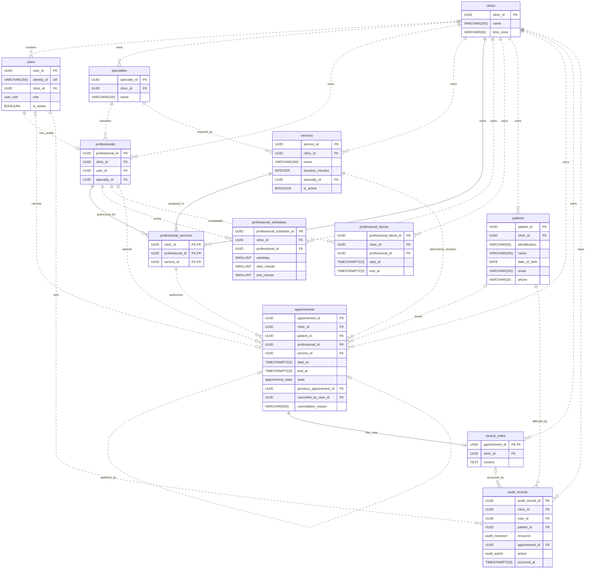

# 1. Business Rules

## Service Catalog Updates

A service's name, duration, and required specialty may be edited while it has no associated appointments. Once any appointment references it, regardless of state, changing its duration or specialty requires a new service to preserve existing appointments and history (`RF3`, `I4`). Name changes remain permitted for corrections, with an administrative rule against redefining the consultation type.

Only the clinic administrator may deactivate a service in their clinic as part of catalog maintenance (`RF3`). Deactivation blocks new bookings and preserves existing appointments and history. Reserved appointments may still be rescheduled with an inactive service to honor existing commitments.

## Appointment States and Rescheduling

Only reserved appointments are considered active. A reserved appointment may become attended, absent, cancelled, or rescheduled. These four states are final (`RF13`). Rescheduling atomically marks the original appointment as rescheduled and creates a linked reserved appointment, preserving the history (`RF10`). Each replacement has a new appointment identifier and may itself be rescheduled.

Rescheduling preserves the patient and service but may change the date, time, or professional within the same clinic, provided the professional is authorized to provide that service.

Booking and rescheduling allow any future start time aligned to a whole minute. Appointment intervals use `[start, end)`, so consecutive appointments do not overlap (`I1`, `I2`).

## Schedule Changes and Appointment Conflicts

A schedule block is created only if its interval does not overlap any appointment in the reserved state for the same professional. Otherwise, the request is rejected, the conflicting appointments are reported, and no block record is created. The actor may retry after resolving the conflicts.

Weekly schedule changes that leave reserved appointments outside the proposed hours are also rejected, with conflicts reported and no changes applied (`RF5`, `I3`). The affected appointments must first be rescheduled or cancelled.

These rules preserve `I3` without adding appointment states or pending block records. Rejecting conflicting blocks departs from `RF6`, which describes creating a block before resolving affected appointments. New bookings may enter before a successful retry.

# 2. Tech Stack

| Technology | Role |
| --- | --- |
| TypeScript | Application language |
| Express | REST API framework |
| PostgreSQL | Relational database and domain source of truth |
| Prisma ORM | Data access and migrations |
| Keycloak | Identity and credential management |
| Redis | Availability cache |
| Docker Compose | Service orchestration and networking |

# 3. Data Model

## clinics

### Fields

- clinic_id UUID NOT NULL DEFAULT gen_random_uuid() (PK)
- name VARCHAR(200) NOT NULL
- time_zone VARCHAR(64) NOT NULL -- Named time zone, Ex: America/Costa_Rica, America/Bogota

### Constraints

- CHECK clinics_name_check: name <> ''

## users

### Fields

- user_id UUID NOT NULL DEFAULT gen_random_uuid() (PK)
- identity_id VARCHAR(255) NOT NULL -- Keycloak user ID, no credentials
- clinic_id UUID NULL (FK->clinics.clinic_id) -- NULL only for platform_administrator
- role user_role NOT NULL -- Enum: platform_administrator, clinic_administrator, reception, healthcare_professional
- is_active BOOLEAN NOT NULL DEFAULT TRUE

### Constraints

- UNIQUE users_identity_id_key: (identity_id)
- UNIQUE users_clinic_user_key: (clinic_id, user_id)
- CHECK users_role_clinic_check: clinic_id must be NULL for platform_administrator and NOT NULL for all other roles

## specialties

### Fields

- specialty_id UUID NOT NULL DEFAULT gen_random_uuid() (PK)
- clinic_id UUID NOT NULL (FK->clinics.clinic_id)
- name VARCHAR(100) NOT NULL

### Constraints

- UNIQUE specialties_clinic_specialty_key: (clinic_id, specialty_id)
- CHECK specialties_name_check: name <> ''

## professionals

### Fields

- professional_id UUID NOT NULL DEFAULT gen_random_uuid() (PK)
- clinic_id UUID NOT NULL (FK->clinics.clinic_id)
- user_id UUID NOT NULL (FK: (clinic_id, user_id) -> users(clinic_id, user_id))
- specialty_id UUID NOT NULL (FK: (clinic_id, specialty_id) -> specialties(clinic_id, specialty_id))

### Constraints

- UNIQUE professionals_clinic_professional_key: (clinic_id, professional_id)
- UNIQUE professionals_user_key: (clinic_id, user_id)

## services

### Fields

- service_id UUID NOT NULL DEFAULT gen_random_uuid() (PK)
- clinic_id UUID NOT NULL (FK->clinics.clinic_id)
- name VARCHAR(200) NOT NULL
- duration_minutes INTEGER NOT NULL
- specialty_id UUID NOT NULL (FK: (clinic_id, specialty_id) -> specialties(clinic_id, specialty_id))
- is_active BOOLEAN NOT NULL DEFAULT TRUE

### Constraints

- UNIQUE services_clinic_service_key: (clinic_id, service_id)
- CHECK services_name_check: name <> ''
- CHECK services_duration_check: duration_minutes > 0

## professional_services

### Fields

- PK: (clinic_id, professional_id, service_id)
- clinic_id UUID NOT NULL (FK->clinics.clinic_id)
- professional_id UUID NOT NULL (FK: (clinic_id, professional_id) -> professionals(clinic_id, professional_id))
- service_id UUID NOT NULL (FK: (clinic_id, service_id) -> services(clinic_id, service_id))

### Constraints

## professional_schedules

### Fields

- professional_schedule_id UUID NOT NULL DEFAULT gen_random_uuid() (PK)
- clinic_id UUID NOT NULL (FK->clinics.clinic_id)
- professional_id UUID NOT NULL (FK: (clinic_id, professional_id) -> professionals(clinic_id, professional_id))
- weekday SMALLINT NOT NULL -- ISO weekday, 1 = Monday, 7 = Sunday
- start_minute SMALLINT NOT NULL -- Minutes after local midnight, Ex: 480 = 08:00
- end_minute SMALLINT NOT NULL -- Exclusive local endpoint, Ex: 1020 = 17:00, 1440 = next midnight

### Constraints

- CHECK professional_schedules_weekday_check: weekday must be between 1 (Monday) and 7 (Sunday)
- CHECK professional_schedules_interval_check: start_minute must be at least 0, end_minute must not exceed 1440, and start_minute must be less than end_minute

## professional_blocks

### Fields

- professional_block_id UUID NOT NULL DEFAULT gen_random_uuid() (PK)
- clinic_id UUID NOT NULL (FK->clinics.clinic_id)
- professional_id UUID NOT NULL (FK: (clinic_id, professional_id) -> professionals(clinic_id, professional_id))
- start_at TIMESTAMPTZ(3) NOT NULL -- Absolute instant, inclusive endpoint
- end_at TIMESTAMPTZ(3) NOT NULL -- Absolute instant, exclusive endpoint

### Constraints

- CHECK professional_blocks_interval_check: start_at and end_at must be finite, and start_at must be earlier than end_at

## patients

### Fields

- patient_id UUID NOT NULL DEFAULT gen_random_uuid() (PK)
- clinic_id UUID NOT NULL (FK->clinics.clinic_id)
- identification VARCHAR(50) NOT NULL
- name VARCHAR(200) NOT NULL
- date_of_birth DATE NOT NULL
- email VARCHAR(320) NULL -- Sensitive contact data, NULL means not provided
- phone VARCHAR(32) NULL -- Sensitive contact data, preserve country prefix and leading zeros, NULL means not provided

### Constraints

- UNIQUE patients_clinic_patient_key: (clinic_id, patient_id)
- UNIQUE patients_identification_key: (clinic_id, identification)
- CHECK patients_identification_check: identification <> ''
- CHECK patients_name_check: name <> ''
- CHECK patients_contact_check: At least one of email or phone must be provided, and neither may be an empty string when provided

## appointments

### Fields

- appointment_id UUID NOT NULL DEFAULT gen_random_uuid() (PK)
- clinic_id UUID NOT NULL (FK->clinics.clinic_id)
- patient_id UUID NOT NULL (FK: (clinic_id, patient_id) -> patients(clinic_id, patient_id))
- professional_id UUID NOT NULL (FK: (clinic_id, professional_id) -> professionals(clinic_id, professional_id))
- service_id UUID NOT NULL (FK: (clinic_id, service_id) -> services(clinic_id, service_id), FK: (clinic_id, professional_id, service_id) -> professional_services(clinic_id, professional_id, service_id))
- start_at TIMESTAMPTZ(3) NOT NULL -- Absolute instant aligned to a whole UTC minute
- end_at TIMESTAMPTZ(3) NOT NULL -- Computed by the backend from start_at and service duration, exclusive endpoint
- state appointment_state NOT NULL DEFAULT 'reserved' -- Enum: reserved, attended, absent, cancelled, rescheduled
- previous_appointment_id UUID NULL (FK: (clinic_id, previous_appointment_id, patient_id, service_id) -> appointments(clinic_id, appointment_id, patient_id, service_id)) -- NULL for first appointments
- cancelled_by_user_id UUID NULL (FK: (clinic_id, cancelled_by_user_id) -> users(clinic_id, user_id)) -- Required only when cancelled
- cancellation_reason VARCHAR(500) NULL -- Required only when cancelled

### Constraints

- UNIQUE appointments_clinic_appointment_key: (clinic_id, appointment_id)
- UNIQUE appointments_replacement_target_key: (clinic_id, appointment_id, patient_id, service_id)
- UNIQUE appointments_previous_key: (clinic_id, previous_appointment_id) -- NULL predecessors remain distinct
- CHECK appointments_interval_check: start_at must be earlier than end_at
- CHECK appointments_minute_check: start_at must be aligned to a whole UTC minute
- CHECK appointments_previous_check: previous_appointment_id must differ from appointment_id when provided
- CHECK appointments_cancellation_check: Cancelled appointments must have cancelled_by_user_id and a nonempty cancellation_reason, all other states must have both fields NULL

## clinical_notes

### Fields

- appointment_id UUID NOT NULL (PK, FK: (clinic_id, appointment_id) -> appointments(clinic_id, appointment_id))
- clinic_id UUID NOT NULL (FK->clinics.clinic_id)
- content TEXT NOT NULL -- Sensitive clinical content, treating professional derived from the appointment

### Constraints

- UNIQUE clinical_notes_clinic_appointment_key: (clinic_id, appointment_id)
- CHECK clinical_notes_content_check: content <> ''

## audit_records

### Fields

- audit_record_id UUID NOT NULL DEFAULT gen_random_uuid() (PK)
- clinic_id UUID NOT NULL (FK->clinics.clinic_id)
- user_id UUID NOT NULL (FK: (clinic_id, user_id) -> users(clinic_id, user_id)) -- Acting user
- patient_id UUID NOT NULL (FK: (clinic_id, patient_id) -> patients(clinic_id, patient_id)) -- Affected patient
- resource audit_resource NOT NULL -- Enum: patient_contact, clinical_note
- appointment_id UUID NULL (FK: (clinic_id, appointment_id) -> clinical_notes(clinic_id, appointment_id)) -- Clinical note identifier, NULL for patient_contact
- action audit_action NOT NULL -- Enum: read, write
- occurred_at TIMESTAMPTZ(3) NOT NULL DEFAULT clock_timestamp() -- Absolute event instant, no sensitive payload copies

### Constraints

- CHECK audit_records_resource_check: appointment_id is required for clinical_note and must be NULL for patient_contact
- TRIGGER audit_records_append_only_guard: Reject every UPDATE, DELETE, or TRUNCATE statement before execution

## Entity-Relationship Diagram

## Relationships

- clinics to users (**1:N**): Each clinic user belongs to one clinic, platform administrators belong to none

- clinics to specialties (**1:N**): Each specialty belongs to one clinic

- clinics to professionals (**1:N**): Each professional belongs to one clinic

- users to professionals (**1:1**, optional): Each professional requires one same-clinic user, a user may have no professional profile

- specialties to professionals (**1:N**): Each professional has one specialty

- clinics to services (**1:N**): Each service belongs to one clinic

- specialties to services (**1:N**): Each service requires one specialty

- professionals to services (**N:M**): professional_services stores distinct authorized pairs within one clinic

- professionals to professional_services (**1:N**): Each authorization belongs to one professional

- services to professional_services (**1:N**): Each authorization belongs to one service

- clinics to professional_services (**1:N**): Each authorization belongs to one clinic

- clinics to professional_schedules (**1:N**): Each weekly interval belongs to one clinic

- professionals to professional_schedules (**1:N**): Each interval belongs to one professional

- clinics to professional_blocks (**1:N**): Each block belongs to one clinic

- professionals to professional_blocks (**1:N**): Each block belongs to one professional

- clinics to patients (**1:N**): Patient records and identification uniqueness are independent between clinics

- clinics to appointments (**1:N**): Each appointment belongs to one clinic

- patients to appointments (**1:N**): Each appointment has one same-clinic patient

- professionals to appointments (**1:N**): Each appointment has one same-clinic professional

- services to appointments (**1:N**): Each appointment uses one same-clinic service

- professional_services to appointments (**1:N**): Each appointment references an explicit professional-service authorization

- users to appointments (**1:N**): A cancelling user is required only for cancelled appointments

- appointments to appointments (**1:1**, optional): Each replacement has one predecessor, each rescheduled appointment has exactly one replacement, clinic, patient, and service are preserved

- clinics to clinical_notes (**1:N**): Each note belongs to one clinic

- appointments to clinical_notes (**1:1**, optional): An attended appointment may have one note, other states have none

- professionals to clinical_notes (**1:N**): The treating professional is derived through appointments

- clinics to audit_records (**1:N**): Each event belongs to one clinic

- users to audit_records (**1:N**): Each event identifies one acting clinic user

- patients to audit_records (**1:N**): Each event identifies one affected patient

- clinical_notes to audit_records (**1:N**): Clinical-note events identify the note through appointment_id, contact-data events have no note reference

## Normalization

### First Normal Form (1NF)

- All tables: Individual field values and declared PKs, with no embedded lists or repeating column groups
- professional_services: One professional-service assignment per row
- professional_schedules and professional_blocks: One working or blocked interval per row

### Second Normal Form (2NF)

Non-key fields must not depend on only part of a composite candidate key

- patients: name, date_of_birth, email, and phone depend on both clinic_id and identification, neither field alone determines those values
- professional_services: An assignment is identified by (professional_id, service_id), service name and duration depend only on service_id and remain in services
- Retained exception: professional_services.clinic_id depends on professional_id alone or service_id alone, retaining it is a deliberate 2NF exception

### Third Normal Form (3NF)

After satisfying 2NF, non-key fields must not depend on another non-key field

- specialties: Clinic name and time zone depend on non-key clinic_id, so they stay in clinics
- professionals and services: Specialty name depends on non-key specialty_id, so it stays in specialties
- professional_schedules and professional_blocks: Professional specialty depends on non-key professional_id, so it stays in professionals
- appointments: Patient details depend on non-key patient_id and service details depend on non-key service_id, so they stay in patients and services
- audit_records: Note content depends on non-key appointment_id, so it stays in clinical_notes
- Retained exceptions: services.clinic_id depends on non-key specialty_id, professional_schedules.clinic_id and professional_blocks.clinic_id depend on non-key professional_id, these retained redundancies and the derived fields are justified below

### Deliberate Denormalizations

- Clinic ownership: Repeated clinic_id supports direct RLS checks and clinic-consistent references, composite FKs prevent disagreement, at the cost of redundant values and additional composite indexes
- Appointment end: Stored end_at provides interval endpoints without joining services, the backend must derive it from start_at and service duration and prevent changes to appointment timing or referenced service durations, at the cost of stored derived data and coordinated validation
- Audit patient: For clinical note events, patient_id allows direct patient filters. It repeats the patient linked to the appointment, so the backend must verify that both references match
- Audit resource: resource explicitly names the data accessed. This repeats information already available from whether appointment_id is NULL, so the CHECK must keep both fields consistent

# 4. Multi-tenancy

All three strategies would require reviewing access permissions for the future OLAP layer. Existing identities, roles, and clinic access rules could be reused. Consolidating data means copying records from several clinics into a common OLAP store. Permissions on the source OLTP data would not automatically protect copies in another store, so access would need to be configured and verified there. The extent of additional authorization work would depend on the OLAP architecture and access requirements.

## Database per Clinic

This comparison considers a separate database for each clinic within a single PostgreSQL instance. Deployments across multiple PostgreSQL instances are outside the scope of this comparison. They would require separate management of server configuration, startup, updates, and recovery.

### Data Isolation

Each clinic would have a separate database containing its patients, appointments, and clinical notes. A PostgreSQL connection selects one database when it opens. Ordinary SQL queries on that connection cannot directly access tables in another database. For example, omitting a clinic filter while querying clinic A's patients would not include patients stored in clinic B's database.

Access would also require restricted database roles. In PostgreSQL, a role is an account or group of permissions managed by the database engine. Separating databases does not prevent an account from connecting to another clinic's database if its permissions allow it. The credentials used for clinic A would need access only to A's database and permitted operations.

The backend would still need to select the database from the authenticated user's clinic association. If it holds credentials for multiple clinics and selects clinic B's connection for a request from clinic A, database separation alone would not prevent the resulting disclosure.

### Implementation Complexity

The application could reuse the same data model and appointment logic across clinics, but it would need to manage connections to different databases. PostgreSQL has a supervisor process that listens for incoming connections and starts a dedicated server process for each connection. During connection startup, the application sends the database name and database user, and PostgreSQL checks authentication and access before accepting queries. The resulting session, meaning the interaction over that connection, stays associated with the selected database. Its server process executes SQL commands and returns results over the same connection. It can serve many successive queries, but the session cannot switch to another database.

A connection pool keeps established connections open and lends them to application operations instead of opening a new connection for every request. Returning a connection to the pool leaves its PostgreSQL session and server process running for reuse. With a database per clinic, a connection opened for clinic A cannot be reassigned to clinic B. The data access layer would need to select an available connection for the requested clinic's database or open one if necessary. Each clinic could have multiple connections, so the server processes would correspond to open connections rather than to clinics.

Registering a clinic would require an automated setup process that creates its database, installs the tables and constraints, configures access permissions, and creates its first administrator. Preparing the database structure could reuse migration scripts, which define changes to tables and other database objects. The additional implementation work would be coordinating these steps for each new clinic.

The setup process would also need to handle partial failures. PostgreSQL does not allow `CREATE DATABASE` inside a transaction block, so database creation and the subsequent setup cannot be rolled back together as one operation. For example, if creating the tables fails after the database has been created, the database remains. The application would need a defined way to retry or clean up incomplete setup without reporting the clinic as ready.

### Operations and Maintenance

Changes to tables, constraints, and indexes would need to be applied to every clinic's database. The same migration scripts could be reused, but their execution and results would need to be tracked separately for each database. If a migration succeeds for clinic A and fails for clinic B, the databases could temporarily have different structures. Deployments would therefore need to account for incomplete migrations before application code starts relying on the new structure.

Separate databases would allow a clinic's data to be exported and restored individually. PostgreSQL's `pg_dump` creates a logical export, meaning a representation of the database's structure and data rather than a copy of its underlying storage files. This would allow clinic A's database to be reconstructed without replacing clinic B's data.

Database separation would not make server maintenance independent for each clinic within the shared PostgreSQL instance. Restarting that instance would interrupt connections for all clinics. Recovery from physical backups also has a shared scope. Restoring a physical backup and replaying the WAL to a selected point in time restores the whole instance, rather than only one clinic's database.

### Resource Usage and Performance

Keeping connections open for several clinics would consume resources even when some clinics have no active requests. Each connection retains a PostgreSQL server process with its own memory and occupies a slot within `max_connections`. Connection pools would therefore need to be sized against the shared instance's capacity.

Each database would have its own tables, indexes, and system catalogs, which are PostgreSQL's internal tables describing database objects. An appointment index in clinic A's database would contain entries only for A's appointments, allowing its queries and indexes to be tuned independently. However, smaller individual indexes do not establish a performance advantage over shared tables with appropriate indexes. The potential benefit is relevant to the comparison, but its practical significance cannot be established without execution plans and measurements using equivalent data and queries.

All clinic databases would still compete for the instance's CPU, memory, and storage throughput. PostgreSQL's `shared_buffers`, the memory area that caches recently accessed blocks of table and index data, is shared across the instance rather than reserved separately for each clinic. A resource-intensive query in clinic A could therefore slow availability queries in clinic B. Database separation would provide separate data structures without guaranteeing independent performance or a reserved share of server resources.

### Implications for OLAP

A future OLAP layer would need to treat each clinic's OLTP database as a separate data source. An extraction process, which reads data from the OLTP databases and transfers it to an OLAP store, could reuse the same logic across databases with matching structures. However, it would need to connect to each database and track extraction results separately. Adding a clinic would also require including its database among the sources. This allows extraction to be scheduled or retried per clinic, but adds coordination as the number of databases grows.

Extracted records would need to retain their clinic of origin. Inside the OLTP system, the database itself identifies which clinic owns the data. That context would need to become explicit when records are copied into a common OLAP store. Identifiers cannot be assumed to be unique across independent databases unless the identifier design guarantees it. The OLAP model would therefore need to preserve clinic ownership and distinguish records from different sources without treating independent patient records as one shared clinical history.

## Schema per Clinic

### Data Isolation

Each clinic would have a separate schema within the same PostgreSQL database. A schema groups named objects such as tables, indexes, and functions. For example, `clinic_a.patients` and `clinic_b.patients` would be independent tables. Querying `clinic_a.patients` would return only A's patients, even without a clinic filter, because B's patients would be stored in another table.

Database-enforced isolation would depend on restricted access permissions. PostgreSQL requires permission to access objects in a schema and the appropriate permissions on its tables. If the role executing clinic A's queries has access only to A's schema and tables, an attempt to read `clinic_b.patients` would be rejected. This protection would also require preventing that role from obtaining broader privileges.

If the backend instead uses a role with access to every clinic's schema, PostgreSQL would permit queries against any of them. Selecting B's schema for a request from A could then expose B's patients. A missing tenant check or a manipulated clinic parameter could cause this error if the backend accepts the client's choice without verifying it against the authenticated user's clinic. Separate schemas alone would not block that access.

### Implementation Complexity

The application could reuse the same domain logic across clinics, but its data access code would need to target different schemas. For example, booking an appointment for clinic A would require every query involving the patient, professional, service, and appointment to use A's tables. Reusing that booking operation for clinic B would require directing those queries to B's tables without duplicating the booking logic.

Registering a clinic would require an automated routine to create its schema, tables, constraints, indexes, and access permissions. The routine could reuse a common structure, but object creation and foreign key references would need to target the new clinic's schema. Creating the schema alone would not create the domain tables or establish the permissions needed to use them.

These PostgreSQL setup steps could run inside one transaction, allowing their changes to be committed together or undone together if a step fails. For example, a failure while creating the appointment table could roll back the new schema and the tables already created within that transaction. This would simplify recovery from incomplete database setup compared with creating a separate database, although the setup routine would still need to handle errors and retries.

### Operations and Maintenance

Changes to tables, constraints, and indexes would need to be applied to each clinic's schema. Adding a column to `clinic_a.patients`, for example, would not add it to `clinic_b.patients`. The same migration scripts could be reused, but their progress and results would need to be tracked per schema. If an update fails for one clinic, deployments would need to account for the resulting differences before relying on the new structure.

PostgreSQL's `pg_dump` can export a clinic's schema, including its tables and data. This would allow a restore to target that clinic's objects without replacing the other clinics' tables.

All schemas would share the same database and PostgreSQL instance, so server maintenance would affect every clinic. Restarting PostgreSQL would interrupt their connections regardless of which schema they use. Physical backups and recovery through WAL would also operate on the instance as a whole. Separate schemas would therefore support selective logical exports, but would not provide independent server maintenance or direct recovery of one schema to a selected point in time.

### Resource Usage and Performance

Creating a schema would not by itself allocate a connection or a dedicated PostgreSQL server process. Those resources are associated with open connections. Because all schemas reside in one database, connections could be reused across clinics when the permissions design allows it. This could reduce the need to keep separate connections idle for each clinic.

Each clinic would require its own tables and indexes, adding another set of structures to store and maintain. For example, an index on clinic A's appointments would contain only A's records. A query using that index would search within A's data rather than an index containing appointments from every clinic. However, a suitable index on shared tables can also narrow a query to one clinic's records. Execution plans and measurements would be needed to determine whether separate indexes offer a meaningful performance benefit.

All schemas would compete for the same CPU, memory, and storage throughput. PostgreSQL's `shared_buffers`, which caches blocks of table and index data in memory, would serve the entire instance. A query reading a large appointment history in clinic A could consume resources needed by availability queries in clinic B. Separate schemas would therefore provide independent tables and indexes without reserving processing capacity or memory for each clinic.

### Implications for OLAP

A future OLAP extraction process could read several clinics' schemas through one database connection, provided its role has permission to access them. For example, it could combine appointments from `clinic_a.appointments` and `clinic_b.appointments` using `UNION ALL`, which appends the results of separate queries. This would simplify collecting data across clinics compared with connecting to a separate database for each one.

The extraction process would still need to include each clinic's schema. A query listing only clinics A and B would not automatically include clinic C when its schema is created. Adding clinics would therefore require updating the extraction sources, either automatically or through configuration. Differences caused by incomplete migrations would also need to be handled before combining results, since the selected columns must have compatible structures and data types.

Each extracted record would need to retain its clinic of origin. Once records from several schemas are combined in shared OLAP tables, the source schemas would no longer separate them. Identifiers could also overlap between schemas unless their design guarantees uniqueness across clinics. The OLAP model would therefore need to distinguish each clinic's records.

## Shared Tables with Row-Level Security

### Data Isolation

Clinics would share the same tables, with `clinic_id` identifying the clinic that owns each record. For example, the `patients` table would contain patients from clinics A and B. The column records ownership but does not restrict access by itself. Isolation would require PostgreSQL policies that use that ownership information to control access to individual rows.

RLS applies rules inside PostgreSQL to determine which rows a query may read or modify. With an active policy restricting access to clinic A, a patient query would exclude B's records even if the application omitted its clinic filter. Policies would also need to reject inserts or updates that assign a record to another clinic.

The clinic used by those policies would need to come from the authenticated user's clinic association. A client-supplied clinic identifier would not be sufficient. If the backend incorrectly establishes B as the clinic for a request from A, the policies could permit access to B's records.

Requests without a valid clinic context would need to be denied access to clinic data. Reusing a database connection must not allow a request for B to inherit A's clinic context from an earlier request.

Application connections would need database roles subject to RLS. PostgreSQL superusers and roles with `BYPASSRLS` can skip these policies. Table owners normally skip them too, unless the table is configured to enforce RLS for its owner. Using a role that bypasses RLS could therefore expose records from every clinic despite correctly defined policies.

Relationships would also need constraints that prevent references between clinics. For example, an appointment belonging to A must not reference a patient belonging to B. RLS does not automatically enforce that rule, because PostgreSQL's foreign key checks operate independently of row visibility. The relationship constraints would need to account for clinic ownership.

### Implementation Complexity

The application would use one shared set of tables and queries for all clinics. Registering a clinic would add its record and initial application data without creating another database, schema, or set of tables. Policies that compare each row's `clinic_id` with the current clinic context could also be reused without defining a separate policy for every new clinic.

Database setup would need to enable RLS and define policies separately for every table containing clinic-specific data. A policy on `patients` would not automatically protect `appointments`. Those definitions would need to cover access to existing rows and validation of inserted or updated rows.

The data access layer would need a common mechanism to establish the authenticated clinic before executing protected queries. If the context is stored in a connection setting, the context assignment and all queries for the operation would need to execute on the same connection. One option would be a transaction-local setting, whose override ends when the transaction is committed or rolled back. Implementing that option would require wrapping protected operations in transactions, including operations that only read data.

### Operations and Maintenance

Changes to tables, constraints, indexes, and shared RLS policies would be maintained in one place. Adding a column to `patients`, for example, would change the structure used by every clinic without running a separate migration for each tenant.

A full logical export of the database would contain records from all clinics. Recovering only one clinic would require selecting its rows across the relevant tables, preserving their relationships, and restoring them without replacing other clinics' data. This would require a recovery procedure that works with clinic-specific rows rather than selecting a dedicated database or schema.

All clinics would share the same PostgreSQL instance, so server restarts and maintenance interruptions would affect them together. Physical backups and recovery through WAL would also operate on the instance as a whole. RLS controls access to rows, but does not provide independent server maintenance or direct recovery of one clinic's records to a selected point in time.

### Resource Usage and Performance

All clinics would share the same tables and indexes. Adding a clinic would add records rather than another set of database objects, while the shared indexes would grow with the combined data volume. An index containing `clinic_id` together with the columns used to search appointments could help PostgreSQL locate one clinic's records without scanning the entire table. The appropriate columns and their order would need to be justified through execution plans.

RLS adds policy conditions that PostgreSQL must evaluate when accessing protected data. A policy comparing a row's `clinic_id` with the current clinic context would involve less work than a policy requiring additional queries to determine access. If transaction-local context were selected, starting transactions and establishing that context would also add work, including for read-only operations. The practical impact would need to be measured using the application's restricted database roles so that the checks actually exercise RLS.

All clinics would compete for the same CPU, memory, storage throughput, and PostgreSQL buffer cache. RLS limits which records a request may access, but does not reserve resources for each clinic. A demanding query or a large number of requests from clinic A could therefore slow clinic B's operations. Sharing tables would reduce the number of separate structures maintained, without establishing a measured performance advantage over the other strategies.

### Implications for OLAP

A future OLAP extraction process could read authorized data from the shared OLTP tables without combining separate databases or schemas for each clinic. New clinics' records would enter those same tables, so adding a clinic would not require defining another extraction source. This would simplify source management compared with maintaining a separate set of tables for every clinic.

RLS would still determine which records an extraction job may read when its database role is subject to those policies. A job using the application's clinic-scoped policies would see only the clinic established in its context. If future OLAP use cases require records from several clinics, the extraction process would need an explicitly authorized access scope. Storing all clinics together would not automatically grant permission to extract all their data.

The existing `clinic_id` would identify each record's clinic of origin and would need to be preserved when copying data into OLAP. This would avoid deriving ownership from a source database or schema name.

## Selected Strategy

The system will use shared tables with `clinic_id` and PostgreSQL RLS.

### Data Isolation

Database per clinic provides a separate database connection boundary. Schema per clinic separates tables within one database, while RLS keeps clinics' rows together and controls their visibility through policies. RLS does not provide the same separation of data objects. This tradeoff is accepted for simpler clinic registration and shared maintenance.

### Implementation Complexity

Database per clinic requires database provisioning and connection selection. Schema per clinic requires creating table sets and directing queries to the correct schema. Shared tables require RLS policies and clinic-context handling, but no new structures for each clinic. This makes the selected strategy preferable for dynamic clinic registration.

### Operations and Maintenance

Separate databases and schemas allow exports to target one clinic, but require structural changes across every clinic's objects. Shared tables centralize those changes, while recovering one clinic requires selecting related rows. The project prioritizes shared maintenance over simpler recovery of an individual clinic, favoring the selected strategy in this criterion.

### Resource Usage and Performance

Separate databases and schemas maintain table and index sets per clinic. Shared tables maintain fewer separate structures, but their indexes cover all clinics and RLS adds policy evaluation work. All three alternatives share instance resources. No performance winner has been established, so the selected strategy is favored for fewer structures, with query performance still requiring execution plans and measurements.

### Implications for OLAP

Database per clinic requires coordinating separate database sources, and schema per clinic requires collecting records from separate table sets. Shared tables provide a common source with clinic ownership already recorded in `clinic_id`. The selected strategy is preferable for extraction source management, while OLAP authorization remains a consideration for all three alternatives.

# 5. Transactions and Concurrency

## Overlapping Bookings

### Concurrency Risk

Concurrent bookings can both find an interval available and insert overlapping appointments. Different patients competing for the same professional can violate `I1`. The same patient booking different professionals within one clinic can violate `I2` (`RF9`).

Ex: two receptionists check tomorrow's `[10:00, 10:30)` interval before either booking commits. Both checks return no conflicts, so an uncoordinated insertion could grant both requests.

Locking matching appointments does not protect an empty interval because the query may return no rows. A transaction alone does not prevent this race under `READ COMMITTED`.

### Transaction Design

1. Begin a PostgreSQL transaction with explicit `READ COMMITTED` isolation under the authenticated clinic and permission context. All database operations must use the same transaction connection. The context mechanism remains pending under Transactional Clinic and Permission Context

2. Acquire `FOR NO KEY UPDATE` locks on the same-clinic professional and patient rows, professionals first and patients second. When multiple rows of one type are required, acquire them in ascending identifier order. Keep the locks until commit or rollback. If a required row is missing or inaccessible, reject the request and roll back

3. Validate the service, its activation, and the professional's authorization, then calculate `end_at` from `start_at` and the service duration. Concurrent Service and Professional Authorization Changes must define how these facts remain valid through commit. This overlap protocol alone does not protect them

4. After acquiring the locks, execute fresh PostgreSQL queries to validate the complete appointment interval against the professional's weekly schedule and blocks. Schedule changes and block creation must acquire the same professional lock before their definitive checks and writes. Their detailed protocols are covered in their respective topics

5. Check same-clinic appointments in state `reserved` for either the professional or the patient. An existing interval conflicts when `existing.start_at < requested.end_at` and `requested.start_at < existing.end_at`. This preserves `[start, end)` semantics and permits adjacency. Reject any conflict and roll back. An empty result permits continuation because competing bookings must first acquire the already-held entity locks

6. Validate whole-minute alignment and perform the final future-start check immediately before insertion, requiring `start_at > clock_timestamp()`. Reject an invalid start and roll back. This establishes that the start is future at validation time, without guaranteeing that commit finishes before that start

7. Insert the appointment as `reserved` and commit. Report success only after commit succeeds. Any failure rolls back the operation. Common waiting, deadlock, and retry policies belong to Conflicts, Deadlocks, and Retries. Redis coordination belongs to Transaction and Cache Coordination

The entity locks serialize competing operations even when no appointments exist. They also make operations on different dates wait when they share a professional or patient. Ordinary reads remain possible.

`SERIALIZABLE` with complete transaction retries was considered but would add dependency monitoring and discarded work after serialization failures. Transaction-level advisory locks were also considered but would require application-defined keys and a separate locking convention. The selected row-lock protocol uses existing entities and requires every participating booking or rescheduling path to follow it.

## Atomic Rescheduling

### Concurrency Risk

Rescheduling must change the original appointment to `rescheduled` and create its `reserved` replacement within one transaction (`RF10`). Committing these writes separately could leave the original without a replacement or leave both appointments active.

Concurrent requests can compete for the destination or attempt to replace the same original. Cancellation and outcome registration can also change the original's state while rescheduling is being validated. Acting on an earlier `reserved` reading could permit a transition from a final state (`RF13`).

Ex: one receptionist moves an appointment to 11:00 while another moves the same original to 14:00. Different destinations do not justify creating two replacements.

### Transaction Design

1. Begin a PostgreSQL transaction with explicit `READ COMMITTED` isolation and the clinic and permission context required by [Overlapping Bookings](#overlapping-bookings). Read the same-clinic original to identify its professional, patient, and service. Reject a missing or inaccessible original and roll back. This preliminary reading does not establish that rescheduling is still permitted

2. Acquire `FOR NO KEY UPDATE` locks on the source and destination professionals in ascending identifier order, locking a shared professional only once. Then acquire the same lock on the patient. Keep these locks until commit or rollback. Reject any missing or inaccessible required entity and roll back

3. Acquire `FOR NO KEY UPDATE` on the original appointment. Confirm that it remains `reserved` and that its clinic, professional, patient, and service match the preliminary reading. Otherwise, reject the operation and roll back. Concurrent Appointment State Transitions must use compatible state protection and preserve this acquisition order whenever both agenda resources and appointment rows are needed

4. Derive the replacement's clinic, patient, and service from the locked original. Validate the destination using [Overlapping Bookings](#overlapping-bookings), excluding only the original's `appointment_id` from both professional and patient overlap checks. All other reserved appointments remain conflicts. Preserve the existing rule allowing rescheduling with an inactive service, while requiring destination professional authorization and calculating the end from the service duration. Protection of service and authorization data remains dependent on Concurrent Service and Professional Authorization Changes

5. After the destination validations succeed, change the original's state to `rescheduled`. Preserve its identifiers, timing, and existing predecessor link

6. Immediately before inserting the replacement, require its whole-minute-aligned `start_at` to remain greater than `clock_timestamp()`. Insert it with a new `appointment_id`, state `reserved`, and `previous_appointment_id` referencing the original. The proposed `appointments_previous_key` provides an additional database constraint against multiple direct replacements. These schema constraints remain unimplemented

7. Commit both writes together and report success only after confirmation. A destination conflict, failed validation, or database error rolls back the entire operation, including any change to the original. Release all transaction locks on completion. A later attempt against an original that is no longer `reserved` must not create another replacement. Recovery when a previous commit's outcome is unknown belongs to Conflicts, Deadlocks, and Retries

The explicit original-row lock permits state validation before either write, at the cost of another locking read and possible waits. A conditional state update was considered as an alternative, but the selected protocol protects the original throughout destination validation.

The original transition and replacement become visible together at commit. Coordinating availability cache entries for both source and destination, including immediate visibility required by `I7`, remains dependent on Transaction and Cache Coordination.

## Concurrent Appointment State Transitions

### Concurrency Risk

Cancellation, rescheduling, and outcome registration can compete for the same reserved appointment (`RF10`, `RF11`, `RF12`, `RF13`). Validating its state before acquiring a lock can allow a later write to overwrite a committed final state.

Ex: two requests read `reserved`. One commits `cancelled`, then the other writes `attended` using its earlier reading. This would violate the rule that final states have no outgoing transitions.

Cancellation must also persist its state, reason, and acting user together. Outcome registration must verify that the appointment's start has passed after any lock wait.

### Transaction Design

1. Begin a PostgreSQL transaction with explicit `READ COMMITTED` isolation under the authenticated clinic and permission context. All queries must use the same transaction connection. The context mechanism remains dependent on Transactional Clinic and Permission Context

2. For cancellation or outcome registration, select the same-clinic appointment by identifier with `FOR NO KEY UPDATE`. Keep the lock until commit or rollback. Reject a missing or inaccessible appointment and roll back. These operations do not acquire professional or patient row locks because they remove an appointment from the reserved set without creating a new occupation

3. After acquiring the lock, require the appointment to remain `reserved` and validate the requested operation's permissions against the protected appointment data. Reject a final state without modifying it. Coordination with concurrent user deactivation or role changes remains dependent on Clinic and User Management Consistency

4. Execute the applicable branch. For cancellation, validate the reason and update `state` to `cancelled`, `cancellation_reason`, and `cancelled_by_user_id` together, deriving the user from the authenticated actor (`RF11`). For an outcome, require `clock_timestamp() > start_at` immediately before updating `state` to `attended` or `absent`, keeping both cancellation fields `NULL` (`RF12`). Reject a failed validation and roll back. The proposed `appointments_cancellation_check` remains unimplemented

5. Commit the change and report success only after confirmation. A database error rolls back the operation. Release the lock on completion. Once one competing transition commits a final state, another request must not overwrite it using an earlier `reserved` reading. Common waiting, deadlock, retry, and unknown commit outcome handling belong to Conflicts, Deadlocks, and Retries

Rescheduling uses the same original-appointment lock and state validation through [Atomic Rescheduling](#atomic-rescheduling), including its replacement transaction. It retains the order professionals, patient, then original appointment. Any operation requiring both agenda resources and an appointment lock must acquire those resources before the appointment.

Locking only the appointment avoids serializing independent cancellations or outcomes for the same professional or patient. Acquiring all three resource types was considered but would introduce additional contention without being necessary for these state changes.

Availability cache coordination remains dependent on Transaction and Cache Coordination. The appointment lock alone does not establish immediate cache consistency.

## Concurrent Weekly Schedule Changes

### Concurrency Risk

Concurrent weekly schedule edits can overwrite changes made after an editor read the schedule. Serializing their writes does not detect an outdated request unless its starting schedule is compared with the current one.

Ex: two editors read the same week. One changes Monday and saves. The other submits a Tuesday change together with the earlier Monday values, unintentionally undoing the first edit.

Schedule changes also compete with bookings and rescheduling. Checking appointments without coordinating those operations could allow a new reserved appointment to fall outside the updated hours, violating `I3` (`RF5`).

### Transaction Design

1. Require the request to include the complete weekly schedule originally read, separately from the proposed schedule. Each original row includes `professional_schedule_id`, `weekday`, `start_minute`, and `end_minute`. Begin a PostgreSQL transaction with explicit `READ COMMITTED` isolation under the authenticated clinic and permission context, using the same connection throughout

2. Acquire `FOR NO KEY UPDATE` on the same-clinic professional and retain it until commit or rollback. Reject a missing or inaccessible professional and roll back. Validate the actor's permission to modify that professional's schedule. Clinic and permission context handling remains dependent on Transactional Clinic and Permission Context

3. Read the professional's complete current weekly schedule after acquiring the lock. Compare it with the request's original set by identifiers and values, independently of presentation order. Reject a missing or mismatching baseline without writing, and require a fresh read before another edit. An empty baseline matches only an empty current schedule. The professional row remains the locking resource even when no schedule rows exist

4. Validate the proposed intervals against the weekday and minute bounds in the [data model](#3-data-model). Scope all referenced schedule identifiers to the same clinic and professional. Construct the complete proposed week before applying any changes. The documented schema constraints remain unimplemented

5. Execute a fresh query for all of the professional's same-clinic `reserved` appointments, including past appointments that retain that state, without acquiring appointment row locks. Interpret the proposed weekly intervals on each appointment's dates using `clinics.time_zone`. Require joint coverage of the complete `[start_at, end_at)` interval with no gaps, allowing adjacent schedule intervals to provide continuous coverage. Use the same coverage rule for booking and rescheduling. If any appointment falls partly outside the proposed hours, report the conflicts and roll back without changing the schedule

6. Apply the schedule inserts, updates, and deletions needed to produce the validated proposed week within this transaction. Every participating schedule writer must acquire the same professional lock before its definitive reads and writes. Bookings and rescheduling must retain their shared professional-lock protocol through commit

7. Commit the complete schedule change and report success only after confirmation. A validation failure or database error rolls back all schedule writes. Release the professional lock on completion. Stale baselines and appointment conflicts are business rejections. Common waiting, deadlock, retry, and unknown commit outcome handling belong to Conflicts, Deadlocks, and Retries

Comparing the complete baseline avoids adding a version field, at the cost of larger requests and conservative conflicts between edits to different weekdays. A version counter was considered but would require a model change and coordinated increments across every schedule writer.

Appointment locks were considered but are unnecessary for this check. While the professional lock prevents new bookings and rescheduling, concurrent cancellations and outcomes can only remove appointments from the reserved set. A query may conservatively reject a schedule because it still sees an appointment being cancelled. The actor may retry after resolving the conflict.

Availability cache coordination remains dependent on Transaction and Cache Coordination.

# 6. Identity, Security, and Auditing

# 7. Availability, Caching, and Indexes
