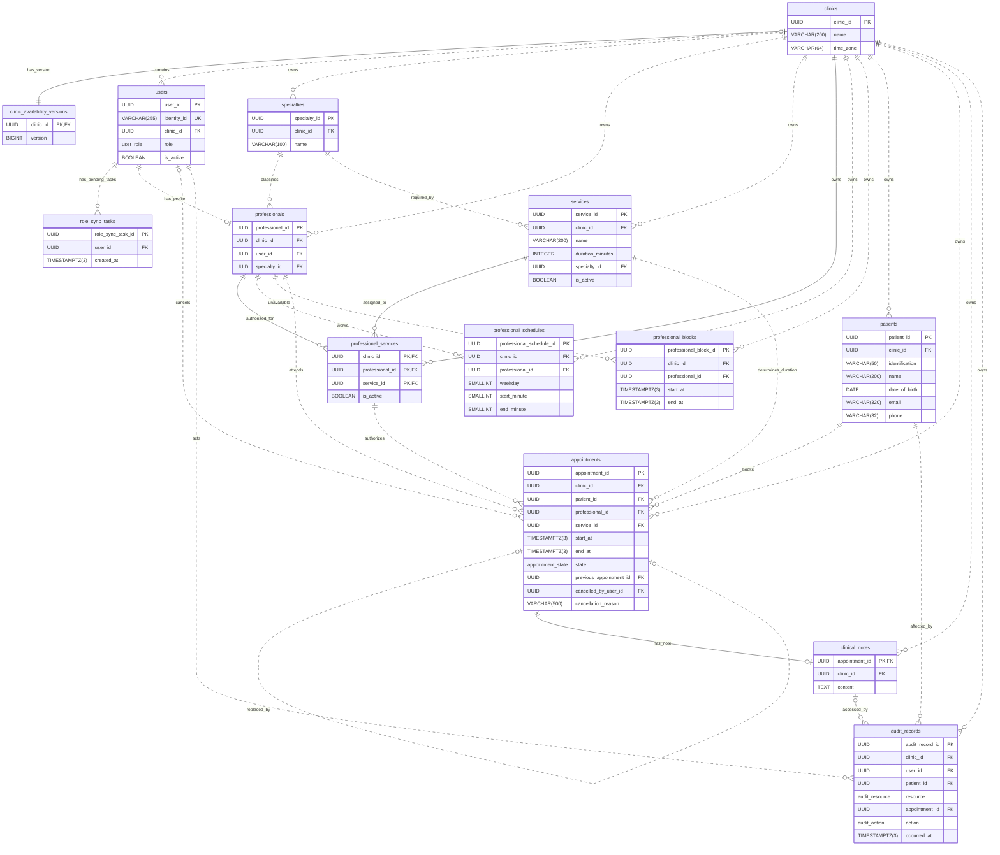

# 1. Business Rules

## Service Catalog Updates

A service's name, duration, and required specialty may be edited while it has no associated appointments. Once any appointment references it, regardless of state, changing its duration or specialty requires a new service to preserve existing appointments and history (`RF3`, `I4`). Name changes remain permitted for corrections, with an administrative rule against redefining the consultation type.

Only the clinic administrator may deactivate a service in their clinic as part of catalog maintenance (`RF3`). Deactivation blocks new bookings and preserves existing appointments and history. Reserved appointments may still be rescheduled with an inactive service to honor existing commitments.

## Appointment States and Rescheduling

Only reserved appointments are considered active. A reserved appointment may become attended, absent, cancelled, or rescheduled. These four states are final (`RF13`). Rescheduling atomically marks the original appointment as rescheduled and creates a linked reserved appointment, preserving the history (`RF10`). Each replacement has a new appointment identifier and may itself be rescheduled.

Rescheduling preserves the patient and service but may change the date, time, or professional within the same clinic, provided the professional is authorized to provide that service.

Booking and rescheduling allow any future start time aligned to a whole minute. Appointment intervals use `[start, end)`, so consecutive appointments do not overlap (`I1`, `I2`).

## Schedule Changes and Appointment Conflicts

A schedule block is created only if its interval does not overlap any appointment in the reserved state for the same professional. Otherwise, the request is rejected, the conflicting appointments are reported, and no block record is created. The actor may retry after resolving the conflicts.

Weekly schedule changes that leave reserved appointments outside the proposed hours are also rejected, with conflicts reported and no changes applied (`RF5`, `I3`). The affected appointments must first be rescheduled or cancelled.

These rules preserve `I3` without adding appointment states or pending block records. Rejecting conflicting blocks departs from `RF6`, which describes creating a block before resolving affected appointments. New bookings may enter before a successful retry.

# 2. Tech Stack

| Technology | Role |
| --- | --- |
| TypeScript | Application language |
| Express | REST API framework |
| PostgreSQL | Relational database and domain source of truth |
| Prisma ORM | Data access and migrations |
| Keycloak | Identity and credential management |
| Redis | Availability cache |
| Docker Compose | Service orchestration and networking |

# 3. Data Model

## clinics

### Fields

- clinic_id UUID NOT NULL DEFAULT gen_random_uuid() (PK)
- name VARCHAR(200) NOT NULL
- time_zone VARCHAR(64) NOT NULL -- Named time zone, Ex: America/Costa_Rica, America/Bogota

### Constraints

- CHECK clinics_name_check: name <> ''

## clinic_availability_versions

### Fields

- clinic_id UUID NOT NULL (PK, FK->clinics.clinic_id)
- version BIGINT NOT NULL DEFAULT 0

### Constraints

- CHECK clinic_availability_versions_version_check: version >= 0

Initialize the row during clinic registration and increment `version` once per relevant transaction without resetting it.

## users

### Fields

- user_id UUID NOT NULL DEFAULT gen_random_uuid() (PK)
- identity_id VARCHAR(255) NOT NULL -- Keycloak user ID, no credentials
- clinic_id UUID NULL (FK->clinics.clinic_id) -- NULL only for platform_administrator
- role user_role NOT NULL -- Enum: platform_administrator, clinic_administrator, reception, healthcare_professional
- is_active BOOLEAN NOT NULL DEFAULT TRUE

### Constraints

- UNIQUE users_identity_id_key: (identity_id)
- UNIQUE users_clinic_user_key: (clinic_id, user_id)
- CHECK users_role_clinic_check: clinic_id must be NULL for platform_administrator and NOT NULL for all other roles

## role_sync_tasks

### Fields

- role_sync_task_id UUID NOT NULL DEFAULT gen_random_uuid() (PK)
- user_id UUID NOT NULL (FK->users.user_id)
- created_at TIMESTAMPTZ(3) NOT NULL DEFAULT clock_timestamp() -- Task creation time

Tasks reconcile the current role in `users` with Keycloak. Delete captured tasks only after the confirmation checks in Clinic and User Management Consistency.

## specialties

### Fields

- specialty_id UUID NOT NULL DEFAULT gen_random_uuid() (PK)
- clinic_id UUID NOT NULL (FK->clinics.clinic_id)
- name VARCHAR(100) NOT NULL

### Constraints

- UNIQUE specialties_clinic_specialty_key: (clinic_id, specialty_id)
- CHECK specialties_name_check: name <> ''

## professionals

### Fields

- professional_id UUID NOT NULL DEFAULT gen_random_uuid() (PK)
- clinic_id UUID NOT NULL (FK->clinics.clinic_id)
- user_id UUID NOT NULL (FK: (clinic_id, user_id) -> users(clinic_id, user_id))
- specialty_id UUID NOT NULL (FK: (clinic_id, specialty_id) -> specialties(clinic_id, specialty_id))

### Constraints

- UNIQUE professionals_clinic_professional_key: (clinic_id, professional_id)
- UNIQUE professionals_user_key: (clinic_id, user_id)

## services

### Fields

- service_id UUID NOT NULL DEFAULT gen_random_uuid() (PK)
- clinic_id UUID NOT NULL (FK->clinics.clinic_id)
- name VARCHAR(200) NOT NULL
- duration_minutes INTEGER NOT NULL
- specialty_id UUID NOT NULL (FK: (clinic_id, specialty_id) -> specialties(clinic_id, specialty_id))
- is_active BOOLEAN NOT NULL DEFAULT TRUE

### Constraints

- UNIQUE services_clinic_service_key: (clinic_id, service_id)
- CHECK services_name_check: name <> ''
- CHECK services_duration_check: duration_minutes > 0

## professional_services

### Fields

- PK: (clinic_id, professional_id, service_id)
- clinic_id UUID NOT NULL (FK->clinics.clinic_id)
- professional_id UUID NOT NULL (FK: (clinic_id, professional_id) -> professionals(clinic_id, professional_id))
- service_id UUID NOT NULL (FK: (clinic_id, service_id) -> services(clinic_id, service_id))
- is_active BOOLEAN NOT NULL DEFAULT TRUE

Inactive associations remain stored for historical appointment references.

## professional_schedules

### Fields

- professional_schedule_id UUID NOT NULL DEFAULT gen_random_uuid() (PK)
- clinic_id UUID NOT NULL (FK->clinics.clinic_id)
- professional_id UUID NOT NULL (FK: (clinic_id, professional_id) -> professionals(clinic_id, professional_id))
- weekday SMALLINT NOT NULL -- ISO weekday, 1 = Monday, 7 = Sunday
- start_minute SMALLINT NOT NULL -- Minutes after local midnight, Ex: 480 = 08:00
- end_minute SMALLINT NOT NULL -- Exclusive local endpoint, Ex: 1020 = 17:00, 1440 = next midnight

### Constraints

- CHECK professional_schedules_weekday_check: weekday must be between 1 (Monday) and 7 (Sunday)
- CHECK professional_schedules_interval_check: start_minute must be at least 0, end_minute must not exceed 1440, and start_minute must be less than end_minute

## professional_blocks

### Fields

- professional_block_id UUID NOT NULL DEFAULT gen_random_uuid() (PK)
- clinic_id UUID NOT NULL (FK->clinics.clinic_id)
- professional_id UUID NOT NULL (FK: (clinic_id, professional_id) -> professionals(clinic_id, professional_id))
- start_at TIMESTAMPTZ(3) NOT NULL -- Absolute instant, inclusive endpoint
- end_at TIMESTAMPTZ(3) NOT NULL -- Absolute instant, exclusive endpoint

### Constraints

- CHECK professional_blocks_interval_check: start_at and end_at must be finite, and start_at must be earlier than end_at

## patients

### Fields

- patient_id UUID NOT NULL DEFAULT gen_random_uuid() (PK)
- clinic_id UUID NOT NULL (FK->clinics.clinic_id)
- identification VARCHAR(50) NOT NULL
- name VARCHAR(200) NOT NULL
- date_of_birth DATE NOT NULL
- email VARCHAR(320) NULL -- Sensitive contact data, NULL means not provided
- phone VARCHAR(32) NULL -- Sensitive contact data, preserve country prefix and leading zeros, NULL means not provided

### Constraints

- UNIQUE patients_clinic_patient_key: (clinic_id, patient_id)
- UNIQUE patients_identification_key: (clinic_id, identification)
- CHECK patients_identification_check: identification <> ''
- CHECK patients_name_check: name <> ''
- CHECK patients_contact_check: At least one of email or phone must be provided, and neither may be an empty string when provided

## appointments

### Fields

- appointment_id UUID NOT NULL DEFAULT gen_random_uuid() (PK)
- clinic_id UUID NOT NULL (FK->clinics.clinic_id)
- patient_id UUID NOT NULL (FK: (clinic_id, patient_id) -> patients(clinic_id, patient_id))
- professional_id UUID NOT NULL (FK: (clinic_id, professional_id) -> professionals(clinic_id, professional_id))
- service_id UUID NOT NULL (FK: (clinic_id, service_id) -> services(clinic_id, service_id), FK: (clinic_id, professional_id, service_id) -> professional_services(clinic_id, professional_id, service_id))
- start_at TIMESTAMPTZ(3) NOT NULL -- Absolute instant aligned to a whole UTC minute
- end_at TIMESTAMPTZ(3) NOT NULL -- Computed by the backend from start_at and service duration, exclusive endpoint
- state appointment_state NOT NULL DEFAULT 'reserved' -- Enum: reserved, attended, absent, cancelled, rescheduled
- previous_appointment_id UUID NULL (FK: (clinic_id, previous_appointment_id, patient_id, service_id) -> appointments(clinic_id, appointment_id, patient_id, service_id)) -- NULL for first appointments
- cancelled_by_user_id UUID NULL (FK: (clinic_id, cancelled_by_user_id) -> users(clinic_id, user_id)) -- Required only when cancelled
- cancellation_reason VARCHAR(500) NULL -- Required only when cancelled

### Constraints

- UNIQUE appointments_clinic_appointment_key: (clinic_id, appointment_id)
- UNIQUE appointments_replacement_target_key: (clinic_id, appointment_id, patient_id, service_id)
- UNIQUE appointments_previous_key: (clinic_id, previous_appointment_id) -- NULL predecessors remain distinct
- CHECK appointments_interval_check: start_at must be earlier than end_at
- CHECK appointments_minute_check: start_at must be aligned to a whole UTC minute
- CHECK appointments_previous_check: previous_appointment_id must differ from appointment_id when provided
- CHECK appointments_cancellation_check: Cancelled appointments must have cancelled_by_user_id and a nonempty cancellation_reason, all other states must have both fields NULL

## clinical_notes

### Fields

- appointment_id UUID NOT NULL (PK, FK: (clinic_id, appointment_id) -> appointments(clinic_id, appointment_id))
- clinic_id UUID NOT NULL (FK->clinics.clinic_id)
- content TEXT NOT NULL -- Sensitive clinical content, treating professional derived from the appointment

### Constraints

- UNIQUE clinical_notes_clinic_appointment_key: (clinic_id, appointment_id)
- CHECK clinical_notes_content_check: content <> ''

## audit_records

### Fields

- audit_record_id UUID NOT NULL DEFAULT gen_random_uuid() (PK)
- clinic_id UUID NOT NULL (FK->clinics.clinic_id)
- user_id UUID NOT NULL (FK: (clinic_id, user_id) -> users(clinic_id, user_id)) -- Acting user
- patient_id UUID NOT NULL (FK: (clinic_id, patient_id) -> patients(clinic_id, patient_id)) -- Affected patient
- resource audit_resource NOT NULL -- Enum: patient_contact, clinical_note
- appointment_id UUID NULL (FK: (clinic_id, appointment_id) -> clinical_notes(clinic_id, appointment_id)) -- Clinical note identifier, NULL for patient_contact
- action audit_action NOT NULL -- Enum: read, write
- occurred_at TIMESTAMPTZ(3) NOT NULL DEFAULT clock_timestamp() -- Absolute event instant, no sensitive payload copies

### Constraints

- CHECK audit_records_resource_check: appointment_id is required for clinical_note and must be NULL for patient_contact
- TRIGGER audit_records_append_only_guard: Reject every UPDATE, DELETE, or TRUNCATE statement before execution

## Entity-Relationship Diagram

## Relationships

- clinics to clinic_availability_versions (**1:1**): Each clinic requires one availability version row, created during clinic registration

- clinics to users (**1:N**): Each clinic user belongs to one clinic, platform administrators belong to none

- users to role_sync_tasks (**1:N**): Each pending reconciliation task references one user, including platform administrators without a clinic

- clinics to specialties (**1:N**): Each specialty belongs to one clinic

- clinics to professionals (**1:N**): Each professional belongs to one clinic

- users to professionals (**1:1**, optional): Each professional requires one same-clinic user, a user may have no professional profile

- specialties to professionals (**1:N**): Each professional has one specialty

- clinics to services (**1:N**): Each service belongs to one clinic

- specialties to services (**1:N**): Each service requires one specialty

- professionals to services (**N:M**): professional_services stores distinct same-clinic pairs and their activation, preserving inactive associations for historical references

- professionals to professional_services (**1:N**): Each authorization belongs to one professional

- services to professional_services (**1:N**): Each authorization belongs to one service

- clinics to professional_services (**1:N**): Each authorization belongs to one clinic

- clinics to professional_schedules (**1:N**): Each weekly interval belongs to one clinic

- professionals to professional_schedules (**1:N**): Each interval belongs to one professional

- clinics to professional_blocks (**1:N**): Each block belongs to one clinic

- professionals to professional_blocks (**1:N**): Each block belongs to one professional

- clinics to patients (**1:N**): Patient records and identification uniqueness are independent between clinics

- clinics to appointments (**1:N**): Each appointment belongs to one clinic

- patients to appointments (**1:N**): Each appointment has one same-clinic patient

- professionals to appointments (**1:N**): Each appointment has one same-clinic professional

- services to appointments (**1:N**): Each appointment uses one same-clinic service

- professional_services to appointments (**1:N**): Each appointment references a same-clinic professional-service association, preserved after deactivation

- users to appointments (**1:N**): A cancelling user is required only for cancelled appointments

- appointments to appointments (**1:1**, optional): Each replacement has one predecessor, each rescheduled appointment has exactly one replacement, clinic, patient, and service are preserved

- clinics to clinical_notes (**1:N**): Each note belongs to one clinic

- appointments to clinical_notes (**1:1**, optional): An attended appointment may have one note, other states have none

- professionals to clinical_notes (**1:N**): The treating professional is derived through appointments

- clinics to audit_records (**1:N**): Each event belongs to one clinic

- users to audit_records (**1:N**): Each event identifies one acting clinic user

- patients to audit_records (**1:N**): Each event identifies one affected patient

- clinical_notes to audit_records (**1:N**): Clinical-note events identify the note through appointment_id, contact-data events have no note reference

## Normalization

### First Normal Form (1NF)

- All tables: Individual field values and declared PKs, with no embedded lists or repeating column groups
- clinic_availability_versions: One availability version per clinic
- role_sync_tasks: One pending reconciliation request per row, identified by role_sync_task_id
- professional_services: One professional-service assignment per row
- professional_schedules and professional_blocks: One working or blocked interval per row

### Second Normal Form (2NF)

Non-key fields must not depend on only part of a composite candidate key

- clinic_availability_versions: The single-column primary key introduces no partial key dependencies
- role_sync_tasks: The single-column primary key introduces no partial key dependencies
- patients: name, date_of_birth, email, and phone depend on both clinic_id and identification, neither field alone determines those values
- professional_services: is_active depends on the complete professional-service pair, while service name and duration depend only on service_id and remain in services
- Retained exception: professional_services.clinic_id depends on professional_id alone or service_id alone, retaining it is a deliberate 2NF exception

### Third Normal Form (3NF)

After satisfying 2NF, non-key fields must not depend on another non-key field

- clinic_availability_versions: version depends on clinic_id, while descriptive clinic attributes remain in clinics
- role_sync_tasks: Provider identity, clinic, and current role remain in users rather than being copied into pending tasks
- specialties: Clinic name and time zone depend on non-key clinic_id, so they stay in clinics
- professionals and services: Specialty name depends on non-key specialty_id, so it stays in specialties
- professional_schedules and professional_blocks: Professional specialty depends on non-key professional_id, so it stays in professionals
- appointments: Patient details depend on non-key patient_id and service details depend on non-key service_id, so they stay in patients and services
- audit_records: Note content depends on non-key appointment_id, so it stays in clinical_notes
- Retained exceptions: services.clinic_id depends on non-key specialty_id, professional_schedules.clinic_id and professional_blocks.clinic_id depend on non-key professional_id, these retained redundancies and the derived fields are justified below

### Deliberate Denormalizations

- Clinic ownership: Repeated clinic_id supports direct RLS checks and clinic-consistent references, composite FKs prevent disagreement, at the cost of redundant values and additional composite indexes
- Appointment end: Stored end_at provides interval endpoints without joining services, the backend must derive it from start_at and service duration and prevent changes to appointment timing or referenced service durations, at the cost of stored derived data and coordinated validation
- Audit patient: For clinical note events, patient_id allows direct patient filters. It repeats the patient linked to the appointment, so the backend must verify that both references match
- Audit resource: resource explicitly names the data accessed. This repeats information already available from whether appointment_id is NULL, so the CHECK must keep both fields consistent

# 4. Multi-tenancy

All three strategies would require reviewing access permissions for the future OLAP layer. Existing identities, roles, and clinic access rules could be reused. Consolidating data means copying records from several clinics into a common OLAP store. Permissions on the source OLTP data would not automatically protect copies in another store, so access would need to be configured and verified there. The extent of additional authorization work would depend on the OLAP architecture and access requirements.

## Database per Clinic

This comparison considers a separate database for each clinic within a single PostgreSQL instance. Deployments across multiple PostgreSQL instances are outside the scope of this comparison. They would require separate management of server configuration, startup, updates, and recovery.

### Data Isolation

Each clinic would have a separate database containing its patients, appointments, and clinical notes. A PostgreSQL connection selects one database when it opens. Ordinary SQL queries on that connection cannot directly access tables in another database. For example, omitting a clinic filter while querying clinic A's patients would not include patients stored in clinic B's database.

Access would also require restricted database roles. In PostgreSQL, a role is an account or group of permissions managed by the database engine. Separating databases does not prevent an account from connecting to another clinic's database if its permissions allow it. The credentials used for clinic A would need access only to A's database and permitted operations.

The backend would still need to select the database from the authenticated user's clinic association. If it holds credentials for multiple clinics and selects clinic B's connection for a request from clinic A, database separation alone would not prevent the resulting disclosure.

### Implementation Complexity

The application could reuse the same data model and appointment logic across clinics, but it would need to manage connections to different databases. PostgreSQL has a supervisor process that listens for incoming connections and starts a dedicated server process for each connection. During connection startup, the application sends the database name and database user, and PostgreSQL checks authentication and access before accepting queries. The resulting session, meaning the interaction over that connection, stays associated with the selected database. Its server process executes SQL commands and returns results over the same connection. It can serve many successive queries, but the session cannot switch to another database.

A connection pool keeps established connections open and lends them to application operations instead of opening a new connection for every request. Returning a connection to the pool leaves its PostgreSQL session and server process running for reuse. With a database per clinic, a connection opened for clinic A cannot be reassigned to clinic B. The data access layer would need to select an available connection for the requested clinic's database or open one if necessary. Each clinic could have multiple connections, so the server processes would correspond to open connections rather than to clinics.

Registering a clinic would require an automated setup process that creates its database, installs the tables and constraints, configures access permissions, and creates its first administrator. Preparing the database structure could reuse migration scripts, which define changes to tables and other database objects. The additional implementation work would be coordinating these steps for each new clinic.

The setup process would also need to handle partial failures. PostgreSQL does not allow `CREATE DATABASE` inside a transaction block, so database creation and the subsequent setup cannot be rolled back together as one operation. For example, if creating the tables fails after the database has been created, the database remains. The application would need a defined way to retry or clean up incomplete setup without reporting the clinic as ready.

### Operations and Maintenance

Changes to tables, constraints, and indexes would need to be applied to every clinic's database. The same migration scripts could be reused, but their execution and results would need to be tracked separately for each database. If a migration succeeds for clinic A and fails for clinic B, the databases could temporarily have different structures. Deployments would therefore need to account for incomplete migrations before application code starts relying on the new structure.

Separate databases would allow a clinic's data to be exported and restored individually. PostgreSQL's `pg_dump` creates a logical export, meaning a representation of the database's structure and data rather than a copy of its underlying storage files. This would allow clinic A's database to be reconstructed without replacing clinic B's data.

Database separation would not make server maintenance independent for each clinic within the shared PostgreSQL instance. Restarting that instance would interrupt connections for all clinics. Recovery from physical backups also has a shared scope. Restoring a physical backup and replaying the WAL to a selected point in time restores the whole instance, rather than only one clinic's database.

### Resource Usage and Performance

Keeping connections open for several clinics would consume resources even when some clinics have no active requests. Each connection retains a PostgreSQL server process with its own memory and occupies a slot within `max_connections`. Connection pools would therefore need to be sized against the shared instance's capacity.

Each database would have its own tables, indexes, and system catalogs, which are PostgreSQL's internal tables describing database objects. An appointment index in clinic A's database would contain entries only for A's appointments, allowing its queries and indexes to be tuned independently. However, smaller individual indexes do not establish a performance advantage over shared tables with appropriate indexes. The potential benefit is relevant to the comparison, but its practical significance cannot be established without execution plans and measurements using equivalent data and queries.

All clinic databases would still compete for the instance's CPU, memory, and storage throughput. PostgreSQL's `shared_buffers`, the memory area that caches recently accessed blocks of table and index data, is shared across the instance rather than reserved separately for each clinic. A resource-intensive query in clinic A could therefore slow availability queries in clinic B. Database separation would provide separate data structures without guaranteeing independent performance or a reserved share of server resources.

### Implications for OLAP

A future OLAP layer would need to treat each clinic's OLTP database as a separate data source. An extraction process, which reads data from the OLTP databases and transfers it to an OLAP store, could reuse the same logic across databases with matching structures. However, it would need to connect to each database and track extraction results separately. Adding a clinic would also require including its database among the sources. This allows extraction to be scheduled or retried per clinic, but adds coordination as the number of databases grows.

Extracted records would need to retain their clinic of origin. Inside the OLTP system, the database itself identifies which clinic owns the data. That context would need to become explicit when records are copied into a common OLAP store. Identifiers cannot be assumed to be unique across independent databases unless the identifier design guarantees it. The OLAP model would therefore need to preserve clinic ownership and distinguish records from different sources without treating independent patient records as one shared clinical history.

## Schema per Clinic

### Data Isolation

Each clinic would have a separate schema within the same PostgreSQL database. A schema groups named objects such as tables, indexes, and functions. For example, `clinic_a.patients` and `clinic_b.patients` would be independent tables. Querying `clinic_a.patients` would return only A's patients, even without a clinic filter, because B's patients would be stored in another table.

Database-enforced isolation would depend on restricted access permissions. PostgreSQL requires permission to access objects in a schema and the appropriate permissions on its tables. If the role executing clinic A's queries has access only to A's schema and tables, an attempt to read `clinic_b.patients` would be rejected. This protection would also require preventing that role from obtaining broader privileges.

If the backend instead uses a role with access to every clinic's schema, PostgreSQL would permit queries against any of them. Selecting B's schema for a request from A could then expose B's patients. A missing tenant check or a manipulated clinic parameter could cause this error if the backend accepts the client's choice without verifying it against the authenticated user's clinic. Separate schemas alone would not block that access.

### Implementation Complexity

The application could reuse the same domain logic across clinics, but its data access code would need to target different schemas. For example, booking an appointment for clinic A would require every query involving the patient, professional, service, and appointment to use A's tables. Reusing that booking operation for clinic B would require directing those queries to B's tables without duplicating the booking logic.

Registering a clinic would require an automated routine to create its schema, tables, constraints, indexes, and access permissions. The routine could reuse a common structure, but object creation and foreign key references would need to target the new clinic's schema. Creating the schema alone would not create the domain tables or establish the permissions needed to use them.

These PostgreSQL setup steps could run inside one transaction, allowing their changes to be committed together or undone together if a step fails. For example, a failure while creating the appointment table could roll back the new schema and the tables already created within that transaction. This would simplify recovery from incomplete database setup compared with creating a separate database, although the setup routine would still need to handle errors and retries.

### Operations and Maintenance

Changes to tables, constraints, and indexes would need to be applied to each clinic's schema. Adding a column to `clinic_a.patients`, for example, would not add it to `clinic_b.patients`. The same migration scripts could be reused, but their progress and results would need to be tracked per schema. If an update fails for one clinic, deployments would need to account for the resulting differences before relying on the new structure.

PostgreSQL's `pg_dump` can export a clinic's schema, including its tables and data. This would allow a restore to target that clinic's objects without replacing the other clinics' tables.

All schemas would share the same database and PostgreSQL instance, so server maintenance would affect every clinic. Restarting PostgreSQL would interrupt their connections regardless of which schema they use. Physical backups and recovery through WAL would also operate on the instance as a whole. Separate schemas would therefore support selective logical exports, but would not provide independent server maintenance or direct recovery of one schema to a selected point in time.

### Resource Usage and Performance

Creating a schema would not by itself allocate a connection or a dedicated PostgreSQL server process. Those resources are associated with open connections. Because all schemas reside in one database, connections could be reused across clinics when the permissions design allows it. This could reduce the need to keep separate connections idle for each clinic.

Each clinic would require its own tables and indexes, adding another set of structures to store and maintain. For example, an index on clinic A's appointments would contain only A's records. A query using that index would search within A's data rather than an index containing appointments from every clinic. However, a suitable index on shared tables can also narrow a query to one clinic's records. Execution plans and measurements would be needed to determine whether separate indexes offer a meaningful performance benefit.

All schemas would compete for the same CPU, memory, and storage throughput. PostgreSQL's `shared_buffers`, which caches blocks of table and index data in memory, would serve the entire instance. A query reading a large appointment history in clinic A could consume resources needed by availability queries in clinic B. Separate schemas would therefore provide independent tables and indexes without reserving processing capacity or memory for each clinic.

### Implications for OLAP

A future OLAP extraction process could read several clinics' schemas through one database connection, provided its role has permission to access them. For example, it could combine appointments from `clinic_a.appointments` and `clinic_b.appointments` using `UNION ALL`, which appends the results of separate queries. This would simplify collecting data across clinics compared with connecting to a separate database for each one.

The extraction process would still need to include each clinic's schema. A query listing only clinics A and B would not automatically include clinic C when its schema is created. Adding clinics would therefore require updating the extraction sources, either automatically or through configuration. Differences caused by incomplete migrations would also need to be handled before combining results, since the selected columns must have compatible structures and data types.

Each extracted record would need to retain its clinic of origin. Once records from several schemas are combined in shared OLAP tables, the source schemas would no longer separate them. Identifiers could also overlap between schemas unless their design guarantees uniqueness across clinics. The OLAP model would therefore need to distinguish each clinic's records.

## Shared Tables with Row-Level Security

### Data Isolation

Clinics would share the same tables, with `clinic_id` identifying the clinic that owns each record. For example, the `patients` table would contain patients from clinics A and B. The column records ownership but does not restrict access by itself. Isolation would require PostgreSQL policies that use that ownership information to control access to individual rows.

RLS applies rules inside PostgreSQL to determine which rows a query may read or modify. With an active policy restricting access to clinic A, a patient query would exclude B's records even if the application omitted its clinic filter. Policies would also need to reject inserts or updates that assign a record to another clinic.

The clinic used by those policies would need to come from the authenticated user's clinic association. A client-supplied clinic identifier would not be sufficient. If the backend incorrectly establishes B as the clinic for a request from A, the policies could permit access to B's records.

Requests without a valid clinic context would need to be denied access to clinic data. Reusing a database connection must not allow a request for B to inherit A's clinic context from an earlier request.

Application connections would need database roles subject to RLS. PostgreSQL superusers and roles with `BYPASSRLS` can skip these policies. Table owners normally skip them too, unless the table is configured to enforce RLS for its owner. Using a role that bypasses RLS could therefore expose records from every clinic despite correctly defined policies.

Relationships would also need constraints that prevent references between clinics. For example, an appointment belonging to A must not reference a patient belonging to B. RLS does not automatically enforce that rule, because PostgreSQL's foreign key checks operate independently of row visibility. The relationship constraints would need to account for clinic ownership.

### Implementation Complexity

The application would use one shared set of tables and queries for all clinics. Registering a clinic would add its record and initial application data without creating another database, schema, or set of tables. Policies that compare each row's `clinic_id` with the current clinic context could also be reused without defining a separate policy for every new clinic.

Database setup would need to enable RLS and define policies separately for every table containing clinic-specific data. A policy on `patients` would not automatically protect `appointments`. Those definitions would need to cover access to existing rows and validation of inserted or updated rows.

The data access layer would need a common mechanism to establish the authenticated clinic before executing protected queries. If the context is stored in a connection setting, the context assignment and all queries for the operation would need to execute on the same connection. One option would be a transaction-local setting, whose override ends when the transaction is committed or rolled back. Implementing that option would require wrapping protected operations in transactions, including operations that only read data.

### Operations and Maintenance

Changes to tables, constraints, indexes, and shared RLS policies would be maintained in one place. Adding a column to `patients`, for example, would change the structure used by every clinic without running a separate migration for each tenant.

A full logical export of the database would contain records from all clinics. Recovering only one clinic would require selecting its rows across the relevant tables, preserving their relationships, and restoring them without replacing other clinics' data. This would require a recovery procedure that works with clinic-specific rows rather than selecting a dedicated database or schema.

All clinics would share the same PostgreSQL instance, so server restarts and maintenance interruptions would affect them together. Physical backups and recovery through WAL would also operate on the instance as a whole. RLS controls access to rows, but does not provide independent server maintenance or direct recovery of one clinic's records to a selected point in time.

### Resource Usage and Performance

All clinics would share the same tables and indexes. Adding a clinic would add records rather than another set of database objects, while the shared indexes would grow with the combined data volume. An index containing `clinic_id` together with the columns used to search appointments could help PostgreSQL locate one clinic's records without scanning the entire table. The appropriate columns and their order would need to be justified through execution plans.

RLS adds policy conditions that PostgreSQL must evaluate when accessing protected data. A policy comparing a row's `clinic_id` with the current clinic context would involve less work than a policy requiring additional queries to determine access. If transaction-local context were selected, starting transactions and establishing that context would also add work, including for read-only operations. The practical impact would need to be measured using the application's restricted database roles so that the checks actually exercise RLS.

All clinics would compete for the same CPU, memory, storage throughput, and PostgreSQL buffer cache. RLS limits which records a request may access, but does not reserve resources for each clinic. A demanding query or a large number of requests from clinic A could therefore slow clinic B's operations. Sharing tables would reduce the number of separate structures maintained, without establishing a measured performance advantage over the other strategies.

### Implications for OLAP

A future OLAP extraction process could read authorized data from the shared OLTP tables without combining separate databases or schemas for each clinic. New clinics' records would enter those same tables, so adding a clinic would not require defining another extraction source. This would simplify source management compared with maintaining a separate set of tables for every clinic.

RLS would still determine which records an extraction job may read when its database role is subject to those policies. A job using the application's clinic-scoped policies would see only the clinic established in its context. If future OLAP use cases require records from several clinics, the extraction process would need an explicitly authorized access scope. Storing all clinics together would not automatically grant permission to extract all their data.

The existing `clinic_id` would identify each record's clinic of origin and would need to be preserved when copying data into OLAP. This would avoid deriving ownership from a source database or schema name.

## Selected Strategy

The system will use shared tables with `clinic_id` and PostgreSQL RLS.

### Data Isolation

Database per clinic provides a separate database connection boundary. Schema per clinic separates tables within one database, while RLS keeps clinics' rows together and controls their visibility through policies. RLS does not provide the same separation of data objects. This tradeoff is accepted for simpler clinic registration and shared maintenance.

### Implementation Complexity

Database per clinic requires database provisioning and connection selection. Schema per clinic requires creating table sets and directing queries to the correct schema. Shared tables require RLS policies and clinic-context handling, but no new structures for each clinic. This makes the selected strategy preferable for dynamic clinic registration.

### Operations and Maintenance

Separate databases and schemas allow exports to target one clinic, but require structural changes across every clinic's objects. Shared tables centralize those changes, while recovering one clinic requires selecting related rows. The project prioritizes shared maintenance over simpler recovery of an individual clinic, favoring the selected strategy in this criterion.

### Resource Usage and Performance

Separate databases and schemas maintain table and index sets per clinic. Shared tables maintain fewer separate structures, but their indexes cover all clinics and RLS adds policy evaluation work. All three alternatives share instance resources. No performance winner has been established, so the selected strategy is favored for fewer structures, with query performance still requiring execution plans and measurements.

### Implications for OLAP

Database per clinic requires coordinating separate database sources, and schema per clinic requires collecting records from separate table sets. Shared tables provide a common source with clinic ownership already recorded in `clinic_id`. The selected strategy is preferable for extraction source management, while OLAP authorization remains a consideration for all three alternatives.

# 5. Transactions and Concurrency

## Overlapping Bookings

### Concurrency Risk

Concurrent bookings can both find an interval available and insert overlapping appointments. Different patients competing for the same professional can violate `I1`. The same patient booking different professionals within one clinic can violate `I2` (`RF9`).

Ex: two receptionists check tomorrow's `[10:00, 10:30)` interval before either booking commits. Both checks return no conflicts, so an uncoordinated insertion could grant both requests.

Locking matching appointments does not protect an empty interval because the query may return no rows. A transaction alone does not prevent this race under `READ COMMITTED`.

### Transaction Design

1. Begin a PostgreSQL transaction with explicit `READ COMMITTED` isolation under the authenticated clinic and permission context. All database operations must use the same transaction connection. The context mechanism remains pending under Transactional Clinic and Permission Context

2. Acquire `FOR NO KEY UPDATE` locks on the same-clinic professional and patient rows, professionals first and patients second. When multiple rows of one type are required, acquire them in ascending identifier order. Keep the locks until commit or rollback. If a required row is missing or inaccessible, reject the request and roll back

3. Validate the service, its activation, and the professional's authorization, then calculate `end_at` from `start_at` and the service duration. Concurrent Service and Professional Authorization Changes must define how these facts remain valid through commit. This overlap protocol alone does not protect them

4. After acquiring the locks, execute fresh PostgreSQL queries to validate the complete appointment interval against the professional's weekly schedule and blocks. Schedule changes and block creation must acquire the same professional lock before their definitive checks and writes. Their detailed protocols are covered in their respective topics

5. Check same-clinic appointments in state `reserved` for either the professional or the patient. An existing interval conflicts when `existing.start_at < requested.end_at` and `requested.start_at < existing.end_at`. This preserves `[start, end)` semantics and permits adjacency. Reject any conflict and roll back. An empty result permits continuation because competing bookings must first acquire the already-held entity locks

6. Validate whole-minute alignment and perform the final future-start check immediately before insertion, requiring `start_at > clock_timestamp()`. Reject an invalid start and roll back. This establishes that the start is future at validation time, without guaranteeing that commit finishes before that start

7. Insert the appointment as `reserved` and commit. Report success only after commit succeeds. Any failure rolls back the operation. Common waiting, deadlock, and retry policies belong to Conflicts, Deadlocks, and Retries. Redis coordination belongs to Transaction and Cache Coordination

The entity locks serialize competing operations even when no appointments exist. They also make operations on different dates wait when they share a professional or patient. Ordinary reads remain possible.

`SERIALIZABLE` with complete transaction retries was considered but would add dependency monitoring and discarded work after serialization failures. Transaction-level advisory locks were also considered but would require application-defined keys and a separate locking convention. The selected row-lock protocol uses existing entities and requires every participating booking or rescheduling path to follow it.

## Atomic Rescheduling

### Concurrency Risk

Rescheduling must change the original appointment to `rescheduled` and create its `reserved` replacement within one transaction (`RF10`). Committing these writes separately could leave the original without a replacement or leave both appointments active.

Concurrent requests can compete for the destination or attempt to replace the same original. Cancellation and outcome registration can also change the original's state while rescheduling is being validated. Acting on an earlier `reserved` reading could permit a transition from a final state (`RF13`).

Ex: one receptionist moves an appointment to 11:00 while another moves the same original to 14:00. Different destinations do not justify creating two replacements.

### Transaction Design

1. Begin a PostgreSQL transaction with explicit `READ COMMITTED` isolation and the clinic and permission context required by [Overlapping Bookings](#overlapping-bookings). Read the same-clinic original to identify its professional, patient, and service. Reject a missing or inaccessible original and roll back. This preliminary reading does not establish that rescheduling is still permitted

2. Acquire `FOR NO KEY UPDATE` locks on the source and destination professionals in ascending identifier order, locking a shared professional only once. Then acquire the same lock on the patient. Keep these locks until commit or rollback. Reject any missing or inaccessible required entity and roll back

3. Acquire `FOR NO KEY UPDATE` on the original appointment. Confirm that it remains `reserved` and that its clinic, professional, patient, and service match the preliminary reading. Otherwise, reject the operation and roll back. Concurrent Appointment State Transitions must use compatible state protection and preserve this acquisition order whenever both agenda resources and appointment rows are needed

4. Derive the replacement's clinic, patient, and service from the locked original. Validate the destination using [Overlapping Bookings](#overlapping-bookings), excluding only the original's `appointment_id` from both professional and patient overlap checks. All other reserved appointments remain conflicts. Preserve the existing rule allowing rescheduling with an inactive service, while requiring destination professional authorization and calculating the end from the service duration. Protection of service and authorization data remains dependent on Concurrent Service and Professional Authorization Changes

5. After the destination validations succeed, change the original's state to `rescheduled`. Preserve its identifiers, timing, and existing predecessor link

6. Immediately before inserting the replacement, require its whole-minute-aligned `start_at` to remain greater than `clock_timestamp()`. Insert it with a new `appointment_id`, state `reserved`, and `previous_appointment_id` referencing the original. The proposed `appointments_previous_key` provides an additional database constraint against multiple direct replacements. These schema constraints remain unimplemented

7. Commit both writes together and report success only after confirmation. A destination conflict, failed validation, or database error rolls back the entire operation, including any change to the original. Release all transaction locks on completion. A later attempt against an original that is no longer `reserved` must not create another replacement. Recovery when a previous commit's outcome is unknown belongs to Conflicts, Deadlocks, and Retries

The explicit original-row lock permits state validation before either write, at the cost of another locking read and possible waits. A conditional state update was considered as an alternative, but the selected protocol protects the original throughout destination validation.

The original transition and replacement become visible together at commit. Coordinating availability cache entries for both source and destination, including immediate visibility required by `I7`, remains dependent on Transaction and Cache Coordination.

## Concurrent Appointment State Transitions

### Concurrency Risk

Cancellation, rescheduling, and outcome registration can compete for the same reserved appointment (`RF10`, `RF11`, `RF12`, `RF13`). Validating its state before acquiring a lock can allow a later write to overwrite a committed final state.

Ex: two requests read `reserved`. One commits `cancelled`, then the other writes `attended` using its earlier reading. This would violate the rule that final states have no outgoing transitions.

Cancellation must also persist its state, reason, and acting user together. Outcome registration must verify that the appointment's start has passed after any lock wait.

### Transaction Design

1. Begin a PostgreSQL transaction with explicit `READ COMMITTED` isolation under the authenticated clinic and permission context. All queries must use the same transaction connection. The context mechanism remains dependent on Transactional Clinic and Permission Context

2. For cancellation or outcome registration, select the same-clinic appointment by identifier with `FOR NO KEY UPDATE`. Keep the lock until commit or rollback. Reject a missing or inaccessible appointment and roll back. These operations do not acquire professional or patient row locks because they remove an appointment from the reserved set without creating a new occupation

3. After acquiring the lock, require the appointment to remain `reserved` and validate the requested operation's permissions against the protected appointment data. Reject a final state without modifying it. Coordination with concurrent user deactivation or role changes remains dependent on Clinic and User Management Consistency

4. Execute the applicable branch. For cancellation, validate the reason and update `state` to `cancelled`, `cancellation_reason`, and `cancelled_by_user_id` together, deriving the user from the authenticated actor (`RF11`). For an outcome, require `clock_timestamp() > start_at` immediately before updating `state` to `attended` or `absent`, keeping both cancellation fields `NULL` (`RF12`). Reject a failed validation and roll back. The proposed `appointments_cancellation_check` remains unimplemented

5. Commit the change and report success only after confirmation. A database error rolls back the operation. Release the lock on completion. Once one competing transition commits a final state, another request must not overwrite it using an earlier `reserved` reading. Common waiting, deadlock, retry, and unknown commit outcome handling belong to Conflicts, Deadlocks, and Retries

Rescheduling uses the same original-appointment lock and state validation through [Atomic Rescheduling](#atomic-rescheduling), including its replacement transaction. It retains the order professionals, patient, then original appointment. Any operation requiring both agenda resources and an appointment lock must acquire those resources before the appointment.

Locking only the appointment avoids serializing independent cancellations or outcomes for the same professional or patient. Acquiring all three resource types was considered but would introduce additional contention without being necessary for these state changes.

Availability cache coordination remains dependent on Transaction and Cache Coordination. The appointment lock alone does not establish immediate cache consistency.

## Concurrent Weekly Schedule Changes

### Concurrency Risk

Concurrent weekly schedule edits can overwrite changes made after an editor read the schedule. Serializing their writes does not detect an outdated request unless its starting schedule is compared with the current one.

Ex: two editors read the same week. One changes Monday and saves. The other submits a Tuesday change together with the earlier Monday values, unintentionally undoing the first edit.

Schedule changes also compete with bookings and rescheduling. Checking appointments without coordinating those operations could allow a new reserved appointment to fall outside the updated hours, violating `I3` (`RF5`).

### Transaction Design

1. Require the request to include the complete weekly schedule originally read, separately from the proposed schedule. Each original row includes `professional_schedule_id`, `weekday`, `start_minute`, and `end_minute`. Begin a PostgreSQL transaction with explicit `READ COMMITTED` isolation under the authenticated clinic and permission context, using the same connection throughout

2. Acquire `FOR NO KEY UPDATE` on the same-clinic professional and retain it until commit or rollback. Reject a missing or inaccessible professional and roll back. Validate the actor's permission to modify that professional's schedule. Clinic and permission context handling remains dependent on Transactional Clinic and Permission Context

3. Read the professional's complete current weekly schedule after acquiring the lock. Compare it with the request's original set by identifiers and values, independently of presentation order. Reject a missing or mismatching baseline without writing, and require a fresh read before another edit. An empty baseline matches only an empty current schedule. The professional row remains the locking resource even when no schedule rows exist

4. Validate the proposed intervals against the weekday and minute bounds in the [data model](#3-data-model). Scope all referenced schedule identifiers to the same clinic and professional. Construct the complete proposed week before applying any changes. The documented schema constraints remain unimplemented

5. Execute a fresh query for all of the professional's same-clinic `reserved` appointments, including past appointments that retain that state, without acquiring appointment row locks. Interpret the proposed weekly intervals on each appointment's dates using `clinics.time_zone`. Require joint coverage of the complete `[start_at, end_at)` interval with no gaps, allowing adjacent schedule intervals to provide continuous coverage. Use the same coverage rule for booking and rescheduling. If any appointment falls partly outside the proposed hours, report the conflicts and roll back without changing the schedule

6. Apply the schedule inserts, updates, and deletions needed to produce the validated proposed week within this transaction. Every participating schedule writer must acquire the same professional lock before its definitive reads and writes. Bookings and rescheduling must retain their shared professional-lock protocol through commit

7. Commit the complete schedule change and report success only after confirmation. A validation failure or database error rolls back all schedule writes. Release the professional lock on completion. Stale baselines and appointment conflicts are business rejections. Common waiting, deadlock, retry, and unknown commit outcome handling belong to Conflicts, Deadlocks, and Retries

Comparing the complete baseline avoids adding a version field, at the cost of larger requests and conservative conflicts between edits to different weekdays. A version counter was considered but would require a model change and coordinated increments across every schedule writer.

Appointment locks were considered but are unnecessary for this check. While the professional lock prevents new bookings and rescheduling, concurrent cancellations and outcomes can only remove appointments from the reserved set. A query may conservatively reject a schedule because it still sees an appointment being cancelled. The actor may retry after resolving the conflict.

Availability cache coordination remains dependent on Transaction and Cache Coordination.

## Concurrent Schedule Block Creation

### Concurrency Risk

Schedule block creation can race with booking or rescheduling. Both operations could find an interval available before either commits, leaving a reserved appointment inside a block and violating `I3`.

Ex: one request finds no appointments in `[10:00, 11:00)` while another finds no blocks and reserves `[10:15, 10:45)`. Independent checks do not prevent both writes from succeeding.

The selected business rule rejects conflicting blocks, reports the appointments, and creates no block record. This preserves the documented deviation from `RF6`, which describes creating the block before resolving affected appointments. New bookings may enter before a later retry succeeds.

### Transaction Design

1. Begin a PostgreSQL transaction with explicit `READ COMMITTED` isolation under the authenticated clinic and permission context. All queries must use the same transaction connection. Context handling remains dependent on Transactional Clinic and Permission Context

2. Acquire `FOR NO KEY UPDATE` on the same-clinic professional and retain it until commit or rollback. Reject a missing or inaccessible professional and roll back. Validate the actor's permission to create a block for that professional. This lock remains the coordination resource even when no appointments or blocks exist

3. Validate that the requested `start_at` and `end_at` are finite and that `start_at < end_at`, using the `[start, end)` semantics in the [data model](#3-data-model). The proposed `professional_blocks_interval_check` remains unimplemented

4. After acquiring the professional lock, execute a fresh PostgreSQL query for same-clinic `reserved` appointments belonging to that professional. An appointment conflicts when `appointment.start_at < block.end_at` and `block.start_at < appointment.end_at`. Adjacent endpoints do not conflict. Do not acquire appointment or patient row locks

5. If the query returns conflicts, report them and roll back without inserting the block or changing appointments. If it returns none, insert the block with the authenticated clinic, the locked professional, and the validated endpoints. The empty result permits insertion because competing bookings and rescheduling must acquire the same professional lock before their definitive checks and writes

6. Commit the block and report success only after confirmation. A validation failure or database error rolls back the operation. Release the professional lock on completion. Common waiting, deadlock, retry, and unknown commit outcome handling belong to Conflicts, Deadlocks, and Retries

[Overlapping Bookings](#overlapping-bookings) and [Atomic Rescheduling](#atomic-rescheduling) must check blocks after acquiring the shared professional lock. This orders competing block creation and appointment creation without relying on cached availability.

Additional appointment locks were considered but would increase contention without adding protection against new bookings. Concurrent cancellations and outcomes can only remove appointments from the reserved set. A conflict query may conservatively reject a block while a cancellation remains uncommitted. The actor may retry after resolving the conflict.

The professional lock also serializes block creation with other participating operations for that professional, including operations on different dates. Availability cache coordination remains dependent on Transaction and Cache Coordination.

## Concurrent Service and Professional Authorization Changes

### Concurrency Risk

Bookings and rescheduling can use service data while another operation changes its duration, required specialty, or activation. A duration change racing with the first booking could leave the stored appointment interval inconsistent with its service (`RF3`, `I4`).

Ex: a booking reads a duration of 30 minutes. Another transaction finds no associated appointments and changes the duration to 45 minutes. Without coordination, the booking could then insert the earlier duration.

Authorization changes also compete with appointment creation and specialty changes (`RF4`). A booking must not use an association that becomes inactive before its transaction completes. An active association must connect a professional and service with matching specialties within the same clinic.

Administrative edits prepared from outdated values can overwrite newer changes, including unintentionally reactivating a service or association.

### Transaction Design

1. Begin a PostgreSQL transaction with explicit `READ COMMITTED` isolation under the authenticated clinic and permission context. Validate the actor's permission for the operation and use the same connection throughout. Context handling belongs to Transactional Clinic and Permission Context

2. Acquire the required locks in the order services, professionals, patients, then appointments, sorting multiple rows of each type by identifier. Bookings and rescheduling acquire `FOR SHARE` on their service before the locks in [Overlapping Bookings](#overlapping-bookings) and [Atomic Rescheduling](#atomic-rescheduling). Service catalog edits acquire `FOR NO KEY UPDATE` on the service. Association creation, reactivation, and deactivation acquire `FOR SHARE` on the service followed by `FOR NO KEY UPDATE` on the professional. Professional specialty edits acquire `FOR NO KEY UPDATE` on the professional. Retain every lock until commit or rollback. Reject missing or inaccessible required entities and roll back

3. For administrative edits, compare the locked current state with the original values supplied by the request. Service edits compare `name`, `duration_minutes`, `specialty_id`, and `is_active`. Professional specialty edits compare the original `specialty_id`. Association reactivation or deactivation compares the original `is_active`. Association creation requires the pair to remain absent. Reject missing or mismatching baselines without writing and require a fresh read before another edit

4. For booking or rescheduling, read and validate the service and association after acquiring their required locks. Require `professional_services.is_active` and matching professional and service specialties. New bookings additionally require `services.is_active`. Rescheduling may retain an inactive service to honor an existing commitment, but its destination association must remain active. Calculate `end_at` from the protected service duration and reuse the remaining appointment protocol

5. For service catalog edits, validate the requested values. Before changing duration or specialty, execute a fresh query for any appointment referencing the service, regardless of state. Reject either change if any appointment exists, requiring a new service instead. An actual specialty change additionally requires no active professional-service associations, which must first be disabled explicitly. The service lock coordinates these checks with first bookings and association writers even when the queries return no rows. Name corrections remain permitted under [Service Catalog Updates](#service-catalog-updates). Service deactivation prevents subsequent new bookings without changing existing appointments or disabling their associations

6. For an actual professional specialty change, require no active service associations before updating the specialty. Every active association must match the current specialty and would become incompatible with a different one. The professional lock prevents association creation or reactivation during this check. Preserve inactive associations and historical appointments

7. For association creation or reactivation, require `professionals.specialty_id = services.specialty_id` within the same clinic. Insert the association or set `professional_services.is_active` to `TRUE` as applicable. Before deactivation, execute a fresh query for `reserved` appointments referencing that professional and service. Reject deactivation while any remain, requiring their cancellation or rescheduling to another authorized professional first. Otherwise, set `is_active` to `FALSE`, retaining the association and its appointment references. Appointment row locks are unnecessary because concurrent cancellations and outcomes can only remove reserved appointments, while new bookings and rescheduling require the held professional lock

8. Apply only the validated operation's writes and commit. Report success only after confirmation. A failed validation or database error rolls back the entire operation and releases its locks. Stale baselines, incompatible specialties, and prohibited changes are business rejections. Common waiting, deadlock, retry, and unknown commit outcome handling belong to Conflicts, Deadlocks, and Retries

Shared service locks allow independent bookings to use stable catalog data concurrently. Using `FOR NO KEY UPDATE` for every service reader was considered but would unnecessarily serialize those operations.

The common professional lock also protects association creation when no association row exists. More specific association locking was considered but would require additional handling for creation and coordination with specialty changes.

Logical deactivation preserves the FK from appointments to their professional-service association. Removing that FK to permit physical deletion was considered but would weaken that relationship. The FK preserves existence, while the transaction protocol checks current activation and specialty compatibility.

Exact baseline comparisons avoid adding version counters, at the cost of rejecting some independent edits to different service fields. Changes affecting availability must follow Transaction and Cache Coordination. Concurrent user deactivation and role changes remain within Clinic and User Management Consistency.

## Concurrent Patient Registration and Updates

### Concurrency Risk

Concurrent registrations can both find no patient with an identification and attempt to create duplicate records within one clinic (`RF14`). A preliminary lookup does not protect an absent row.

Concurrent updates can overwrite values changed after an editor read the patient. Contact changes must also preserve at least one contact method and must not store empty strings as provided contact values.

Ex: one receptionist corrects a patient's phone while another edits the name using an earlier copy of the record. Saving that copy could restore the old phone.

Contact reads and writes also require audit coordination (`RF18`), including reads used to compare an update's starting state.

### Transaction Design

1. Begin a PostgreSQL transaction with explicit `READ COMMITTED` isolation under the authenticated clinic and permission context. Validate the actor's permission and use the same transaction connection throughout. Updates must supply the original `identification`, `name`, `date_of_birth`, `email`, and `phone` received when the patient was read. Context handling belongs to Transactional Clinic and Permission Context

2. For registration, validate the complete proposed record and execute a normal insert. Use `patients_identification_key` on `(clinic_id, identification)` as the definitive uniqueness guarantee. A preliminary lookup cannot replace it, and an empty lookup result does not provide a row lock. Reject a conflict on this constraint without modifying or automatically reusing the existing patient. Roll back the attempted registration before reporting the business conflict

3. For an update that changes `identification` relative to its supplied baseline, acquire `FOR UPDATE` on the same-clinic patient from the start. Otherwise, acquire `FOR NO KEY UPDATE` and omit `identification` from the subsequent `UPDATE`. Retain the lock until commit or rollback. Reject a missing or inaccessible patient and roll back

4. After acquiring the lock, compare all baseline fields with the protected current values, treating `NULL` as matching `NULL`. Reject a missing or mismatching baseline without updating the patient and require a fresh read before another edit. Do not use a reading made before the lock as the definitive comparison

5. Construct and validate the complete resulting record before writing. Require nonempty identification and name, valid field types and lengths, and at least one of `email` or `phone`. Neither contact field may be an empty string when provided. Preserve phone values as strings, including country prefixes and leading zeros. Keep `clinic_id` and `patient_id` unchanged. Apply these rules to registration as well, following the [data model](#3-data-model)

6. For an update, write the validated changes together while retaining the patient lock. If `identification` changes, the same uniqueness constraint must reject an identification already used within that clinic. Do not merge patients or overwrite the conflicting record. The database constraints remain an additional guard on the resulting row

7. Coordinate contact access and audit persistence through Sensitive Data Access and Audit Consistency before reporting success, then commit. Failed validations or database errors roll back patient writes. Audit treatment for contact reads already performed, including reads during rejected edits, follows that shared protocol. Release patient locks on completion. Duplicate identifications and stale baselines are business conflicts. Common waiting, deadlock, retry, and unknown commit outcome handling belong to Conflicts, Deadlocks, and Retries

Patient-only updates do not acquire explicit service, professional, or appointment row locks. Operations requiring additional domain resources must preserve the order in [Concurrent Service and Professional Authorization Changes](#concurrent-service-and-professional-authorization-changes).

Explicit locking permits complete validation before writing. Conditional updates using baseline values were considered, but the selected protocol keeps comparison and validation together under the patient lock.

Exact baseline comparison avoids version counters but conservatively rejects some edits to different fields. Selecting the lock mode by the intended changes avoids using `FOR UPDATE` for every edit while acquiring the stronger mode before identification changes.

## Concurrent Clinical Note Creation

### Concurrency Risk

Concurrent requests can attempt to create different clinical notes for the same appointment (`RF15`). Both can find no existing note before either inserts, so a preliminary lookup cannot guarantee uniqueness.

Ex: the treating professional submits two requests from separate sessions. The second creation must not overwrite the content committed by the first.

Creation must also verify that the appointment is `attended` and belongs to the authenticated professional. The note and its audit event must commit together to prevent persisted clinical content without its required write record (`RF18`).

### Transaction Design

1. Begin a PostgreSQL transaction with explicit `READ COMMITTED` isolation under the authenticated clinic and permission context. Require permission to create clinical notes and resolve the professional through the authenticated user's association. Do not accept a client-supplied author as proof of ownership. Use the same transaction connection throughout

2. Select the same-clinic appointment by `appointment_id` with `FOR SHARE`, without filtering by state before acquiring the lock. Retain the lock until commit or rollback. Reject a missing or inaccessible appointment and roll back. If an outcome update is already in progress, the locking read can wait before checking the resulting row

3. After acquiring the lock, require `state = 'attended'` and require the appointment's `professional_id` to match the authenticated professional. Validate that the supplied `content` is nonempty text. Reject a failed validation and roll back. Derive the note's clinic and appointment identifiers from the protected appointment

4. Insert the note normally. Use the PK on `clinical_notes.appointment_id` as the definitive guarantee of at most one note per appointment, including when no note row exists to lock. Reject a duplicate creation without updating the existing note or automatically returning its content. Do not use an upsert that replaces clinical content

5. Insert the write audit event in the same PostgreSQL transaction. Derive `patient_id` from the protected appointment and the acting user from the authenticated context. Identify the created note, use `resource = 'clinical_note'` and `action = 'write'`, and do not copy clinical content into the event. The shared audit protocol belongs to Sensitive Data Access and Audit Consistency

6. Commit the note and event together and report success only after confirmation. If either insertion or commit fails, do not report a successful creation. A failed transaction rolls back both writes and releases its locks. Duplicate creation is a business conflict. Common waiting, deadlock, retry, and unknown commit outcome handling belong to Conflicts, Deadlocks, and Retries

The shared appointment lock was selected over an ordinary read to wait for an outcome update already in progress and retain protected appointment values through creation. It does not serialize competing note creators, whose uniqueness is enforced by the note's PK.

The treating professional is derived from the appointment. Current service activation or an active professional-service association is not an additional condition for documenting a historical attended appointment. Stability of the authenticated identity, professional association, and permissions follows Clinic and User Management Consistency and Transactional Clinic and Permission Context.

Separate note and audit transactions were considered but would lose their atomicity and require an additional recovery protocol. The selected transaction preserves both writes as one operation.

## Sensitive Data Access and Audit Consistency

### Concurrency Risk

Returning sensitive content before confirming its audit event can expose clinical notes or patient contact data without a persistent access record (`RF18`). Recording a write separately from its audit event can also leave either an unaudited modification or an event describing a modification that never committed.

Internal reads require the same consideration. Rolling back an unsuccessful patient update cannot undo contact values already read by the backend, but it removes audit events inserted within that transaction.

Ex: an update reads the current contact, detects an outdated baseline, and rolls back. If the read event shares that transaction, the access disappears from the audit trail.

This design records reads conservatively as authorized access attempts. Such an event does not establish that content was retrieved successfully or delivered to the client.

### Transaction Design

1. Prepare each sensitive retrieval by identifying and authorizing its target resources using metadata only. Establish the authenticated clinic and permission context and use `READ COMMITTED` for this preparation and audit phase. Do not retrieve `email`, `phone`, or clinical note `content` during target discovery

2. Insert one `read` event per distinct target resource in the authorized attempt, grouping all events into one audit transaction. For `patient_contact`, identify the clinic and patient and leave `appointment_id` as `NULL`. For `clinical_note`, identify the note by its appointment and derive the matching patient from that appointment. Derive the actor from authenticated context. An empty authorized target set requires no resource events and permits no sensitive content retrieval. Do not invent identifiers for missing resources or copy sensitive values into events

3. Commit the complete event batch before acquiring the subsequent operation's domain locks or querying its sensitive content. The audit transaction must permit inserts, even when the domain request only reads data. If the batch fails or its commit is not confirmed, do not proceed with sensitive access. Already confirmed events remain valid authorized attempts if the later operation fails or never executes

4. Start the subsequent read or domain transaction with its clinic and permission context established again. Apply current permissions rather than treating the earlier event as an authorization token. Use the isolation and locking protocol of the applicable operation. Each phase must use its own transaction client consistently. Identity and permission stability follow Clinic and User Management Consistency, and connection context handling follows Transactional Clinic and Permission Context

5. Retrieve content only for the previously audited resource set and only while currently authorized. Do not add resources discovered after the audit commit without another confirmed audit batch. A further sensitive retrieval requires another authorized attempt. If additional preparation is required after acquiring domain locks, end that operation before starting an independent audit transaction. The audited target set does not freeze resource values. Snapshot consistency across multiple queries belongs to Consistent Concurrent Queries

6. Apply this preparation to internal contact reads used by [Concurrent Patient Registration and Updates](#concurrent-patient-registration-and-updates), including baseline comparisons. Rejecting a stale or invalid update must leave the prior read events intact. A registration or note creation that does not retrieve stored sensitive content needs no read event merely for receiving its input or obtaining identifiers

7. Generate write events explicitly through the application's common transactional protocol. Patient registration records a `patient_contact` write. An update writing `email` or `phone` records a contact write for each affected patient, including assignments that retain the same value. Changes confined to other patient fields do not require a contact write event, though their contact reads still require prior read events. Clinical note creation records its write as specified in [Concurrent Clinical Note Creation](#concurrent-clinical-note-creation). Derive event targets from validated or protected records and insert events using the same transaction client as the domain writes

8. Commit all of the operation's domain writes and their write events together. A failed validation or SQL operation rolls back the complete domain transaction, while confirmed read attempts from the earlier phase remain. Do not report success unless commit is confirmed. Return only identifiers and the operation result from sensitive writes. SQL and ORM result projections must not automatically retrieve contact or clinical content. Any subsequent content retrieval uses the separate audited read protocol. Unknown commit outcomes and retries belong to Conflicts, Deadlocks, and Retries

9. Preserve committed events through PostgreSQL append-only protection against application `UPDATE`, `DELETE`, and `TRUNCATE` (`I6`). This protection does not make an uncommitted insert survive rollback. Concurrent event creation uses ordinary inserts without an application-wide audit lock. `occurred_at` identifies event generation time, including the prior authorization attempt for reads, rather than client receipt or a strict global commit order

The earlier proposal to keep read events inside the domain transaction and preserve them with a savepoint is replaced by independently committed read attempts. Full rollback of a later domain operation therefore preserves those attempts without requiring local recovery through a savepoint.

The selected read protocol adds a transaction and may retain events for authorized attempts that never retrieve content. Returning content before audit confirmation or recording audit afterward would introduce a gap when later recording fails. Batch confirmation avoids partial authorization caused by an audit insertion failure, while requiring the entire batch to succeed.

Application-generated write events keep the transaction flow and its authenticated metadata explicit. Database triggers were considered as an alternative for write generation, but would require supplying that actor context inside their execution. Every sensitive write path must use the common application protocol. PostgreSQL remains responsible for protecting committed audit records from modification.

## Clinic and User Management Consistency

### Concurrency Risk

Creating a clinic separately from its first administrator can leave an incomplete registration (`RF1`). Concurrent registrations can also attempt to associate the same Keycloak identity with different local users or clinics (`RF2`, `I5`). A preliminary lookup does not protect an identity that has no local row.

Deactivation and role changes can race with operations that already checked permissions. Booking can also use a professional whose associated user becomes inactive or loses the professional role before the operation completes. Administrative edits based on earlier values can unintentionally overwrite a newer role or reactivate a user.

Changing identity, clinic, or professional-user associations could alter the ownership used to authorize operations on historical appointments and clinical notes (`RF15`, `RF17`). User and professional registration can also occur separately, so a professional role alone does not establish that its required profile exists.

PostgreSQL and Keycloak changes do not share one transaction. A process can stop after the local commit but before synchronizing the role. Workers and delayed external requests can apply changes out of order.

Ex: an earlier synchronization request completes after a later role change and leaves Keycloak with an outdated assignment. A session lock cannot cancel a request already sent to the external service.

### Transaction Design

1. Authenticate the caller and perform preliminary permission checks. For user creation, verify the supplied `identity_id` against an existing identity in the configured Keycloak realm before opening the management transaction. This workflow does not create provider identities or store credentials. Identity verification is a point-in-time check and does not lock the external account

2. Use explicit `READ COMMITTED` isolation for management transactions and the worker's short SQL phases. Establish the applicable clinic and permission context and use the same transaction connection throughout each phase. Other domain operations retain their documented isolation. Query isolation remains a separate decision under Consistent Concurrent Queries

3. Identify the required users through metadata, then acquire their row locks before domain locks. Preserve the order `users -> services -> professionals -> patients -> appointments`, sorting multiple rows of each type by identifier and avoiding duplicates. Include the actor, an administrative target, and a destination professional's user when applicable. Use `FOR SHARE` for permission and eligibility checks and `FOR NO KEY UPDATE` for a user whose role or activity will change. Acquire the stronger mode initially when one row serves both purposes. Select by identity or identifier without filtering out inactive users before locking. Retain row locks until commit or rollback and reject missing or inaccessible required users

4. After locking, require the actor to be active, require their current `users.role` to be included in the validated token's mapped domain roles, and require that role to permit the operation (`RF17`). Derive clinic access from the protected local association. An older token role cannot restore permissions withdrawn locally. Apply this protection independently to the audit and data phases in [Sensitive Data Access and Audit Consistency](#sensitive-data-access-and-audit-consistency), checking current permissions again in each phase

5. For clinic registration, insert the clinic and its first active `clinic_administrator` in the same PostgreSQL transaction (`RF1`). For ordinary user registration, insert the user within the authorized clinic (`RF2`). Record durable work for the initial role synchronization in that transaction. Use normal inserts and the PKs and `users_identity_id_key` as definitive uniqueness guards. An empty preliminary lookup provides no row lock. A uniqueness conflict rolls back the complete registration, including any new clinic and synchronization work, without reassigning or automatically returning an existing user. Recognizing a repetition of an earlier request belongs to Conflicts, Deadlocks, and Retries

6. For a role or activity edit, require the original `role` and `is_active` values read when editing began, separately from the requested changes. Compare both with the locked current values, even when editing only one field. Reject a missing or mismatching baseline without writing and require a fresh read. Validate the resulting role and clinic relationship before updating. Every actual role change records durable synchronization work in the same transaction. An activity-only change updates `users.is_active` without changing Keycloak `enabled` or creating role synchronization work

7. Keep `users.identity_id`, `users.clinic_id`, `professionals.user_id`, and `professionals.clinic_id` unchanged. Preserve logically inactive users and historical professional profiles. A different identity or clinic requires another local account and, when needed, another professional profile. Because the previous user retains its unique identity association, the same Keycloak identity cannot be reused for that new account

8. Permit user and professional profile registration as separate operations (`RF2`, `RF4`). Profile registration protects the target user's clinic and role through the common user-lock protocol, requires `healthcare_professional`, and performs a normal profile insertion. Use `professionals_user_key` to reject duplicate profiles without overwriting an existing association. Operations requiring the authenticated user's professional profile must resolve that stable association and reject the operation while the profile is absent

9. New bookings and rescheduling destinations require the professional's protected user to be active with role `healthcare_professional`, in addition to the service and association conditions in [Concurrent Service and Professional Authorization Changes](#concurrent-service-and-professional-authorization-changes). Deactivation or removal of that role waits for transactions holding conflicting user locks but does not require resolving all reserved appointments first. Preserve those appointments. Reception or the clinic administrator can explicitly move them to another eligible professional through [Atomic Rescheduling](#atomic-rescheduling). An inactive source user does not prevent that move, and existing cancellation and outcome operations retain their applicable permissions

10. Commit each management operation's validated local writes and durable synchronization work together. A validation or SQL failure rolls back the complete transaction. Begin external synchronization only after the local commit is confirmed. A later Keycloak failure preserves the committed local change and its recoverable work. Distinguish confirmed local completion from pending or failed external synchronization rather than reporting complete cross-service success. Local reactivation does not enable a provider account that was disabled independently

11. Process synchronization sequentially per user, allowing different users to proceed concurrently. Every worker acquires the same exclusive session-level advisory lock for that user through a dedicated PostgreSQL connection. Retain it across the synchronization run, without holding a SQL transaction open during Keycloak calls. Management transactions do not wait for this worker lock while holding their row locks. Release it before returning a connection for reuse, or close the connection if cleanup cannot be confirmed. Loss of the session releases its lock but does not establish that an external request was cancelled

12. Under the advisory lock, open a short `READ COMMITTED` transaction, acquire `FOR SHARE` on the user, read the stable identity and current role, and capture the identifiers of the pending tasks included in this attempt. Commit that phase before contacting Keycloak. Tasks signal a need to reconcile the current local role rather than requiring replay of each historical role. Administrative changes may continue after the short transaction releases its user lock

13. Synchronize the application's domain-role assignment in Keycloak outside SQL transactions, preserving credentials, unrelated roles, and the provider account's `enabled` state. Require confirmation of the external synchronization before completing work. Failed or uncertain external results leave the attempt unresolved. A missing provider identity requires recovery rather than automatic creation of another identity

14. After confirmed synchronization, begin another short `READ COMMITTED` transaction and acquire `FOR SHARE` on the user. Require its current role to match the role applied by the attempt before completing only the captured task identifiers. Keep the user lock until that acknowledgement commits. Tasks created during the external call remain pending. If the role changed, preserve the work and reconcile the current state in another attempt. Do not complete every task for the user merely because one external call succeeded

15. Recover pending work after interruption and periodically compare local role assignments with Keycloak, including users without pending tasks. Persist new reconciliation work for observed differences and process it through the same per-user protocol. This detects drift caused by delayed external requests that finish after a worker loses its session. Convergence depends on changes ceasing, earlier requests finishing, and the services allowing reconciliation to complete. The protocol does not promise permanent cross-service equality or a maximum recovery time

16. Preserve current local authorization checks throughout temporary discordance. Deactivation and role changes wait for already protected transactions, allowing those transactions to finish before the administrative change commits. This does not undo content already retrieved or guarantee when a response reaches its client. Connection and permission context handling belongs to Transactional Clinic and Permission Context. Waiting, deadlocks, retries, and unknown commit outcomes belong to Conflicts, Deadlocks, and Retries

Existing identities were selected over identity creation within the registration workflow. Shared user locks permit concurrent operations by the same user while stabilizing their local permissions. Checking permissions without retaining a lock would allow an administrative change to commit while an operation continued under its earlier authorization.

Exact baseline comparisons were selected over version counters, accepting conservative rejection of independent edits. Separate profile registration avoids requiring specialty data during every professional-role assignment, at the cost of temporarily rejecting operations that need a missing profile.

Durable work and periodic reconciliation were selected over manual recovery. Reconciling the current role avoids applying unnecessary historical states. Per-user processing permits unrelated users to progress independently. Session advisory locks avoid lease renewal and expiry coordination, at the cost of a dedicated connection per active synchronization and additional provider queries for reconciliation.

## Consistent Concurrent Queries

### Concurrency Risk

Availability, agendas, patient history, and appointment counts can combine data from different committed states when a response uses several queries under `READ COMMITTED` (`RF7`, `RF8`, `RF16`, `RF20`, `RF21`). Each query has its own snapshot, so a transaction alone does not make their combined results consistent.

Ex: an agenda query returns a reserved appointment. A concurrent cancellation commits before a second query counts reserved appointments. The response can contain that appointment alongside a total of zero without either query reading uncommitted data.

A database snapshot does not fix a changing wall-clock reference or preserve values across the independent audit and data phases. Sending results before all queries finish can also expose an incomplete response that cannot be withdrawn after a later failure.

### Transaction Design

1. Validate the request parameters and retain the same scope throughout response construction. Components describing the same population must use matching clinic, date bounds, filters, and applicable resource restrictions. Do not independently recalculate their scope between queries

2. Before retrieving patient contact or clinical note content, complete the independently committed audit preparation in [Sensitive Data Access and Audit Consistency](#sensitive-data-access-and-audit-consistency) (`RF18`). Begin the subsequent data phase only after that confirmation. Restrict sensitive retrievals to the previously audited resource set. The audit phase does not freeze resource values or supply the data phase's snapshot. Additional resources require another authorized attempt after ending the current phase

3. Begin a short PostgreSQL transaction with explicit isolation selected before its first query. Use `READ COMMITTED` when one SQL statement retrieves all related domain facts needed for the response. Use `REPEATABLE READ` when several statements must share a snapshot. Base this choice on actual SQL statement boundaries rather than the number of application or ORM calls. Establish the clinic and permission context and use the same transaction connection throughout. Connection context handling belongs to Transactional Clinic and Permission Context

4. Acquire and retain the actor's `FOR SHARE` user lock and validate current authorization through [Clinic and User Management Consistency](#clinic-and-user-management-consistency). Reject a missing, inaccessible, inactive, or unauthorized actor and roll back. The phase must permit that row lock rather than declaring PostgreSQL `READ ONLY`. Database privilege handling belongs to Transactional Clinic and Permission Context. Read domain resources through ordinary snapshot queries without adding professional, patient, or appointment row locks solely for consultation

5. Under `READ COMMITTED`, the domain statement supplies the common snapshot for its related results. Under `REPEATABLE READ`, the snapshot is established by the transaction's first non-transaction-control statement and retained across its queries, which can include authorization preparation. A locking read can fail if the user changed after that snapshot was established. Abort and discard that attempt rather than continuing with stale authorization. Common retry handling belongs to Conflicts, Deadlocks, and Retries

6. After obtaining authorization locks and before time-dependent calculations, capture `clock_timestamp()` once when the response needs a current-time reference. Reuse the captured value across all related SQL queries and application calculations. Do not invoke a changing clock independently for each professional, date, or result fragment. Interpret clinic-local dates and weekly schedules using `clinics.time_zone` from the applicable data snapshot

7. Retrieve the complete related dataset through the selected snapshot strategy. Availability calculations must combine schedules, blocks, appointments, service data, and professional eligibility under their existing rules. Agenda and history components must use consistent appointment states and related values. Counts describing the same population must apply the corresponding scope, using one aggregate statement when sufficient. Apply audited-resource restrictions consistently to components describing that restricted population. An empty result remains a snapshot result and does not lock an interval or authorize a booking

8. Materialize all database results required for the response before committing. Keep the phase short and perform no client transmission while its transaction remains open. After commit is confirmed, release the connection and transaction locks, then construct and send the complete response from those materialized values. Do not issue later queries to fill missing response components from another snapshot

9. If a query or validation fails, roll back the phase and discard its accumulated results. If commit is not confirmed, do not report a successful complete response. Do not combine fragments from failed and subsequent attempts. Previously confirmed read audit events remain intact. A further sensitive retrieval follows a new authorized and audited attempt. Error, retry, and unknown commit outcome handling belong to Conflicts, Deadlocks, and Retries

10. Limit snapshot consistency to the response being constructed. Later requests may observe newer committed states, and concurrent changes may commit while the materialized response is being sent. Availability consultation does not reserve a slot. Booking and rescheduling retain their protected PostgreSQL checks and final future-start validation. Coordinating cached availability with PostgreSQL and meeting `I7` and `I8` belong to Transaction and Cache Coordination

The mixed isolation strategy uses a single statement when it expresses the response clearly and retains a shared snapshot when multiple statements are necessary. It avoids forcing every response into one complex statement or using `REPEATABLE READ` for every query. Multi-statement phases retain their snapshot and connection until their reads finish.

Additional agenda locks were considered but would make participating writers wait without being necessary for snapshot consistency. The actor lock remains necessary to stabilize authorization. Capturing the clock after authorization waits provides a common calculation reference without using the earlier transaction start time.

Materializing results was selected over streaming while the transaction remains open. It requires memory for the response dataset but releases database resources before transmission and prevents a later query failure from producing a partially delivered result.

## Transactional Clinic and Permission Context

### Concurrency Risk

A pooled connection can serve different users and clinics in succession. Session-level clinic settings or operating roles can survive a successful transaction and affect a later request, compromising tenant isolation (`I5`). Establishing context on one connection and executing queries on another also separates the operation from its intended permissions and transaction.

Resolving the actor's clinic requires access to local user metadata before the ordinary clinic context is available. Operations can additionally require preliminary resource relationships before acquiring their ordered locks. Granting broad access for this preparation would weaken the intended permission boundary.

Ex: booking receives a `professional_id` and must resolve its associated user before acquiring user locks. Trusting a client-supplied association could protect the wrong user, while locking the professional first would violate the accepted acquisition order.

Incomplete preparation can also appear as an ordinary empty result when policies filter inaccessible rows. Platform registration and synchronization workers require explicit execution paths because neither represents an ordinary authenticated clinic operation (`RF1`, `RF17`).

### Transaction Design

1. Authenticate the request and identify its requested operation before opening the database phase. Obtain the provider identity from the validated token, rather than accepting an independent actor identifier from request data. Complete external identity verification required for registration before entering its PostgreSQL transaction. Preliminary checks do not replace the protected local authorization below

2. Enter a common transaction wrapper using the shared application pool and its restricted base login role. Select the operation's explicit isolation before its first query, following the applicable protocol and [Consistent Concurrent Queries](#consistent-concurrent-queries). Use a transaction access mode that permits the required row locks. Initialize transaction-local context in a state that denies ordinary domain access. Do not retain clinic context or operating-role selections through session-level assignments

3. Call a limited `SECURITY DEFINER` bootstrap function through the transaction client. Resolve only `user_id` and `clinic_id` for the authenticated provider identity. Reject a missing local association. This preliminary lookup does not authorize the operation or acquire the actor's row lock. A platform administrator's `clinic_id = NULL` does not grant access to every clinic

4. Use limited metadata-resolution functions when the operation needs additional resource relationships before locking. Scope those lookups through the actor's stable local clinic association. Return only the identifiers needed for the requested operation, such as a professional's associated user or the original appointment's references. Do not retrieve `email`, `phone`, or clinical note `content`, and do not acquire agenda locks during this preparation

5. Gather the required users and acquire their locks through the limited locking functions, preserving the order and modes in [Clinic and User Management Consistency](#clinic-and-user-management-consistency). Acquire multiple user rows sequentially in ascending identifier order, without duplicates or later lock upgrades. The actor, administrative targets, and destination professional users participate when required. Retain the locks until the current SQL transaction ends

6. Validate the protected actor's activity, current role, token-role correspondence, and permission for the requested operation. Require its identifiers and clinic association to agree with the preliminary resolution. Resolve the stable professional association when ownership checks require it. Derive the final actor, clinic, role, and operation scope from these checks rather than from client-supplied clinic or role values. Reject failed authorization and roll back

7. Establish the validated context using fixed setting names and bound values with transaction-local `set_config(..., true)`. Select the PostgreSQL operating profile through a fixed application-controlled mapping and predefined `SET LOCAL ROLE` statements. Do not construct SQL role names from request values. Execute role selection outside `SECURITY DEFINER` functions. Complete and validate the applicable preparation before making the transaction client available to the operation

8. Pass that scoped client explicitly to every repository and helper used by the phase. Execute all ORM and SQL queries through it. Do not use the global client, open another transaction inside a helper, or retain the scoped client for use after its phase ends. Await every query before completing the callback. Acquire subsequent domain locks in the accepted order. Where a lock requires modification privileges that the operating profile should not possess, use a limited locking function instead of granting those privileges to the caller

9. Run audit preparation and the subsequent data operation as separate wrapper invocations under [Sensitive Data Access and Audit Consistency](#sensitive-data-access-and-audit-consistency). Each invocation establishes its own context and checks current authorization. Pass the confirmed audited resource identifiers between phases, not a reusable authorization grant or connection context. End the data phase before starting another independent audit attempt if additional preparation becomes necessary

10. For platform clinic registration, validate and protect the platform administrator, select its restricted operating profile, and invoke a specific creation function (`RF1`). Within the caller's transaction, that function creates the new clinic, its first active administrator, and the initial role synchronization work. Its inputs contain the validated registration data and existing provider identity. It does not grant general insertion rights over users in existing clinics or access to patients, appointments, or clinical notes. The platform actor retains `clinic_id = NULL`

11. Run role synchronization through a distinct restricted technical login and dedicated connection, following [Clinic and User Management Consistency](#clinic-and-user-management-consistency). Permit only the required metadata access, locking helpers, and task management. Do not allow that login to assume clinical operating profiles or modify local user roles or activity. Establish a technical context and verified target in each short SQL phase without impersonating the target user or requiring that user to be active. Retain the session advisory lock between those phases on the same physical connection, without holding a SQL transaction open during Keycloak calls

12. Restrict each auxiliary function to its defined operation, resource scope, and necessary result projection. Use owners with only the required privileges, fixed qualified object references, a trusted `search_path`, and explicitly restricted execution privileges rather than default `PUBLIC` execution. Do not expose arbitrary SQL through function parameters. Bootstrap, metadata resolution, locking, and clinic creation remain distinct responsibilities. Functions participate in the caller's transaction and do not independently commit their work or release its row locks

13. Abort a phase whose preparation is missing, incomplete, inconsistent, or unsuccessful before executing its ordinary operation. Do not interpret such a failure as a valid empty business result. Independently require ordinary RLS-protected access to have a complete valid clinic context, without treating missing, empty, malformed, or `NULL` clinic values as unrestricted scope. Preparatory functions, platform creation, and technical synchronization retain only their explicitly bounded access paths. Detailed grants and policy expressions belong to [Identity, Security, and Auditing](#6-identity-security-and-auditing)

14. Commit or roll back the complete phase through its transaction boundary. Transaction-local settings and role selections end with that boundary, while the worker's session advisory lock follows its separate lifecycle. Do not reuse a connection whose baseline or transaction state cannot be established safely. Report success only after the required commit confirmation and preserve the response rules in [Consistent Concurrent Queries](#consistent-concurrent-queries). Waiting, recovery, retries, and unknown commit outcomes belong to Conflicts, Deadlocks, and Retries

Transaction-local context was selected over session context with manual cleanup. The common wrapper and explicit client propagation centralize preparation instead of repeating it in each operation. The shared pool selects its operating profile after protected authorization, avoiding provisional routing to separate request pools. Operating privileges must not be inherited automatically by the base login, and ordinary runtime profiles remain subject to RLS without ownership or `BYPASSRLS` exemptions.

Limited bootstrap and metadata functions were selected over broader preparatory table access. Locking functions avoid granting unnecessary modification privileges to callers. The specific clinic creation function confines the platform exception, while the separate technical login limits the worker to its metadata and task responsibilities. These choices add functions and privilege configuration that must remain consistent with their bounded purpose.

The backend remains trusted to validate the token, supply the authenticated identity, and select the permitted operation and SQL profile. Transaction settings are not independent proof of token authenticity. SQL `current_user` identifies an operating profile or function owner rather than the human actor, so application authorization and audit attribution use the protected local user identity.

## Transaction and Cache Coordination

### Concurrency Risk

Invalidating Redis only after a PostgreSQL commit leaves a failure gap. A confirmed booking can remain available in an older cache entry if the process stops before deletion (`I8`). Cancellation or rescheduling can similarly leave the released occupation visible in cached data, preventing the next consultation from observing the committed change (`I7`).

Concurrent cache producers can finish out of order. A calculation started before a booking can be published after that booking commits. Reading a newer version afterward and attaching it to the earlier calculation would incorrectly label stale data as current.

The passage of time can make a returned start no longer future without any database write. Cached professional lists can also omit newly eligible professionals. Cache entries therefore require both transactional validation and response-specific processing (`RF7`, `RF8`).

Redis and PostgreSQL do not share one transaction. Redis failures must not turn an unvalidated entry into an authoritative result, while waiting for Redis inside SQL transactions would retain connections and actor locks during that wait.

### Transaction Design

1. Maintain one transactional availability version per clinic in PostgreSQL using `clinic_availability_versions`. Initialize `version` to `0` within the clinic registration transaction. Treat it as technical metadata for cache validation. A missing version row is a failed prerequisite, not an implicit initial value or permission to accept Redis data

2. Require version updates for bookings, rescheduling, and every transition out of `reserved`, including cancellation, attendance, and absence. Also cover weekly schedule edits, block creation, service catalog edits, professional specialty changes, professional-service association creation or activation changes, professional registration, and role or activity changes of users associated with professional profiles. Apply the same obligation to any other write affecting an availability input. Contact, clinical note, audit-event, and synchronization-task writes do not change the version by themselves

3. Increment the clinic version atomically once per relevant transaction, after its validated domain writes and transactional audit events or work records, immediately before commit. Acquire this technical resource after the existing domain resources and do not acquire earlier domain locks afterward. Preserve the operation's existing isolation and locking protocol. A failed increment rolls back the complete domain transaction. Domain changes and their new version become visible together at commit. Rescheduling covers source release and destination occupation with the same increment

4. Use one cache unit per clinic, professional, service, and requested clinic-local date, with the exact version included in its key. Store the complete calculated spaces for that date before filtering by the current time. Preserve complete interval coverage and conflict checks even when an interval reaches another date. Entries contain availability and the metadata needed to identify their scope, without patient contact or clinical note content. Cached professional availability does not establish that a particular patient can be booked

5. Start an initial authorized SQL phase through [Transactional Clinic and Permission Context](#transactional-clinic-and-permission-context). Resolve the clinic, candidate version, and units needed for the request. For service-range queries, identify candidate professionals and dates for constructing the lookup keys. Finish and confirm this phase before contacting Redis. Its authorization and preliminary resource selection do not authorize the later definitive phase

6. Retrieve the candidate entries from Redis outside SQL transactions. Do not expose them to the client or treat them as authoritative. Treat missing, unreadable, malformed, or scope-mismatching entries as unavailable candidates. Redis failure permits proceeding to the PostgreSQL calculation rather than manufacturing an empty availability result

7. Open a separate definitive SQL phase and establish current authorization again. Select its isolation through [Consistent Concurrent Queries](#consistent-concurrent-queries). The version, final eligible professional set, and availability inputs must share one statement snapshot or a `REPEATABLE READ` snapshot when several SQL statements are necessary. Obtain the clinic version from that snapshot rather than carrying the initial phase's version forward unchecked. Capture the response's `clock_timestamp()` reference once after authorization locks and before time-dependent processing

8. Determine the final request scope under this definitive snapshot. Accept a candidate only when its clinic, professional, service, local date, version, and expected format match that scope. Compare versions exactly. Do not mix entries from different versions. For `RF8`, include currently eligible professionals even when they were absent from the initial candidate selection, and exclude those no longer eligible. An earlier empty candidate selection does not establish a definitive empty result

9. Calculate missing or rejected units from PostgreSQL within the definitive snapshot, using the documented schedules, blocks, reserved appointments, service rules, and professional eligibility. Combine valid candidates with calculated units only under that same version. If the version changed, calculate the required current units directly instead of opening another Redis lookup cycle. Associate every calculated unit with the version from its source snapshot, never with a newer version read after calculation

10. Apply the current-time filter to the complete spaces using the single captured reference. Keep that reference consistent across professionals and dates. The cache payload remains independent of this filter so it can be reused as time advances. Interpret local dates through `clinics.time_zone` from the applicable snapshot and retain the interval and eligibility rules of the existing domain protocols

11. Materialize the complete response and the unfiltered units eligible for publication, including their scope and source version, before confirming the definitive SQL transaction. Do not send partial results or fill later response components through new queries. If authorization, validation, or SQL execution fails, discard that attempt's accumulated results. Do not return the candidate merely because PostgreSQL validation could not finish

12. After the definitive commit is confirmed, attempt to publish calculated units under their source version keys. Set the value and a finite TTL in the same Redis operation. Do not publish results from an unconfirmed phase or cache the time-filtered response as the reusable day entry. A producer may publish an older version after another version commits, but its distinct key cannot overwrite the newer version's entry

13. Permit concurrent producers for the same unit and version without an additional per-key lock. Each request retains its own authorization and snapshot checks. Equivalent calculations may publish the same version key, accepting duplicate SQL work during concurrent misses. Use the finite TTL to clean up retained keys. Physical deletion of earlier versions is not required to confirm a domain operation, and TTL expiry is not proof of freshness

14. If Redis lookup or publication fails, preserve the PostgreSQL result and use the definitive SQL calculation as the fallback. A failed cache publication does not reverse a confirmed domain operation or invalidate its calculated response. If PostgreSQL cannot supply and confirm the required validation phase, do not serve an unvalidated Redis entry. Waiting, timeouts, retries, and unknown commit outcomes belong to Conflicts, Deadlocks, and Retries

15. Treat the committed version change as logical invalidation of earlier entries. A definitive snapshot established after a relevant commit must observe its new version and reject earlier candidates. Cancellation and rescheduling therefore expose their committed occupation changes without waiting for Redis deletion or expiry, subject to the remaining availability rules (`I7`, `I8`). Requests using an earlier definitive snapshot retain the response consistency boundary in [Consistent Concurrent Queries](#consistent-concurrent-queries). Booking and rescheduling still execute their authoritative PostgreSQL checks, including patient conflicts and the final future-start validation

A clinic-wide version was selected over versions per professional to simplify shared dependencies and changes in the eligible professional set. Conservative updates can invalidate unaffected entries and make version increments wait on one shared row per clinic. Every relevant writer must participate, and cache hits still require PostgreSQL authorization and version validation. A separate table keeps version updates on a dedicated row, at the cost of an additional lookup compared with a column in `clinics`.

Version keys were selected over a stable key with conditional replacement. They separate publications from different source versions. Daily professional-service units support reuse across overlapping date ranges, while storing spaces before the current-time filter avoids temporal expiry being mistaken for transactional invalidation.

Two SQL phases were selected over retaining a transaction during Redis lookup. This adds database preparation even on cache hits but releases SQL resources during the network wait. Concurrent fills accept duplicate calculations without a coordination lock. TTL cleanup avoids enumerating old keys after each write. Detailed key encoding, serialization, and TTL configuration belong to [Availability, Caching, and Indexes](#7-availability-caching-and-indexes).

## Conflicts, Deadlocks, and Retries

### Concurrency Risk

Concurrent operations can encounter business conflicts, deadlocks, or serialization failures despite following the documented locking protocols. Repeating only a failed statement can reuse decisions made before competing changes.

Unbounded retries and separate waiting budgets can retain resources or extend a request indefinitely. A communication failure during commit creates a different risk: the mutation may already be committed, so repeating it can duplicate an effect.

Ex: a schedule block commits, but its confirmation is lost. Repeating the insertion can create another block because the request has no idempotency mechanism.

### Transaction Design

1. Classify failures using structured database error information, including SQLSTATE and the applicable constraint name. Treat overlaps, prohibited duplicates, final appointment states, stale editing baselines, and failed authorization as rejected operations without automatic retries. Do not infer error categories from localized message text or automatically refresh the client's original editing baseline

2. Permit automatic SQL retries only for `40001` (`serialization_failure`) and `40P01` (`deadlock_detected`), after establishing that the failed transaction cannot commit and ending that phase. Lock timeouts, statement timeouts, connection errors, and unknown commit outcomes do not independently qualify. Follow the reported error rather than assuming every interrupted lock wait represents a detected deadlock

3. Allow at most two additional SQL transaction executions per API request, shared across all its phases and helpers. Planned audit, preparation, and data phases do not themselves consume retries. Do not create nested retry counters. A phase can therefore execute at most three times when no earlier phase has consumed the shared retry allowance

4. Before each retry, roll back the failed phase and discard its provisional results. For API requests, release its row locks and pooled connection before waiting. Use an independently randomized delay of 0-50 milliseconds before the first retry and 0-100 milliseconds before the second. Start another attempt only while both the retry allowance and overall work budget remain available

5. Repeat the complete failed SQL transaction and the logic that determines its queries and values. Establish fresh context through [Transactional Clinic and Permission Context](#transactional-clinic-and-permission-context), reacquire the required locks in order, and repeat current authorization and domain checks. Preserve the original request intent and editing baseline. Reevaluate time-dependent conditions according to the applicable protocol rather than carrying forward an earlier attempt's clock reference

6. Preserve independently confirmed phases instead of blindly repeating the whole request. Previously committed read audit events survive a later failure. Another retrieval of sensitive values requires a fresh authorized and previously committed audit attempt under [Sensitive Data Access and Audit Consistency](#sensitive-data-access-and-audit-consistency). Discard failed response fragments. Cache candidates remain untrusted inputs that require validation against the new definitive snapshot

7. Establish one 10-second API work budget measured with a monotonic elapsed-time reference. Share it across connection acquisition, SQL phases, Redis operations, retry delays, and other request work. Do not reset it between phases or retries. Stop initiating work when it expires and begin cancellation and cleanup. This budget does not guarantee response delivery within 10 seconds or prove that remote processing has already stopped

8. Limit each API pool acquisition to 1 second, capped by the remaining work budget. An acquisition timeout does not begin the SQL phase. If a connection arrives after the request has stopped accepting work, return it in a safe state without starting the operation

9. Apply transaction-local `lock_timeout` of 1 second per lock acquisition and `statement_timeout` of 3 seconds per statement, including its lock waits. Cap these limits by the remaining overall budget and update them as necessary before subsequent statements. Do not use zero to represent an exhausted budget because zero disables these PostgreSQL timeouts. These limits do not replace the overall deadline or expand the retry allowlist

10. Limit Redis work to 500 milliseconds total per API request, shared across lookup and publication and capped by the remaining overall budget. A failed or exhausted lookup proceeds through the PostgreSQL fallback in [Transaction and Cache Coordination](#transaction-and-cache-coordination). Skip optional publication when no budget remains. Publication failure or expiry must not turn an already confirmed PostgreSQL result into a failed mutation

11. On failure, roll back the complete current SQL phase, including its domain writes, transactional audit events, synchronization work, and availability version increment where applicable. Do not continue issuing queries from an abandoned callback. Use cancellation and transaction cleanup supported by the selected database client, and retire a connection whose transaction state or context cannot be established safely. Sending a cancellation request or closing a connection is not evidence that an uncertain commit rolled back

12. If a domain mutation's commit outcome cannot be established, report an indeterminate result and do not automatically submit that mutation again. Use manual reconciliation through authorized inspection of business state and available technical diagnostics before deciding whether another action is appropriate. An empty ordinary query does not prove rollback while the original transaction may still be in progress. A matching record does not by itself identify which request created it. Preserve the unknown outcome when the available evidence is insufficient

13. Do not introduce an idempotency key, deduplication registry, or automatic recovery of a mutation result. A new submission after manual reconciliation remains a new operation under its normal business constraints. Diagnostic information must exclude credentials, tokens, patient contact, clinical note content, and sensitive request payloads. A read audit event records an authorized access attempt and does not prove that a domain mutation committed

14. Apply unknown outcomes according to the affected phase. An unconfirmed audit commit prevents sensitive access during that attempt, although its events may have persisted. A new sensitive read requires another confirmed audit attempt. An unsuccessful consultation can be requested again without manually reconciling a domain mutation. These cases do not expand the server's automatic SQL retry allowlist. Confirmed local role changes retain their pending external synchronization status rather than being reported as rolled back

15. Give each role synchronization attempt its own 10-second work budget, separate from API requests. Limit each Keycloak call to 2 seconds and apply the same 1-second lock and 3-second statement limits to its short SQL phases, always capped by the remaining attempt budget. Allow at most two additional SQL executions across that attempt, using the same randomized delays. Retry only the failed SQL phase and its checks, without automatically repeating a Keycloak call already performed

16. Preserve the worker's dedicated physical connection and session advisory lock across its short SQL phases and external calls, following [Clinic and User Management Consistency](#clinic-and-user-management-consistency). SQL phases release their transaction locks before retry delays, while the session advisory lock can remain held within the attempt budget. On external failure, uncertainty, or budget exhaustion, stop the attempt and leave unconfirmed work pending. Release the advisory lock explicitly or close the connection when cleanup is uncertain. Later reconciliation checks current state and retains the existing protection against late external effects

Bounded automatic retries were selected over requiring a new client request for every serialization failure or deadlock. Randomized delays reduce synchronized contention without guaranteeing eventual success. Shared counters and deadlines prevent helpers and separate phases from multiplying the permitted work.

Manual reconciliation was selected over request idempotency to keep the project scope bounded. It adds operational work, can leave outcomes unresolved, and does not guarantee deduplication of a later submission. External role synchronization retains its separate automatic reconciliation protocol.

The timeout values are design limits rather than measured performance results. They bound admitted work and individual waits, while cancellation, cleanup, and uncertain outcomes retain the limitations above.

# 6. Identity, Security, and Auditing

## Delegated Authentication and Token Validation

### Keycloak Access

Define the app's roles under the API's Keycloak client. Give the worker a separate client and credentials.

The API can check tokens and look up existing accounts. The worker can read those accounts and change only the app roles assigned to them.

### Token Checks

For every protected request, check the token's signature and expiration, and confirm it comes from our realm and is meant for this API. Then ask Keycloak whether it is still active. Do not reuse an earlier answer.

Return `401` for missing, invalid, or inactive tokens, `403` for a missing required role, and `503` if the Keycloak check cannot be completed.

This avoids tracking logouts in PostgreSQL, but adds a network call and makes protected requests depend on Keycloak.

### Logout

Use Keycloak to close only the current session. Other sessions and account settings stay unchanged. Later requests using tokens from that session must be rejected. Requests that already passed the token check may still finish.

## PostgreSQL Roles and Restricted Functions

### Database Roles

Use four database roles, one for each `users.role` value. Separate roles keep each domain role's database permissions distinct, at the cost of maintaining four permission sets instead of grouping roles.

### Function Ownership

Use a separate `NOLOGIN` owner role for each group of auxiliary `SECURITY DEFINER` functions listed below. Callers must not be members of these owner roles.

Separate owners keep lookup functions from running with clinic-creation permissions, at the cost of separate role, grant, and RLS configuration.

### Table and Function Permissions

The following table defines the planned grants for clinic administrators, reception, and healthcare professionals. The API still checks the requested operation, and RLS limits the accessible rows.

| Table | Clinic administrator | Reception | Healthcare professional |
| --- | --- | --- | --- |
| `clinics` | `SELECT` | `SELECT` | `SELECT` |
| `users` | `SELECT`, `INSERT`, `UPDATE` | `SELECT` | `SELECT` |
| `specialties` | `SELECT`, `INSERT` | None | None |
| `professionals` | `SELECT`, `INSERT`, `UPDATE` | `SELECT` | `SELECT` |
| `services` | `SELECT`, `INSERT`, `UPDATE` | `SELECT` | `SELECT` |
| `professional_services` | `SELECT`, `INSERT`, `UPDATE` | `SELECT` | `SELECT` |
| `professional_schedules` | `SELECT`, `INSERT`, `UPDATE`, `DELETE` | `SELECT` | `SELECT`, `INSERT`, `UPDATE`, `DELETE` |
| `professional_blocks` | `SELECT`, `INSERT` | `SELECT` | `SELECT`, `INSERT` |
| `patients` | `SELECT`, `INSERT`, `UPDATE` | `SELECT`, `INSERT`, `UPDATE` | `SELECT` |
| `appointments` | `SELECT`, `INSERT`, `UPDATE` | `SELECT`, `INSERT`, `UPDATE` | `SELECT`, `UPDATE` |
| `clinical_notes` | None | None | `SELECT`, `INSERT` |
| `audit_records` | `SELECT`, `INSERT` | `INSERT` | `INSERT` |
| `clinic_availability_versions` | `SELECT`, `UPDATE` | `SELECT`, `UPDATE` | `SELECT`, `UPDATE` |
| `role_sync_tasks` | `INSERT` | None | None |

Apply column grants where access is narrower than the whole table:

- Limit `clinics` reads to `clinic_id` and `time_zone`. For reception and professionals, limit `users` reads to `user_id`, `clinic_id`, `role`, and `is_active`
- Limit `users` updates to `role` and `is_active`, `professionals` updates to `specialty_id`, and `professional_services` updates to `is_active`
- Limit `services` updates to `name`, `duration_minutes`, `specialty_id`, and `is_active`. Limit schedule updates to `weekday`, `start_minute`, and `end_minute`
- Limit patient updates to `identification`, `name`, `date_of_birth`, `email`, and `phone`
- Limit appointment updates to `state`, `cancelled_by_user_id`, and `cancellation_reason`. Professionals may update only `state`, through the outcome operation
- Limit availability updates to `version` and task inserts to `user_id`. Audit inserts supply only `clinic_id`, `user_id`, `patient_id`, `resource`, `appointment_id`, and `action`, leaving the identifier and timestamp to their defaults

The remaining roles have these permissions:

| Role | Table access | Function access |
| --- | --- | --- |
| API base login | None | `EXECUTE` on identity resolution, metadata lookup, and preparatory user-locking functions |
| Platform administrator | None | `EXECUTE` on clinic creation |
| Synchronization worker | `SELECT` on `users.user_id`, `identity_id`, `clinic_id`, and `role`. `SELECT`, `INSERT`, and `DELETE` on `role_sync_tasks`, with inserts limited to `user_id` | `EXECUTE` on the user-locking function needed for synchronization |
| Identity resolution owner | `SELECT` on `users.identity_id`, `user_id`, and `clinic_id` | Owns identity resolution functions |
| Metadata lookup owner | `SELECT` on the identifier and relationship columns needed from `users`, `professionals`, and `appointments`, excluding patient contact and note content | Owns metadata lookup functions |
| Row-locking owner | Required metadata reads and the minimum column-level `UPDATE` grant needed to lock `users`, `services`, and `professionals` | Owns locking functions |
| Clinic creation owner | `INSERT` on `clinics`, `users`, `clinic_availability_versions`, and `role_sync_tasks`, plus `SELECT` only on identifiers returned by creation | Owns the clinic creation function |

## Row-Level Security Policies

### Clinic Policies

| Role | Table | Operation | Row condition |
| --- | --- | --- | --- |
| Clinic administrator, reception, healthcare professional | Tables with `clinic_id` | Granted operations | Valid clinic context, with the existing or new row's `clinic_id` matching that clinic |
| Clinic administrator | `role_sync_tasks` | `INSERT` | The referenced user's `clinic_id` matches the validated clinic |

### Professional Policies

| Role | Table | Operation | Row condition |
| --- | --- | --- | --- |
| Healthcare professional | `professional_schedules` | `INSERT`, `UPDATE`, `DELETE` | The existing or new row's `professional_id` matches the authenticated professional |
| Healthcare professional | `professional_blocks` | `INSERT` | The new row's `professional_id` matches the authenticated professional |
| Healthcare professional | `clinical_notes` | `SELECT` | The appointment belongs to the authenticated professional |
| Healthcare professional | `clinical_notes` | `INSERT` | The appointment belongs to the authenticated professional and is `attended` |

### Other Policies

| Role | Table | Operation | Row condition |
| --- | --- | --- | --- |
| Identity resolution owner | `users` | `SELECT` | Allow reads without a clinic filter to find the authenticated user's local account before their clinic is known, including platform accounts |
| Metadata lookup owner | `users`, `professionals`, `appointments` | `SELECT` | Allow reads without a clinic filter to find required IDs before the request's clinic checks finish |
| Row locking owner | `users`, `services`, `professionals` | `SELECT`, locks | Allow reads and locks without a clinic filter for user permission checks, including platform users and worker targets. Reject actual updates |
| Clinic creation owner | `clinics`, `users`, `clinic_availability_versions` | `INSERT`, identifier reads | The row's `clinic_id` matches the new clinic ID in transaction context. For `users`, `user_id` must also match the first administrator ID in that context |
| Clinic creation owner | `role_sync_tasks` | `INSERT` | The task's `user_id` matches the first administrator ID in transaction context |
| Synchronization worker | `users`, `role_sync_tasks` | `SELECT` | The context identifies a worker scan. No clinic filter applies, and inactive users remain visible |
| Synchronization worker | `users` | `SELECT` | The context identifies synchronization of one verified user, and the row's `user_id` matches that target ID |
| Synchronization worker | `role_sync_tasks` | `SELECT`, `INSERT`, `DELETE` | The context identifies synchronization of one verified user, and the task's `user_id` matches that target ID |
| Clinic administrator, reception, healthcare professional | `audit_records` | `INSERT` | `resource = 'patient_contact'` and the event's `user_id` matches the authenticated user |
| Healthcare professional | `audit_records` | `INSERT` | `resource = 'clinical_note'` and the event's `user_id` matches the authenticated user. The appointment's `professional_id` matches their professional profile, and its `patient_id` matches the event's patient |

# 7. Availability, Caching, and Indexes
